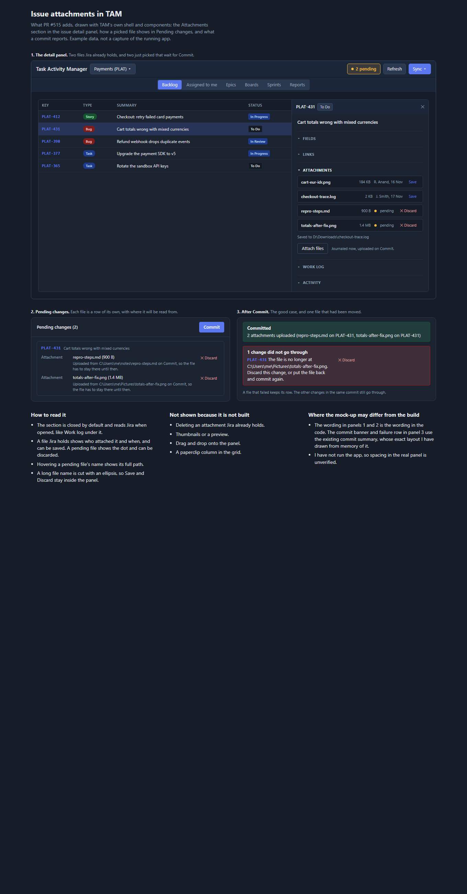

# TAM issue attachments

Issue #514.

## Why

TAM shows an issue's fields, links, comments and work log but not its files, and cannot add one. Attaching a screenshot or a log to a bug means leaving TAM for Jira's own page.

## What it is

An Attachments section in the issue detail panel, which every issue view opens.

- It lists the files Jira holds: name, size, author, date. Each can be saved to disk.
- "Attach files" picks one or more files. Each becomes a pending change, listed as pending and discardable.
- Commit uploads the pending files.

## Goals

- Adding a file works like every other TAM write: journalled, reviewable, discardable, sent on Commit.
- A failed upload never takes other changes down with it, and says why.
- The user's token is only ever sent to the Jira instance.

## Not in this version

- Deleting an attachment Jira holds.
- Previewing a file inside TAM.
- Drag and drop onto the panel.
- A paperclip column in the grids. The cached issue row does not carry an attachment count, so it needs a sync change.

## Approaches

**When a picked file is uploaded.**

1. On Commit (chosen). The file is a journal row like a link or a worklog. It shows in Pending changes, can be discarded, and works on a draft issue, which has no key to upload to until Commit creates it.
2. Immediately. Simpler to reason about, but it would be the only write in TAM that skips the journal, it cannot be taken back, and it cannot work on a draft.

**What the journal holds for a pending file.**

1. The file's path (chosen). Nothing is copied. The file must still be there at Commit; Commit checks and reports a missing one for that row alone.
2. A copy inside TAM's data folder. Survives the original being moved, but doubles the disk used, needs cleaning up after a discard or a commit, and puts user files inside a folder that is otherwise a cache.

**How a download is addressed.**

1. By attachment id, looked up in the issue's listing on the Go side (chosen). The window never supplies a URL.
2. By the content URL from the listing, passed through the window. One less read, but it lets anything that can call the binding point an authenticated request at a URL of its choosing.

## Design

### Jira

- List: `GET /rest/api/2/issue/{key}?fields=attachment`. There is no endpoint for attachments alone.
- Upload: `POST /rest/api/2/issue/{key}/attachments`, multipart with the file in a part named `file`, and the header `X-Atlassian-Token: no-check`. The body is streamed.
- Download: `GET` on the `content` link of a listed attachment. The client refuses a link that does not start with its own base URL.

### Backend

`backend.AttachmentBackend` is a new optional interface: `Attachments`, `AddAttachment`, `SaveAttachment`. The Jira and demo backends implement it. The demo keeps uploaded files in memory for the run.

### Journal and Commit

Entity type `attachment`. The row's key is the issue key, its field the file's absolute path, and its after value the draft (path, name, size) as JSON. Using the path as the field means the same file picked twice is one row.

Commit gains an `attachments` phase, after the creates and before worklogs. It sends one file at a time and clears each journal row on success. For each row:

- An issue this Commit failed to create: held, like a link or worklog on it.
- File missing at its path: a failure that is not offered for retry.
- Jira refuses: a retryable failure carrying Jira's message.

Discarding an attachment row deletes the journal row only. No file was copied, so there is nothing else to remove.

### Bindings

- `ListAttachments(profileID, key)`: Jira's files then the pending ones. A draft key reads only the journal.
- `PickAttachmentFiles()`: the native multi-file dialog, on its own so the next call can be tested without a window.
- `AttachFiles(profileID, key, paths)`: checks every path names a readable regular file, then journals them. One bad path journals none.
- `SaveAttachment(profileID, key, id, name)`: save dialog, then download.

### Frontend

`AttachmentsSection` sits above Work log in `IssueDetailPanel` and is read on expand. Pending changes shows an Attachment line per file with a note that the file must stay at its path. The commit banner counts uploaded attachments.

Mock-up of the section, the Pending changes rows and the commit result, with example data:

## Left to the builder

Wording of empty and error states, and styling within the existing list rows.
