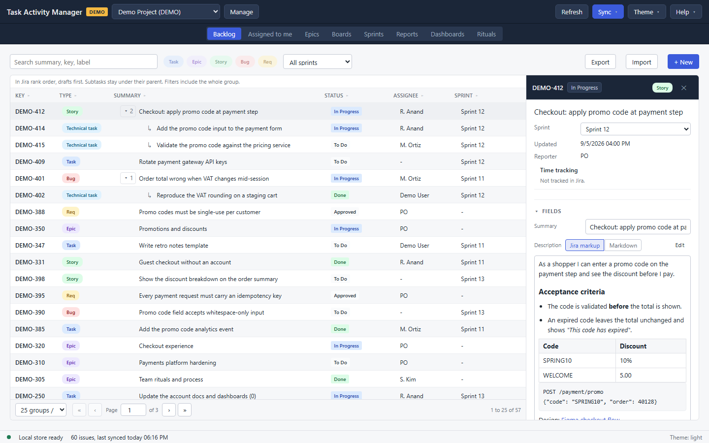

# Backlog

The Backlog is the project's whole issue list: a filter bar, a grid in rank order, and a detail panel for whatever is selected. It is where issues are created, edited, imported and exported.

## Find issues

The filter bar sits above the grid, and every control in it narrows the same query.

- **Search** matches a summary, a key or a label. It waits for you to stop typing before it runs.
- **Type** is one dropdown, reading **All types** until you narrow it. Several types can be chosen at once, so "stories and bugs" is one filter rather than two passes. The list is one entry per issue type the project has, in Jira's order; types TAM models have short labels, and a type it does not know is listed under the project's own name for it.
- **Status** narrows to one workflow status. The list is the statuses this project's cached issues actually carry, so it never offers one the grid has nothing for.
- **Assignee** narrows to one person, read from the cache the same way. **Unassigned** is its own choice, for the work nobody has picked up.
- **Sprint** narrows to one sprint, or stays on **All sprints**.

Changing any of them goes back to page one, so a filter never lands you on a page that no longer exists.

### The grid

Eight columns: **Key**, **Type**, **Summary**, **Status**, **Assignee**, **Sprint**, **Pts** and **Time**. Click a header to sort by it. The first click sorts the way that column reads best, ascending for text and largest-first for a number, the second click reverses it, and the third returns to the project's rank order.

Subtasks stay under their parent rather than scattering through the list, and the toggle on a parent collapses them. A filter applies to the whole family, so a parent is still drawn when one of its subtasks matches.

### Paging

The pager under the grid carries the page size (25, 50, 100 or 250 groups), first, previous, next and last, and a page box you can type into. A parent and its subtasks count as one group, so a page of 25 holds 25 families rather than 25 rows.

The page size is a reading preference and survives a profile switch; the filters do not.

## Read and edit an issue

Click a row and the detail panel opens on the right. Drag its left edge to resize it.

The top of the panel carries the key, the type, the status, the sprint, the reporter and the updated date, with the time tracking figures under them: estimated, logged and remaining, with a bar. An issue Jira does not track time on says so rather than showing zeros.

Below that are sections you can open and close:

- **Fields** is where editing happens. **Summary**, **Description**, **Priority**, **Labels**, **Story points**, **Assignee** and **Epic** are editable; the rest of the panel is read-only. An edit is saved to the cache as you make it and queued for commit, which the panel says in as many words.
- **Comments** lists the issue's comments, with a note saying how old the cached copy is. They are read-only here; add one in Jira.
- **Links** lists the issue's links and adds one. **Check** confirms the key you typed exists and shows its summary, and **Add** queues the link for the next commit.
- **Covered by tests** lists the Xray tests that cover this issue, for a project that uses XTM alongside TAM.
- **Work log** lists what has been logged and adds an entry: time spent and a comment.
- **Done agreement** shows the team's definition of done from the [Rituals](08-rituals.md) pages, so it is readable while the issue is.
- **Activity** is the issue's history.

Descriptions and comments are written in either Jira wiki markup or Markdown, and TAM works out which as you type. The field has a **Write** and a **Preview** tab.

An issue that can hold subtasks has a button under its fields to draft one beneath it, named after whatever your project calls a subtask.

An issue created here and not yet committed is marked **Draft**, and a field with an uncommitted edit carries a pending mark.

## Create an issue

**+ New** opens the dialog. **Type** and **Summary** are required; **Description**, **Priority**, **Labels** (a comma list), **Story points**, **Assignee**, **Epic**, **Parent** and **Sprint** are optional. TAM checks which fields your Jira project requires and says so while the dialog is open.

The new issue appears in the grid straight away, marked **Draft**, with a temporary key. Commit creates it in Jira and the real key replaces the temporary one.

## Import from a spreadsheet

**Import** reads a CSV or XLSX file. Map the file's columns to TAM's fields and the dialog dry-runs the mapping as you change it, saying how many rows are valid and how many will be skipped.

A row with an issue key updates that issue; a row without one creates a new issue. Both arrive as pending work, so nothing reaches Jira until you commit. A **Sprint** value on a row that updates an existing issue is reported as unused, because moving an issue between sprints is a board change rather than a field.

## Export what you filtered

**Export** writes the current filter to a workbook, not just the page on screen. Narrow the list first and the file holds exactly that list. The path it wrote to appears under the filter bar.
