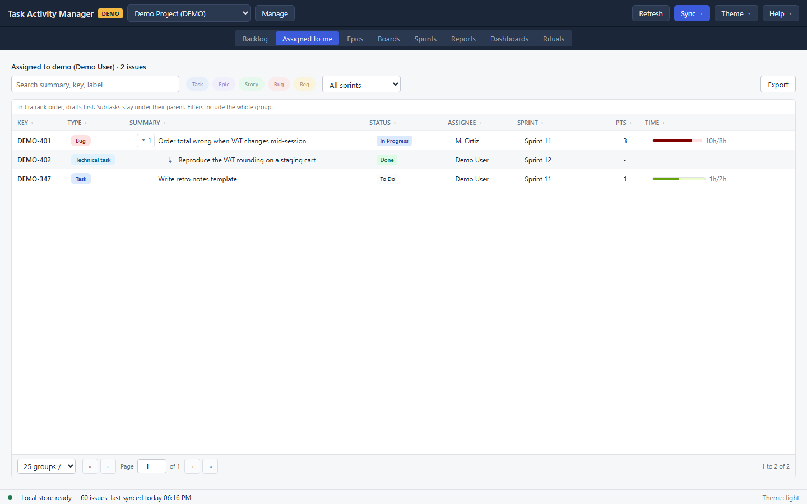

# Assigned to me

The same grid the [Backlog](01-backlog.md) uses, narrowed to the issues assigned to you in Jira, in rank order. Everything the Backlog does here works the same way: the filter bar, the sort, the pager, the detail panel and editing.

The line above the grid names the account it matched and counts what it found, for example `Assigned to jsmith (Jane Smith) · 14 issues`.

## Two things this view does differently

**It knows who you are from the connection, not from a setting.** TAM learns your Jira username when it syncs or when you test the connection. Before that it cannot narrow anything, so the view says so and offers **Sync** and **Test connection** rather than listing the whole project.

**It falls back to your display name.** An issue synced before TAM knew your username is matched on the name Jira shows instead. When any row on the page was matched that way, a note under the header says the view is showing matches by display name until the next sync.

## What it does not have

There is no **+ New** and no **Import** here. An issue you create is not assigned to you until somebody assigns it, so creating one from a view defined by its assignee would be a dialog that files the result somewhere else. Both live in the Backlog.
