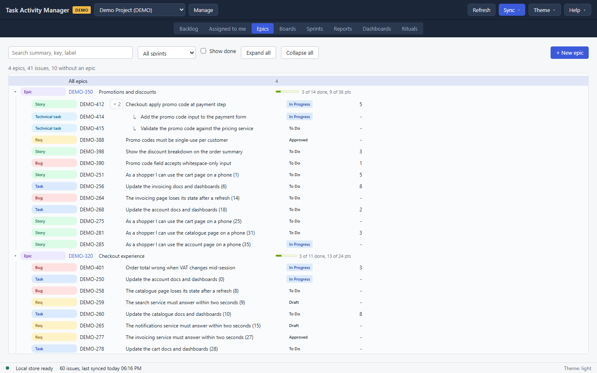

# Epics

The Epics view answers two questions, and has a tab for each: how much of the work under an epic has landed, which the flat backlog cannot show, and what was never filed under an epic at all.

Each tab is labelled with the number of issues on its side, for example `Under epics 2,238` and `No epic 5,988`. Between them they account for every issue in the cache that is not itself an epic. The labels count the whole side, so they hold still while a filter narrows what the tab shows.

## Under epics

Each epic is a row with its key, its summary and its progress: a bar and a count, for example `7 of 12 done, 21 of 34 pts`. The points half only appears when the issues carry estimates. Open an epic to see its children; a child with subtasks opens again.

The line above the tree counts the epics and the issues currently drawn.

Narrowing works on the children, and an epic the filter leaves nothing under drops out of the tree rather than sitting there empty.

## No epic

Work that was never filed under an epic is a flat list rather than a tree, so this tab is the same grid, filter bar and pager the [Backlog](01-backlog.md) uses. Every issue on it is reachable by paging, however many there are, and you do not have to search for one to find out it is there.

Giving an issue an epic moves it to the other tab on the next read.

## Narrow it

- **Search** matches a summary, a key or a label, across epics and their children.
- **Type**, **Status** and **Assignee** are the same three controls the [Backlog](01-backlog.md#find-issues) has, narrowing by issue type, workflow status and who the work belongs to. **Unassigned** is its own choice on the assignee list.
- **Sprint** narrows to one sprint.
- **Show done** includes completed work, which is off by default so a long-running epic shows what is left.
- **Expand all** and **Collapse all** work on every epic currently listed.

## Work on an issue

Select any row, epic or child, and the detail panel opens beside the tree. It is the same panel the [Backlog](01-backlog.md) uses, with the same editable fields.

Changing an issue's **Epic** in that panel moves it in the tree as soon as the change is saved, and the row flashes where it lands so a move of a dozen rows is visible rather than something to hunt for. Like every other edit, the move is queued and reaches Jira on Commit.

## Create an epic

**+ New epic** opens the same dialog the Backlog uses, with the type set to epic. The epic appears in the tree as a **Draft** until Commit creates it in Jira.
