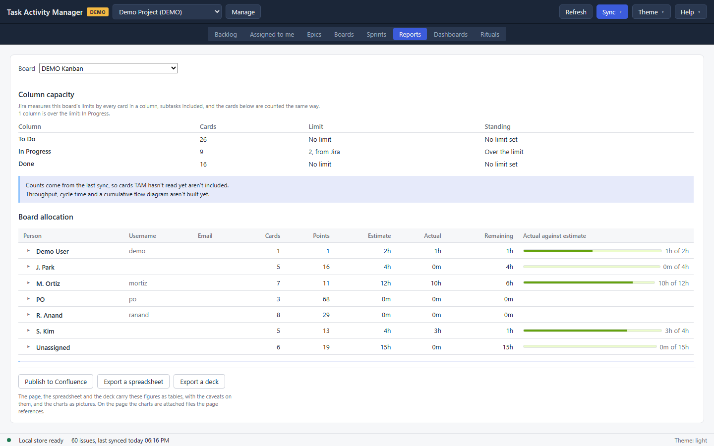

# Reports

The Reports view is what a sprint review starts with: how much the team committed to, what arrived and left during the sprint, what was finished, and what came behind it. The figures are rebuilt from Jira's own history rather than read from a chart endpoint, so they can be explained line by line.

Pick a **Board** and a **Sprint**. A board defaults to its most recently closed sprint, which is the report you want the morning after a sprint ends, or to the active one when nothing has closed yet.

## The sprint report

The summary sentence names the sprint and gives the figures: committed, added, removed, completed and carried over, in points or in cards, with the completion rate.

Under it is the method line, because the numbers mean nothing without it:

> Done means the board's last column. TAM uses Jira history, so its totals can differ from Jira's own, and a removed card counts only once it comes back.

Two more qualifications appear when they apply. **Committed is a minimum**, because a card added and removed before anyone looked leaves no trace to count. And where Jira returned only part of a card's history, the report says which cards and that those figures are not exact, rather than quietly rounding over the gap.

### The charts

Four, each with its numbers written beside it so no figure is only available as a picture:

- **Burndown** over the sprint's days, in points.
- **Burndown in hours**, the same days against logged and remaining time.
- **Sprint outcome**: committed, added, removed, completed and carried over as bars.
- **Velocity** across the last closed sprints.

### Velocity and capacity

A table of the recent closed sprints with what each committed and completed. Committed is a minimum in every row, for the same reason it is in the summary, and the table says so.

**Column capacity** follows: the board's columns against their limits, with each limit attributed to Jira or to this team, and a line naming any column over its limit.

### Rebuilding

A stored report is read from the cache and opens instantly, including with Jira unreachable. **Rebuild from Jira** reconstructs it from the changelog, which takes a while on a long sprint and holds the profile's lock, so Sync and Commit wait for it. A rebuild can be cancelled.

## The People tab

The same sprint, by person: who carried what, with the time bars, opening to the cards behind each row. A report stored before TAM counted people says so and asks for a rebuild rather than showing an empty panel.

## Boards with no sprints

A kanban board has no sprint to report on, so this view shows its columns against their limits instead, and the open work per assignee: cards, points, estimate, actual and remaining, with a bar per person. The limits carry the same attribution the board uses: **from Jira** for the board's own configuration, **set in TAM** for one this team set.

## Publishing

Three buttons take the report off the screen, and all three render the same document, so a figure reads identically wherever it lands:

- **Publish to Confluence** writes the report to a page under the profile's reports root. Set that root in the profile's Confluence settings.
- **Export a spreadsheet** writes a workbook.
- **Export a deck** writes slides.

Exports go to the folder in **File → Settings…**. None of the three touches Jira.
