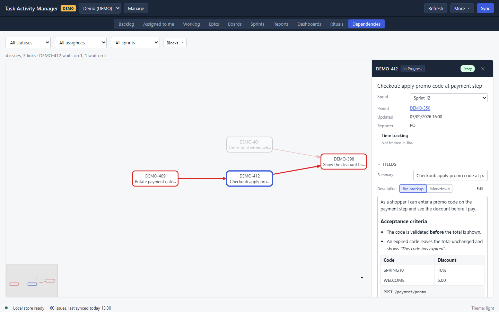

# Dependencies

A graph of how the project's issues wait on each other. Each issue is a box and each link is an arrow from the issue that blocks to the issue it holds up, so a chain such as "A blocks B blocks C" reads left to right. Links can be added, removed and retyped here, and like every other change in TAM they reach Jira when you [commit](00-getting-started.md).

## What it draws

Every cached issue that has at least one link of the types chosen in the filter bar. The sync reads each issue's links along with the rest of it, so the graph covers the whole cached project, not only the issues whose panel you opened. A project synced before this view existed shows its links after the next sync.

An issue at the far end of a link that TAM has not synced, such as one in another project, is drawn with a dashed border and shows the summary the link carries.

A link waiting for Commit is drawn dashed and labelled **pending**. A link you removed stays on the graph, dashed and labelled **removal pending**, until Commit deletes it in Jira.

## Filters

| Filter | What it does |
|---|---|
| Sprint | Keeps the links that touch an issue in that sprint. |
| Status | Keeps the links that touch an issue in that status. |
| Assignee | Keeps the links that touch an issue assigned to that person, or to nobody. |
| Link types | Which link types are drawn. It starts on **Blocks**, Jira's dependency type; pick others to see them too. |

A link stays when either of its issues matches, so a sprint's issues still show what they wait on outside the sprint. The line under the filters counts the issues and links left.

## Picking an issue

Press an issue's box. Everything it waits on (upstream) and everything that waits on it (downstream) is lit, the rest fades, and the issue opens in the same detail panel the other views use. The line under the filters says how many issues it waits on and how many wait on it.

The graph can be dragged to pan, the mouse wheel zooms, and the + and − buttons in the corner zoom too.

## Adding a link

Drag from one issue's box to another's. A dialog asks which link it is, worded from the first issue: "blocks", "is blocked by", "relates to" and every other type the Jira instance defines. **Add link** journals it and the new arrow appears, dashed, at once.

Adding a **Blocks** link that would close a loop, where the issue you are making blocked already blocks the other one directly or through others, asks first. Each issue in a loop waits on the other, which is usually a mistake.

## Removing or changing a link

Press an arrow. The panel on the right shows the link as a sentence and offers:

- **Remove link**, which journals its removal.
- **Change type to**, which journals the removal of this link and a new link of the chosen type between the same two issues. Jira has no way to change a link's type in place.

A pending link offers **Discard the link** instead, and a pending removal **Keep the link**. Both take the change out of the journal, the same as discarding it from **Pending changes**.

A link cached before TAM stored link ids cannot be removed until the next sync gives it one; the panel says so.

## Exporting for a report

Two buttons at the right of the filter bar write an Excel workbook wherever you choose.

- **Export chain** needs a picked issue. It exports that issue and the issues lit around it: what it waits on and what waits on it, through the link types chosen in the filter bar.
- **Export all** exports every issue the profile has synced, with or without links, and every link of every type. The filters do not narrow it, so the report means the same thing whoever exports it.

The workbook has three sheets:

| Sheet | What it holds |
|---|---|
| Issues | One row per issue: its key, type, summary, status, assignee and sprint, how many issues block it, how many it blocks, how many other links it has, and the linked issues by name, such as `Blocks → PLAT-7; Relates ← PLAT-2`. An issue with no links says **No dependencies**. A chain export adds **In the chain**, which marks the picked issue **Selected** and every other row **Upstream** or **Downstream**. An issue that is not synced to this profile is listed last, with the status **Not in this profile**. |
| Links | One row per link: the issue it comes from, its type, the issue it goes to, both summaries, and whether it is **Committed**, **Pending** or **Removal pending**. |
| Graph | A picture of the graph. For a chain it shows the chain alone; for the whole profile it shows every linked issue. Issues with no links are in the Issues sheet but not in the picture. |

Pending changes are exported as they stand, so a report taken before Commit says which links are still waiting. If the picture cannot be drawn, the workbook is still written without the Graph sheet, and the message under the filter bar says so.

## What it does not do

- It does not create issues. Draft them in the [Backlog](01-backlog.md) first.
- Removing and retyping need the **Link Issues** permission on the issue, like adding a link from the detail panel. Without it the buttons are disabled and say why.
