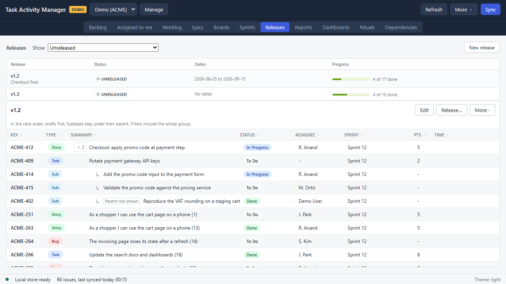
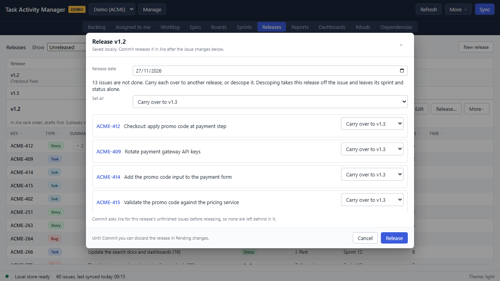
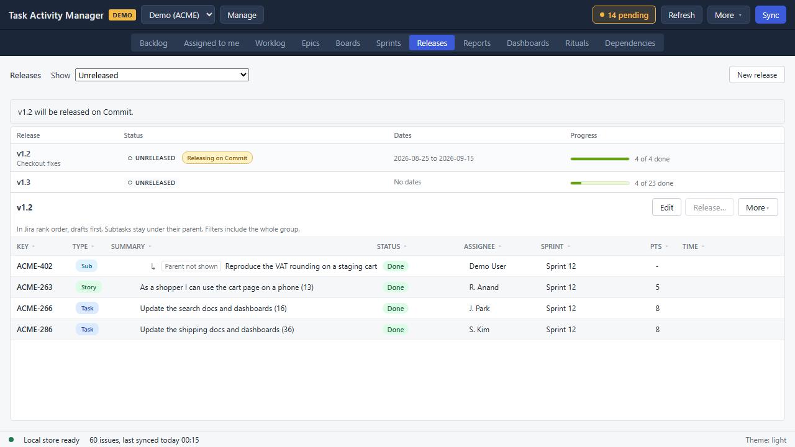
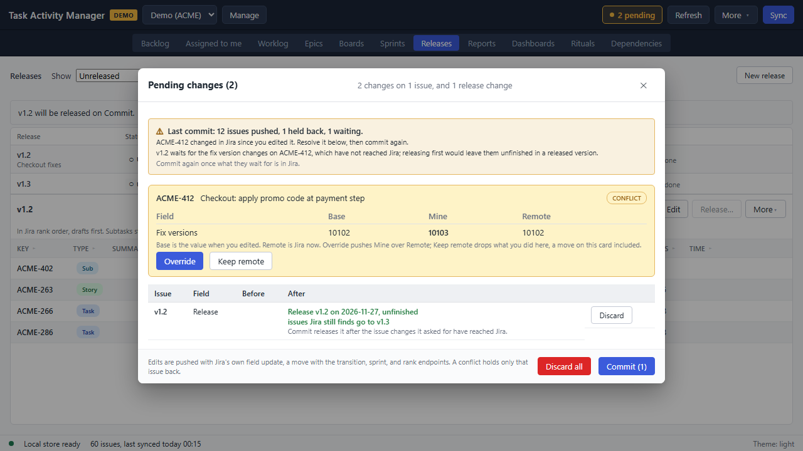
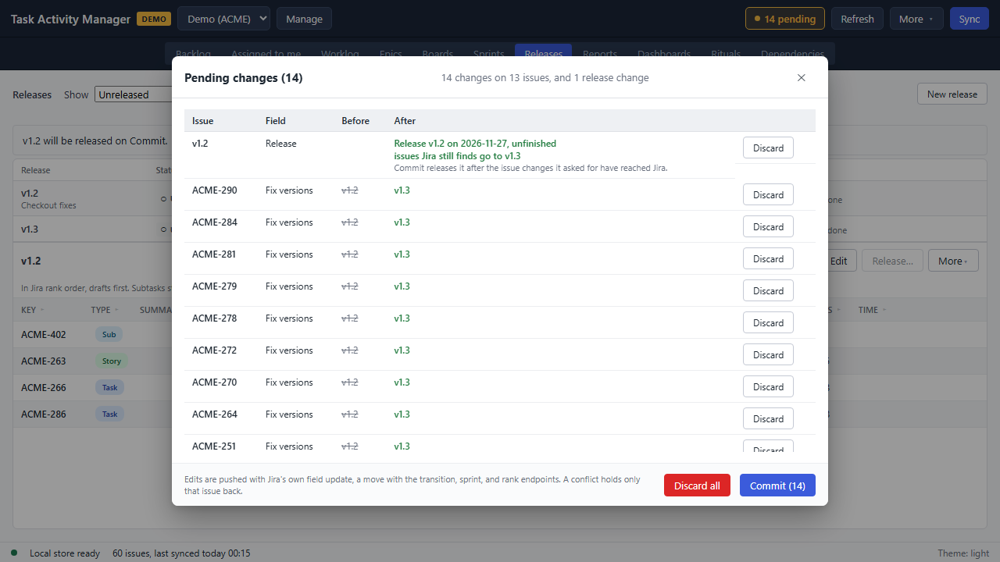

# Releases

A release is a Jira fix version of the profile's project. This view lists them with their dates, status and progress, shows the issues in the one you pick, and is where you create, edit, release, archive and delete them. Like everything else in TAM, those changes wait in the local cache until you [commit](00-getting-started.md).

## What it shows

The table lists the project's releases, ordered by release date with undated ones last. **Show** picks which: **Unreleased** (the default), **Released**, **Archived** or **All**. An archived release is only under Archived and All, whether or not it was released first.

Each row has the release's name and description, its status, its dates and its progress. Progress counts the issues TAM has synced that carry the release, and how many of them are done. An issue counts as done when Jira puts its status in the Done category; for an issue synced before TAM read categories, a status called Done, Closed or Resolved counts. When the profile has a scope JQL, a line above the table says the counts can be short, since the scope keeps some issues out of the cache.

Pick a row to see the release's issues underneath, in the same table and issue panel the Backlog uses. Column headers sort the list.

A row with a change waiting for Commit says so next to its status: **Releasing on Commit**, **Archiving on Commit**, **Unarchiving on Commit**, **Deleting on Commit**, or **Edited, not committed**. A release you made in TAM and have not committed is marked **Draft**.

## Creating and editing

**New release** asks for a name, an optional description, and optional start and release dates. The release is a draft: every release picker in TAM offers it at once, so you can put issues in it before Commit creates it in Jira. Commit creates it first, then sends the issue changes that name it.

**Edit** changes the same four fields. On a draft it rewrites the draft. On a release Jira holds it is a pending change, and the table shows the new values straight away.

Two releases of one project cannot share a name, and a release cannot end before it starts; TAM refuses both before anything is queued.

## Releasing

**Release…** opens a dialog listing the release's issues that are not done.

For each one, pick where it goes:

- **Carry over to** another unreleased release. The dialog starts every row on the next release by date.
- **Descope**. The issue loses this release from its fix versions and nothing else changes: its sprint, status and any other fix versions stay as they are.

**Set all** sets every row at once. The release date starts on today. When no other release is open, the dialog says so and offers **New release**, which drafts one you can carry issues over to; **Descope** is always there.

**Release** queues one fix version change per issue and the release itself. Until Commit, the row reads **Releasing on Commit** and the whole thing can be discarded in Pending changes.

Commit sends the issue changes first and releases last. Two things hold a release back rather than leave unfinished work in a released version:

- An issue change it asked for did not reach Jira, because Jira refused it or it conflicted. The release waits, and Pending changes says which issue it is waiting for. Fix that issue and commit again.
- Jira holds unfinished issues in the release that the dialog never listed, usually because the profile's scope JQL kept them out of the cache. Commit asks Jira for them just before releasing. If **Set all** named a release, Jira moves them there as it releases. If it said **Descope**, the release waits and Pending changes names the issues.

## Archiving and deleting

**More** holds **Archive** (or **Unarchive** on an archived release) and **Delete…**. Archive and release are not offered on a draft: commit it first.

Deleting a draft discards it at once and takes it off every issue you gave it. Deleting a release Jira holds is queued for Commit, and the dialog lets you pick a release to move its issues to; with none picked, the issues simply lose it. The issues themselves are never deleted.

## Permissions

Creating, editing, releasing, archiving and deleting a release need Jira's **Administer Projects** permission. When the last sync found the token without it, those buttons are turned off and their tooltip says why. Editing or deleting a draft stays open, since a draft never reaches Jira until someone who can commit it does. The Release dialog's issue changes are fix version edits, so each issue also needs **Edit Issues** and **Resolve Issues**.

## In Pending changes

Each release's changes are a group of their own, read in words: "Release v1.2 on 2026-11-27, unfinished issues Jira still finds go to v1.3", "Edit release v1.2: name to v1.2.1", "New release in ACME, release 2026-12-15". The issue changes a release queued are listed under their issues.

The Commit line names what went: "1 release change pushed (v1.2 released)".
