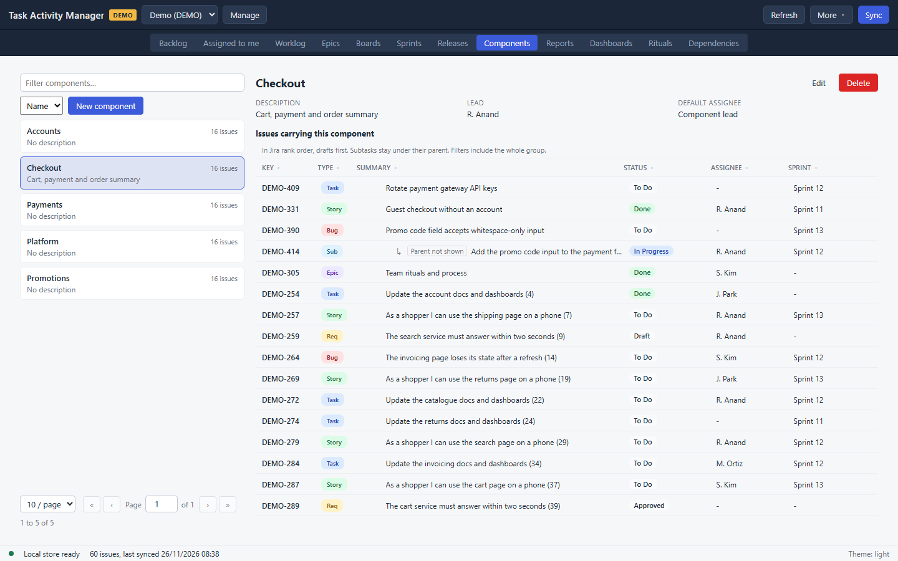
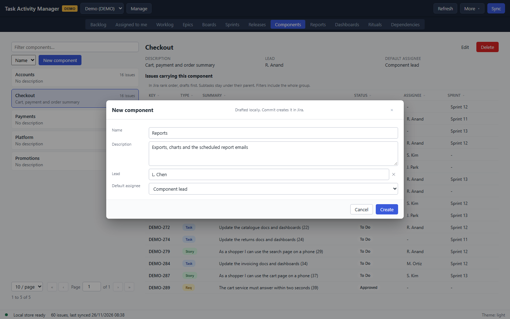
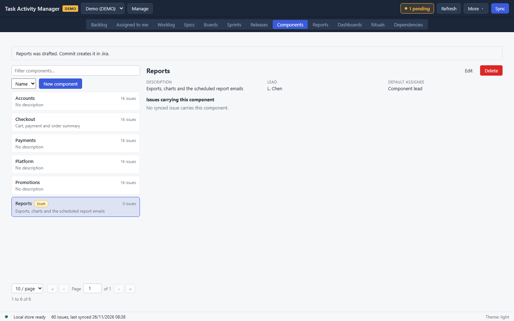
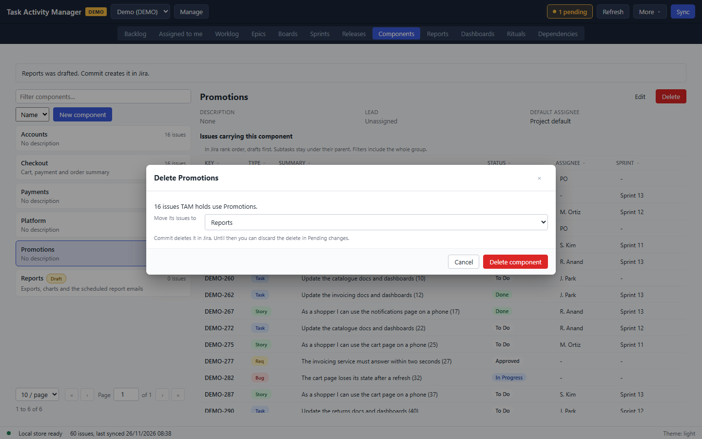
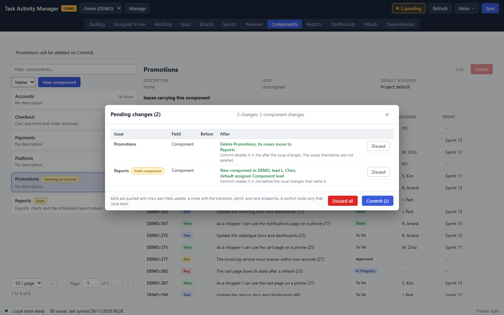
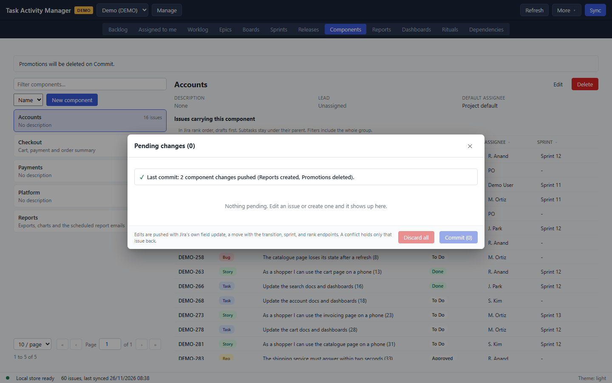

# Components

A component is one of the groups a Jira project files its issues under. This view lists the project's components with their lead and issue count, shows the issues filed under the one you pick, and is where you create, edit and delete them. It has the same layout and wording as the Components view in Xray Test Manager. As everywhere in TAM, the changes wait in the local cache until you [commit](00-getting-started.md).

## What it shows

The list on the left holds every component of the profile's project, ten to a page. **Filter components…** keeps the ones whose name, description or lead contains what you type, and the sort control orders them by **Name**, **Issues** or **Lead**. Each entry shows its description and how many of the issues TAM has synced carry it. When the profile has a scope JQL, a line at the top says the counts can be short, since the scope keeps some issues out of the cache.

The pane on the right shows the picked component's description, lead and default assignee, and under them the issues filed under it, in the same table and issue panel the Backlog uses. Column headers sort the issues, and clicking one opens it.

An entry with a change waiting for Commit says so: **Deleting on Commit** or **Edited, not committed**. A component you made in TAM and have not committed is marked **Draft**.

## Creating and editing

**New component** asks for a name, an optional description, a lead and a default assignee. The lead is picked the way an assignee is: type part of a name and choose from the people Jira knows, or from the cached list when Jira cannot be reached. The default assignee is one of Jira's four: **Project default**, **Component lead**, **Project lead** or **Unassigned**.

The new component is a draft. The issue panel, New issue and the Backlog's **Set components** offer it straight away, so you can file issues under it before Commit creates it in Jira. Commit creates it first, then sends the issue changes that name it.

**Edit** changes the same four fields. On a draft it rewrites the draft. On a component Jira holds it is a pending change, and the view shows the new values straight away.

Two components of one project cannot share a name, ignoring case. TAM refuses a duplicate before anything is queued.

## Deleting

**Delete** opens a dialog that says how many of the issues TAM holds use the component and offers to move them to another component. With **Nowhere (just remove the component)**, the issues lose it and keep everything else. The issues themselves are never deleted.

Deleting a draft discards it at once and takes it off every issue you gave it. Deleting a component Jira holds is queued: Commit sends it after the issue changes, and Jira moves the issues as part of the delete. A delete can name a draft component as the target; Commit creates the draft first, and if Jira refuses to create it, the delete waits.

## Permissions

Creating, editing and deleting a component need Jira's **Administer Projects** permission. When the last sync found the token without it, those buttons are turned off and their tooltip says why. Editing or deleting a draft stays open, since a draft never reaches Jira until someone who can commit it does.

## In Pending changes

Each component's changes are a group of their own, read in words: "New component in ACME, lead L. Chen, default assignee Component lead", "Edit component Auth: name to Login", "Delete Promotions, its issues move to Reports".

The Commit line names what went: "2 component changes pushed (Reports created, Promotions deleted)". Before an edit, Commit reads the component back from Jira. If someone changed it there since TAM last synced, the edit fails and names each field as it was, as you set it and as Jira has it; discard the edit, sync, and edit again if you still want to.

