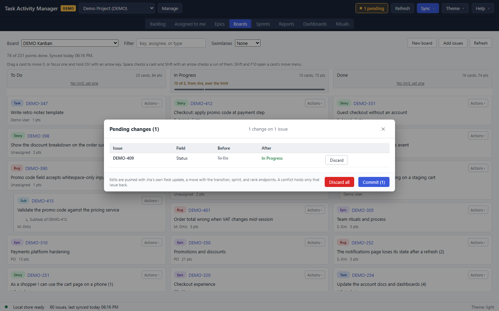
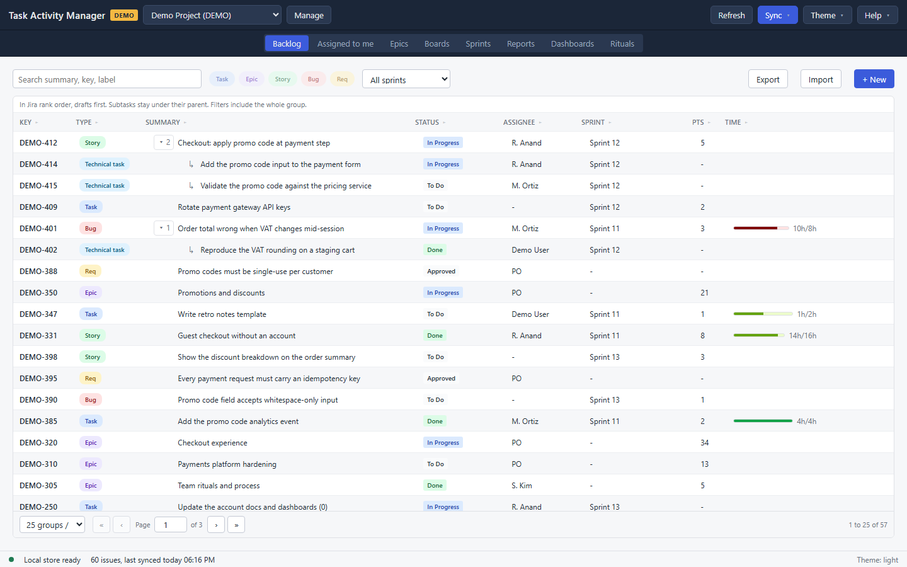
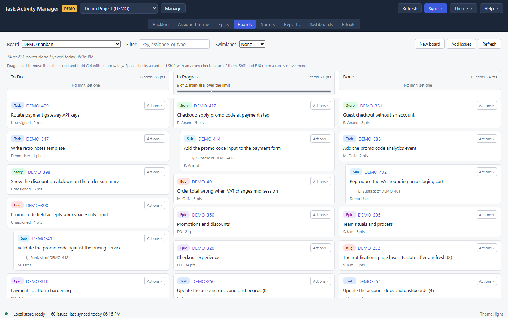
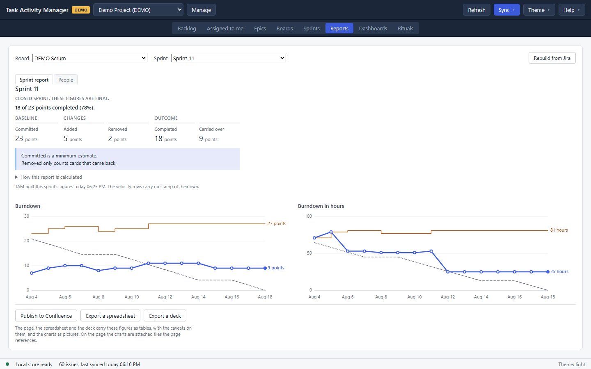
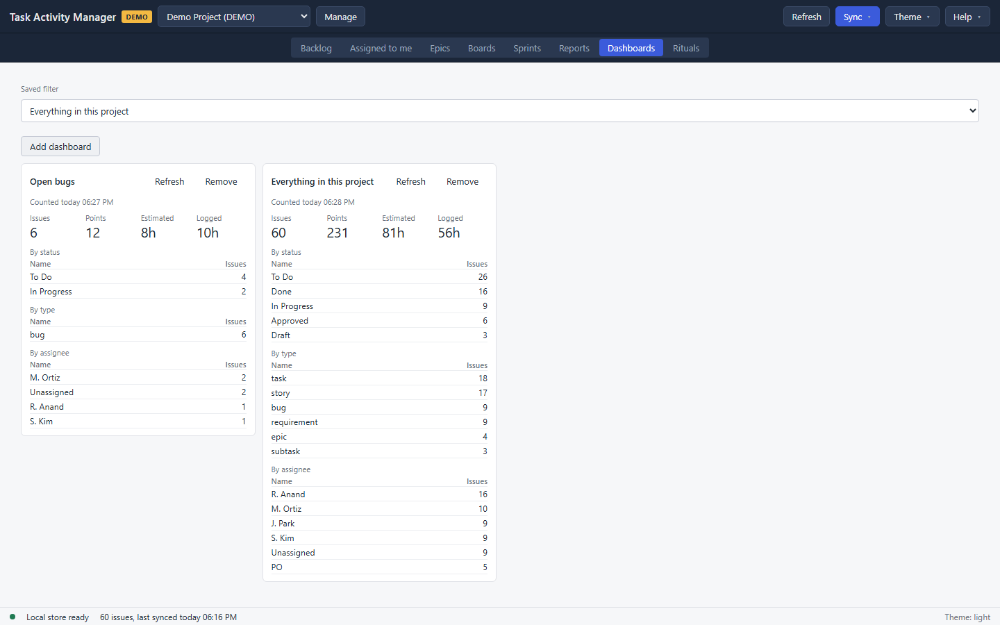
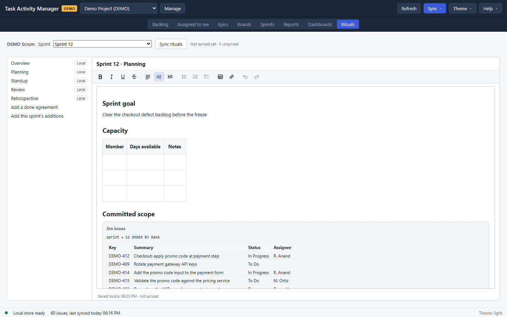

# Task Activity Manager — User Guide

**Version:** 1.0.0 · **Platform:** Windows 10/11 (64-bit) · **Audience:** scrum
masters, product owners, and anyone planning work in Jira Data Center.

Task Activity Manager (TAM) is a Windows desktop app for planning and tracking
work in **Jira Data Center**: the backlog, epics, boards, sprints, the numbers
a sprint review needs, and the Confluence pages a team keeps around its
ceremonies. It syncs a project into a local cache, so the grid and the board
open instantly on a project of thousands of issues, and it holds your changes
on this machine until you commit them. **Jira is always the system of record;**
nothing reaches it until you press Commit.

TAM shares its connection profiles with Xray Test Manager, so a project set up
in one app is already set up in the other.

> **About the figures in this guide.** They are captured from a demo profile,
> so the keys start with `DEMO-` and the data is generated. Your field set and
> issue types will differ.
>
> **Reading this on screen.** The same material is split one page per view in
> [this folder](README.md), which is easier to navigate and is where edits are
> made.

---

## Contents

1. [Installation and first launch](#1-installation-and-first-launch)
2. [Connecting to Jira (profiles)](#2-connecting-to-jira-profiles)
3. [Demo mode: try it without Jira](#3-demo-mode-try-it-without-jira)
4. [The main window](#4-the-main-window)
5. [The loop: edit, review, commit](#5-the-loop-edit-review-commit)
6. [Backlog](#6-backlog)
7. [Assigned to me](#7-assigned-to-me)
8. [Epics](#8-epics)
9. [Boards](#9-boards)
10. [Sprints](#10-sprints)
11. [Reports](#11-reports)
12. [Dashboards](#12-dashboards)
13. [Rituals](#13-rituals)
14. [Syncing](#14-syncing)
15. [Settings and profile management](#15-settings-and-profile-management)
16. [Diagnostics and troubleshooting](#16-diagnostics-and-troubleshooting)
17. [Glossary](#17-glossary)

---

## 1. Installation and first launch

TAM ships as a single Windows executable. A release carries two artifacts:

| Artifact | Use it when |
| --- | --- |
| `task-activity-manager-<version>-windows-amd64.exe` | **Portable.** Run it directly, no install. |
| `task-activity-manager-<version>-windows-amd64-installer.exe` | **Installer.** Adds a Start-menu entry and an uninstaller. |

**Prerequisite:** the Microsoft **WebView2** runtime, which is already present
on up-to-date Windows 10 and 11. If the window is blank on first launch,
install the Evergreen WebView2 runtime from Microsoft and start TAM again.

On first launch there is no profile, so the first thing to do is make one.

## 2. Connecting to Jira (profiles)

A profile is one connection to one Jira project. Open **File → Profiles…**, or
press **Manage** beside the profile picker, and fill in the form.

| Field | What it is |
| --- | --- |
| **Profile name** | Any name you will recognise, for example `Platform team`. |
| **Jira base URL** | Your Jira server, for example `https://jira.example.com`. Type `demo` for sample data. |
| **Project key** | The project you plan in, for example `PLAT`. |
| **Personal Access Token** | A Jira PAT. TAM stores it in the Windows Credential Manager, never in its database. |

**Show token** reveals what you typed. Where you already have a profile for the
same server, **Reuse token from** saves pasting it again.

The rest are optional:

- **Scope JQL** narrows what syncs, for example `labels = team-a`. Anything the
  clause excludes never reaches the cache.
- **Requirement issue type** is the Jira issue type TAM treats as a
  requirement. Blank means `Requirement`. Changing it makes the next sync pull
  everything again.
- **Issue detail freshness (minutes)** is how long a cached issue detail is
  used before TAM asks Jira for it again. Blank means 10 minutes. **0** keeps
  details cached until you press **Refresh**, which is what to set if you work
  with no connection.
- **Confluence Rituals** and **Reports root page** are for the
  [Rituals](#13-rituals) and [Reports](#11-reports) views, and can be added
  later.

**Test connection** checks the URL and the token. **Create profile** saves it.

Profiles are shared with Xray Test Manager through one database, so a profile
made in either app appears in both. The Xray-only fields XTM shows are left
untouched when a profile is edited here.

## 3. Demo mode: try it without Jira

A profile whose **Jira base URL** is `demo` runs on generated data and contacts
no server. The profile name, project key and token can be anything. A yellow
**DEMO** chip sits beside the app name while that profile is active.

Demo mode is a safe place to learn the loop: syncing, editing, dragging cards,
committing, completing a sprint and publishing a report all work, on data
nobody minds you breaking.

## 4. The main window

| Part | What is in it |
| --- | --- |
| Top bar | The app name, the DEMO chip, the profile picker, **Manage**, the pending count, **Refresh**, **Sync**, **Theme** and **Help**. |
| Tab band | The eight views. |
| Navigation rail | An optional list of the same views down the left, toggled with **Ctrl+B**. |
| Main area | The active view. |
| Status bar | Whether the local store is ready, the cached issue count, when the last sync finished, and sync progress while one runs. A failed sync takes the whole bar as a red ribbon. |

The native menu bar carries the same things:

| Menu | Items |
| --- | --- |
| **File** | Profiles…, Settings…, Sync (**Ctrl+R**), Full Sync (**Ctrl+Shift+R**), Quit (**Ctrl+Q**) |
| **View** | The eight views (**Ctrl+1** to **Ctrl+8**), and Navigation Rail (**Ctrl+B**) |
| **Help** | Diagnostics…, About |

The views, in menu order: Backlog, Assigned to me, Epics, Boards, Sprints,
Reports, Dashboards, Rituals.

A status bar reading `38 of 2,943 issues` means the scope JQL, or an issue type
TAM does not sync, keeps the rest of the project out of the cache.

## 5. The loop: edit, review, commit

Nothing you do in TAM reaches Jira on its own. Editing a field, dragging a
card, filling a sprint, drafting one, starting one, completing one, deleting
one: each writes to the local cache and queues a pending change.

When there is uncommitted work, a **N pending** button appears in the top bar.

1. Press it to open **Pending changes (N)**. Rows are grouped by issue, and
   each shows the field, the value before and the value after. A drafted
   sprint, a moved card and a sprint waiting to be completed each appear as
   rows of their own.
2. **Discard** on a row throws that one change away. Jira is not touched.
3. **Discard all** reverts everything, after a confirmation.
4. **Commit (N)** sends what can be sent. The number is what Commit will push.

A banner afterwards says what went, what failed and what was held back.
Commit again to retry the failures.

### When Jira has moved on

If somebody changed an issue in Jira after you edited it here, Commit holds
that issue back rather than overwriting their work, and shows a card with three
columns: **Base** is the value when you edited, **Mine** is your edit, and
**Remote** is Jira now.

- **Override** pushes your value over theirs.
- **Keep remote** drops your edit, including a move of that card.

Changes to other issues in the same commit still go.

## 6. Backlog

The project's whole issue list: a filter bar, a grid in rank order, and a
detail panel for whatever is selected.

### Finding issues

- **Search** matches a summary, a key or a label, and waits for you to stop
  typing before it runs.
- The **type chips** are one per issue type the project has, in Jira's order.
  Press one to include that type, press it again to drop it.
- **Status** narrows to one workflow status, and **Assignee** to one person.
  Both lists are read from this project's cached issues, so neither offers a
  value the grid has nothing for. **Unassigned** is its own choice.
- **Sprint** narrows to one sprint, or stays on **All sprints**.

Changing any filter returns to page one.

### The grid

Eight columns: **Key**, **Type**, **Summary**, **Status**, **Assignee**,
**Sprint**, **Pts** and **Time**. A header click sorts by that column: first
the way it reads best, then the other way, then back to the project's rank
order.

Subtasks stay under their parent rather than scattering through the list, and a
filter applies to the whole family, so a parent is still drawn when one of its
subtasks matches. The pager counts families rather than rows, so a page of 25
holds 25 parents and everything beneath them.

### Reading and editing an issue

Select a row and the detail panel opens on the right; its left edge drags to
resize. The head carries the key, type, status, sprint, reporter and updated
date, with the time tracking figures and bar under them.

| Section | What it does |
| --- | --- |
| **Fields** | **Summary**, **Description**, **Priority**, **Labels**, **Story points**, **Assignee** and **Epic** are editable. Everything else in the panel is read-only. |
| **Comments** | Lists the issue's comments, with a note saying how old the cached copy is. |
| **Links** | Lists the issue's links and adds one. **Check** confirms the key exists and shows its summary; **Add** queues the link. |
| **Covered by tests** | The Xray tests covering this issue, for a project that uses XTM alongside TAM. |
| **Work log** | What has been logged, and a form to log time and a comment. |
| **Done agreement** | The team's definition of done from the ritual pages, readable while the issue is. |
| **Activity** | The issue's history. |

Descriptions and comments are written in either Jira wiki markup or Markdown,
and TAM works out which as you type. The field has **Write** and **Preview**
tabs.

An issue that can hold subtasks has a button to draft one beneath it, named
after whatever your project calls a subtask. An issue created here and not yet
committed is marked **Draft**, and a field with an uncommitted edit carries a
pending mark.

### Creating, importing, exporting

**+ New** opens the create dialog. **Type** and **Summary** are required;
Description, Priority, Labels, Story points, Assignee, Epic, Parent and Sprint
are optional. TAM checks which fields your project requires and says so. The
issue appears in the grid with a temporary key and a **Draft** mark; Commit
creates it in Jira and the real key replaces the temporary one.

**Import** reads a CSV or XLSX file. Map the columns to TAM's fields and the
dialog dry-runs the mapping as you change it, saying how many rows are valid
and how many will be skipped. A row with an issue key updates that issue; a row
without one creates a new issue. A **Sprint** value on a row that updates an
existing issue is reported as unused, because moving an issue between sprints
is a board change rather than a field.

**Export** writes the current filter to a workbook, not just the page on
screen, and says where it saved it.

## 7. Assigned to me

The Backlog grid narrowed to the issues assigned to you in Jira. The filter
bar, sort, pager, detail panel and editing all work the same way.

The line above the grid names the account it matched and counts what it found.

TAM learns your Jira username when it syncs or when you test the connection.
Before that it cannot narrow anything, so the view says so and offers **Sync**
and **Test connection** rather than listing the whole project. An issue synced
before TAM knew your username is matched on your display name instead, and a
note says so until the next sync.

There is no **+ New** or **Import** here: an issue you create is not assigned
to you until somebody assigns it. Both live in the Backlog.

## 8. Epics

Two tabs: the work under each epic, and the work filed under none. Each is
labelled with the number of issues on its side, for example
`Under epics 2,238` and `No epic 5,988`, and between them they account for
every issue in the cache that is not itself an epic. The labels count the
whole side, so they hold still while a filter narrows what the tab shows.

**Under epics** is the tree. An epic row carries its key, its summary and
its progress, for example `7 of 12 done, 21 of 34 pts`. The points half
appears only when the issues carry estimates. The line above the tree counts
the epics and the issues currently drawn.

**No epic** is a flat list, so it is the same grid, filter bar and pager the
Backlog uses. Every issue on it is reachable by paging, however many there
are. Giving an issue an epic moves it to the other tab on the next read.

**Search** matches across epics and children, **Type**, **Status** and
**Assignee** narrow the children the same way the Backlog's do, **Sprint**
narrows to one sprint, and **Show done** includes completed work, which is off
by default. An epic the filter leaves nothing under drops out of the tree
rather than sitting there empty. **Expand all** and **Collapse all** work on
everything listed.

Selecting any row opens the same detail panel the Backlog uses. Changing an
issue's **Epic** moves it in the tree as soon as the change is saved, and the
row flashes where it lands. **+ New epic** opens the create dialog with the
type fixed to epic.

## 9. Boards

Your Jira board: its columns, the cards in them, and the sprint ceremonies.

The bar above the board carries **Board**, **Filter** (a key, an assignee or a
type), **Sprint** on a scrum board, and **Swimlanes** (None, Assignee or
Epic). **Refresh** re-reads the board from Jira. Under it is the same
**Type**, **Status** and **Assignee** row the Backlog has, so narrowing the
board needs no guessing at a substring. It and the Filter box both have to
match, and neither takes a column or a lane off the board.

### Moving a card

Drag it to another column, to another place in the same column, or onto a
sprint. By keyboard:

| Key | What it does |
| --- | --- |
| Arrows | Move focus |
| **Ctrl** with an arrow | Move the focused card: left and right between columns, up and down within one |
| **Enter** | Open the card in the detail panel |
| **Space** | Select the card |
| **Shift** with an arrow | Extend the selection |
| **Context menu** or **Shift+F10** | The card's own menu: move to a column, to a sprint, or to the backlog |

A move the board cannot make is refused out loud, and nothing moves while a
commit is running.

Selecting cards raises a bar with the count, a destination picker and
**Clear**. The selection follows what the board draws, so a card a filter or a
refresh removes leaves the selection with it.

### Column limits

Under each column name is its work-in-progress limit, for example
`4 of 6, from Jira` or `3, minimum 2, set in TAM`. A column over its limit, or
under its minimum, says so and is marked.

**from Jira** is the board's own configuration, which TAM prints and never
changes. **set in TAM** is a limit this team set here, for a column Jira does
not limit; press the limit to set or clear one. A column with neither reads
**No limit, set one**.

### Filling a board, and ceremonies

**Add issues** opens a picker: search by key, summary or assignee, then choose
whether they go into the board's backlog or one of its sprints. Issues already
on the board are left out.

**New board** drafts a board, which exists locally until Commit creates it.

On a scrum board the toolbar grows the ceremony that fits the sprint:

- **New sprint** drafts one, marked as a draft in the picker.
- **Start sprint** appears for a future sprint, with a name, a goal and dates
  suggested from the board's history.
- **Complete sprint** appears for an active one, listing the cards that are not
  in the last column and saying where they will go.

All three are queued, not sent. The unfinished list in the Complete dialog is a
preview built from the cache; Commit reads Jira again and moves whatever is
unfinished then. Where the board is not drawing every card, the dialog says how
many it cannot name. Completing a sprint with other changes pending asks you to
commit first.

## 10. Sprints

Where the board answers "where is this card", this view answers "what is in
this sprint, and what happens to it next".

Pick a **Board** and its sprints appear as a tree, with the issues in each
beneath and the board's unassigned work folded in. Each row carries the
sprint's name, state, dates and what it holds: how many issues are done and how
many points have landed. A closed sprint whose figures have not been rebuilt
says so rather than drawing a bar at zero. **Show closed** brings closed
sprints back.

The **Type**, **Status** and **Assignee** row below the board picker narrows
the cards drawn under every sprint at once, which is how you read what one
person is carrying across a release. Every sprint stays listed whether or not
the filter left it anything, and each sprint's own figures go on describing the
sprint rather than this view of it. A checked card the filter hides leaves the
selection with it, so a move can never touch a card you cannot see.

Select issues with **Space** or the checkbox, extend with **Shift** and an
arrow, and a bar offers a destination: another sprint, or the backlog. An issue
the cache does not hold is skipped, and the bar says how many actually moved.

Each sprint's menu carries what its state allows: **New sprint**, **Edit
sprint…**, **Start sprint…**, **Complete sprint…** and **Delete sprint…**.
Everything is queued. A deletion says plainly that Commit deletes the sprint in
Jira, that Jira then moves its issues back to the backlog, and that the issues
themselves are not deleted; until you commit it can be discarded. Deleting a
**draft** touches nothing in Jira and returns its cards to where they came
from.

Where TAM cannot be sure of a sprint's size it says "at least" rather than
quoting a number that might be low.

## 11. Reports

What a sprint review starts with, rebuilt from Jira's own history rather than
read from a chart endpoint.

Pick a **Board** and a **Sprint**. A board defaults to its most recently closed
sprint, or to the active one when none has closed.

The summary names the sprint and gives the figures: committed, added, removed,
completed and carried over, with the completion rate. Under it is the method
line, because the numbers mean nothing without it:

> Done means the board's last column. TAM uses Jira history, so its totals can
> differ from Jira's own, and a removed card counts only once it comes back.

**Committed is a minimum**: a card added and removed before anyone looked
leaves no trace to count. Where Jira returned only part of a card's history,
the report names the cards and says those figures are not exact.

Four charts, each with its numbers written beside it: **burndown** over the
sprint's days in points, **burndown in hours** against logged and remaining
time, **sprint outcome** as bars, and **velocity** across recent closed
sprints. A velocity table lists those sprints with what each committed and
completed, and a column capacity table follows it.

A stored report opens instantly, including with Jira unreachable. **Rebuild
from Jira** reconstructs it from the changelog, holds the profile's lock while
it runs, and can be cancelled.

The **People** tab shows the same sprint by person, with time bars opening to
the cards behind each row. A report stored before TAM counted people asks for a
rebuild rather than showing an empty panel.

A kanban board has no sprint to report on, so the view shows its columns
against their limits and the open work per assignee instead.

Three buttons take the report off the screen, all rendering the same document:
**Publish to Confluence** (under the profile's reports root), **Export a
spreadsheet** and **Export a deck**. Exports go to the folder in **File →
Settings…**. None of them touches Jira.

## 12. Dashboards

A dashboard is one of your saved Jira filters, counted and kept.

Pick a filter from **Saved filter** and add it. Each panel shows **Issues**,
**Points**, **Estimated** and **Logged**, rankings **By status**, **By type**
and **By assignee**, and when it was last counted. A panel that has never run
says **Not counted yet**.

The figures are a snapshot, not a live query, so a dashboard says the same
thing with Jira unreachable and the same thing again a week later. **Refresh**
re-runs that filter and restamps it; nothing refreshes on its own. **Remove**
takes the panel off the view and leaves the Jira filter alone.

## 13. Rituals

The Confluence pages a team keeps around its ceremonies, per sprint. It needs
the **Confluence Rituals** settings on the profile; without them the view says
so and does nothing else.

Pick a **Board** and a **Sprint** and the documents appear: **Overview**, and
beneath it **Planning**, **Standup**, **Review** and **Retrospective**.
Alongside them is the **Done agreement**, the team's definition of done, kept
at board level with any additions this sprint made.

Each document in the sidebar carries its name, whether it is synced and when
it last was, so what Confluence has and what it does not is readable at a
glance. One TAM has created but never pushed says **Not synced yet**.
**Filter documents** narrows the list by name and nothing else: the page you
are reading stays open.

The editor has headings, bullet and numbered lists, tables and links. A
Confluence macro the editor cannot safely change, such as a Jira issue list, is
shown as it renders and kept exactly as it is. On the Standup page, **Add
today's entry** adds a dated heading under the daily log, and refuses politely
when today already has one.

What you type is local. **Sync rituals** is the one control here that talks to
a server: it creates the pages a sprint lacks, sends your edits, brings back
what changed, and reports what it did. **Open in Confluence** opens the page in
your browser.

A page edited in both places is held as a conflict, with **Keep mine** and
**Take theirs**. A page deleted or moved in Confluence is marked **Gone from
Confluence**, with **Recreate on next Sync** and **Remove local copy**.

Every ritual page lives under a root page set in the profile. Changing the root
re-syncs straight afterwards.

## 14. Syncing

**Sync** at the right of the top bar offers:

- **Sync changes** pulls what changed since the last sync. Also **File → Sync**
  or **Ctrl+R**.
- **Full sync** clears the cached issues and fetches everything. Also
  **Ctrl+Shift+R**. Use it after changing the scope JQL or the requirement
  issue type, or when the cache looks wrong.

The status bar shows progress while a sync runs, then the issue count and when
it finished. A failed sync is reported there too.

**Refresh**, beside Sync, re-reads the view you are on and fetches issue
details again. It takes the same lock a sync does, so the two never run at
once, and neither does a report rebuild or a ritual sync.

## 15. Settings and profile management

**File → Settings…** holds the **Report export folder**, where spreadsheets and
decks are written.

**Theme** in the top bar switches between light, dark and the system setting.
**Ctrl+B** shows or hides the navigation rail. Both are remembered.

**Manage**, beside the profile picker, edits, exports and deletes profiles.
Switching profiles is blocked while a sync or a commit is running.

**Help → Take the tour** walks through the view you are on; **Take the
first-run tour** walks through the whole loop.

## 16. Diagnostics and troubleshooting

**Help → Diagnostics** shows the database paths, the build and the recent log.
It is the first thing to collect when something misbehaves.

| Symptom | What to check |
| --- | --- |
| The window is blank on first launch | Install the Evergreen WebView2 runtime and restart. |
| "The local store could not be opened" | The path and error are on screen, with the log path. Another copy of TAM holding the same database is the usual cause. |
| The grid is empty after a sync | A **Scope JQL** on the profile may exclude everything. The status bar says how much of the project is cached. |
| Issue details look stale | **Refresh** re-reads them. **Issue detail freshness** on the profile controls how long they are reused. |
| A commit reports failures | The banner names them. Commit again to retry; a held-back issue is a conflict, resolved with **Override** or **Keep remote**. |
| Sync, Commit or Refresh is disabled | Another of them, a report rebuild or a ritual sync holds the profile's lock. |
| The Rituals view says it cannot sync | Add the Confluence settings to the profile. |

## 17. Glossary

| Term | What it means |
| --- | --- |
| **PAT** | Personal Access Token, how TAM authenticates to Jira DC. |
| **Pending change** | A local edit queued in TAM, not yet in Jira. |
| **Commit** | Push pending changes to Jira. |
| **Sync** | Pull the latest from Jira into the local cache. |
| **Draft** | An issue, sprint or board that exists only in TAM until Commit creates it. |
| **Carried over** | Work a sprint did not finish, counted in its report. |
| **Committed** (report) | What the sprint held when it started, counted as a minimum. |
| **Swimlane** | A horizontal split of a board, by assignee or by epic. |
| **WIP limit** | The most cards a column should hold, set in Jira or in TAM. |
| **Ritual page** | A Confluence page for a ceremony, kept per sprint. |
| **Demo profile** | A profile with Jira URL `demo`, running offline on generated data. |

---

*This guide is distributed with Task Activity Manager. Your field set and
issue types may differ by Jira configuration.*
