# Getting started

This guide covers what every other guide assumes: connecting XTM to a Jira project, syncing tests into the local cache, committing your edits back to Jira, and the commands in the top bar and the **More** menu.

## How XTM handles your data

Jira is the source of truth. XTM keeps a local cache of your project's tests, folders, containers and requirements, and reads from that cache so the app stays fast.

Almost every change you make (a summary, a step, a new test, a run result) is saved on your machine as a pending change, and nothing reaches Jira until you commit it. The Components view is the one exception: its changes go to Jira immediately.

A sync pulls changes from Jira into the cache. Run one when you start work and whenever someone else may have changed the project.

## Connect your first profile

A profile is one connection to one Jira project. When you open XTM with no profiles, it shows the **New profile** form.

1. Fill in the form:
   - **Profile name**: any name you will recognise, for example `QA: Project X`.
   - **Backend**: `Xray / Jira` for Jira Data Center with Xray, or `Kiwi TCMS`.
   - **Jira base URL**: the address of your Jira server, for example `https://jira.example.com`.
   - **Project key**: the key of the project that holds your tests, for example `QA`.
   - **Personal Access Token**: a Jira personal access token. XTM stores it in the Windows Credential Manager, never in its database. Click the eye button to show what you typed.

   The optional fields can be left empty:
   - **Scope JQL** limits which tests sync, for example `labels = smoke`.
   - **Cross-project source projects** lists other project keys you want to link preconditions, test calls and cloned steps from.
   - **Bug issue type** and **Bug project** control where defects are filed.
   - **Advanced: TLS / certificate settings** is for servers with a private certificate authority.

   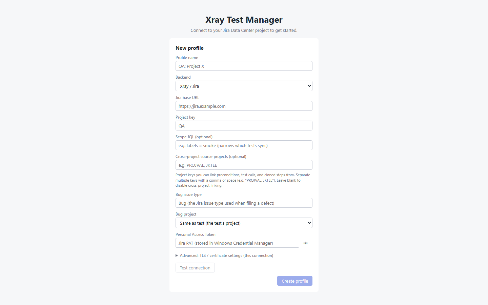

2. Click **Test connection** to check the URL and token. The result appears next to the button.

3. Click **Create profile**.

   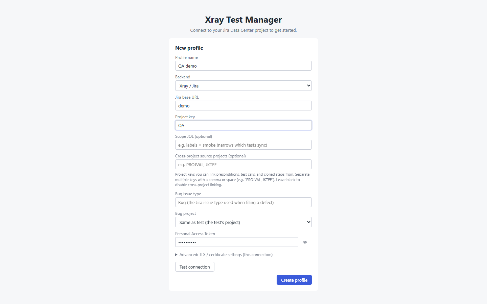

XTM opens the main window on the Browse view. The grid stays empty until you sync.

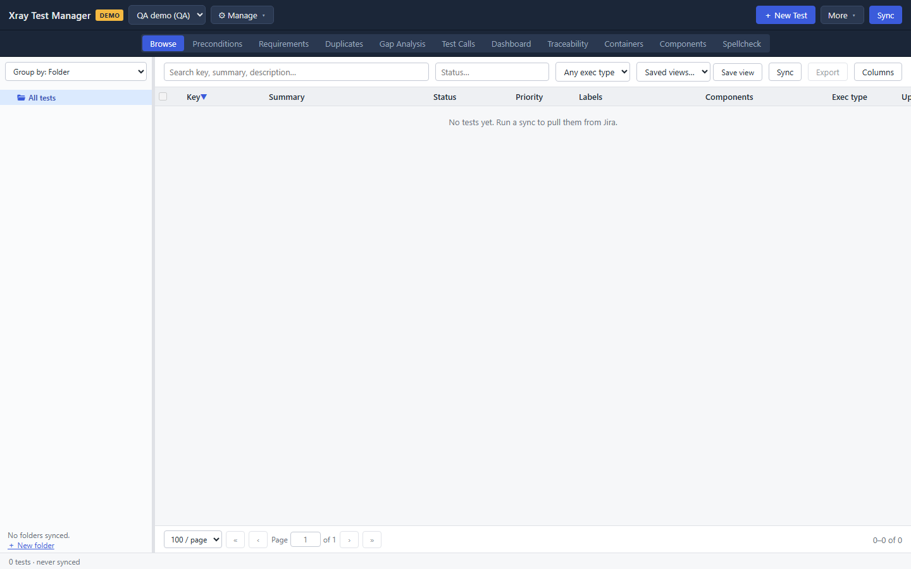

### Try XTM without Jira (demo mode)

Enter `demo` as the **Jira base URL** to create a demo profile. You still need a profile name, a project key and a token, but they can be anything. A demo profile generates about 5,000 tests, folders, preconditions, requirements, containers and bugs, and never contacts a server. The top bar shows a yellow **DEMO** chip while a demo profile is active.

Demo mode is a safe place to learn the app: commits, component changes and imports all act on generated data.

## Sync tests from Jira

1. Click **Sync** at the right end of the top bar. You can also press Ctrl+R or choose **File → Sync**.

2. Watch the progress bar in the status bar at the bottom of the window. While a sync runs, the **Sync** button reads **Syncing…** and you cannot switch profiles.

   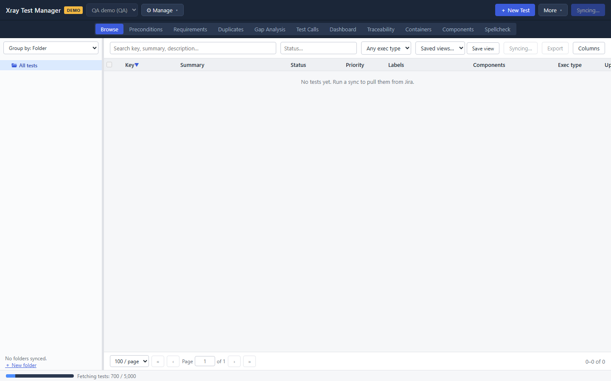

3. When the sync finishes, the folder tree and the grid fill in, and the status bar shows the test count and the time of the last sync.

The status bar also carries two things at all times. On the left, a dot and the words beside it say whether the local store came up: **Local store ready**, or **Starting up** while it has not. On the right it says which theme is in force, which is worth having on **System**, where the menu says System and this says what System resolved to.

   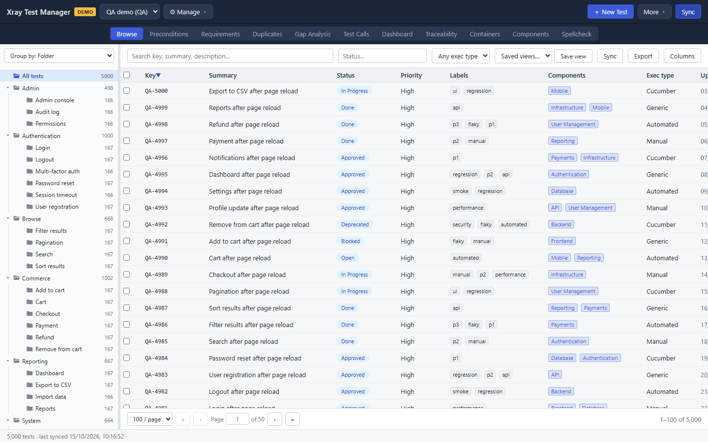

After the first sync, XTM offers a short tour of the window. Click **Next** to step through it, or the **×** to close it. You can start it again from **More → Take the tour**.

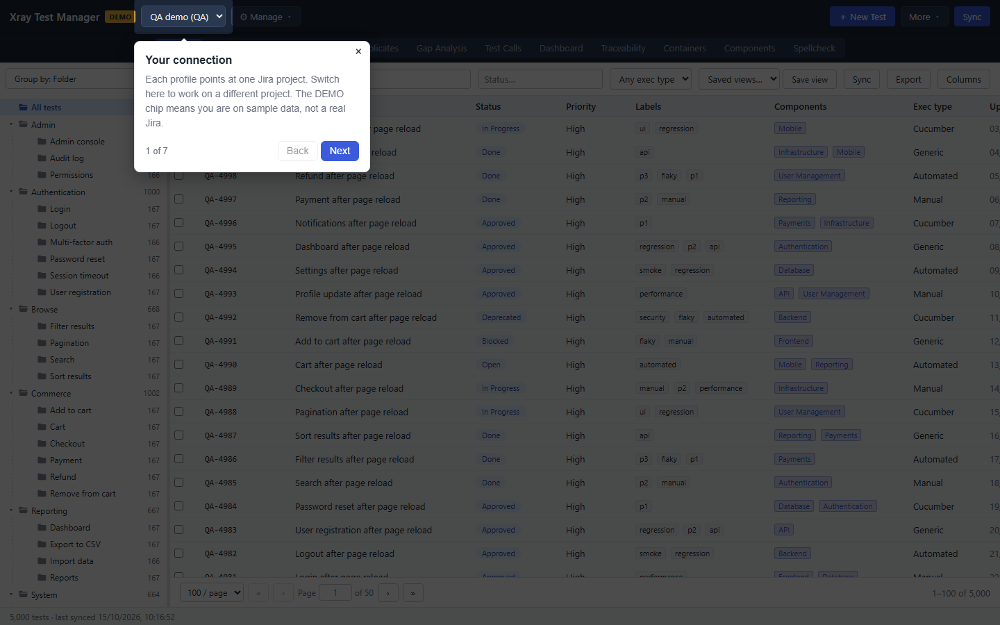

Sync only fetches what changed since the last run. If the folder structure looks wrong, use a full resync instead: choose **More → Full resync (re-pull folders)** and click **Continue**. A full resync pulls every test again and can take a while on a large project.

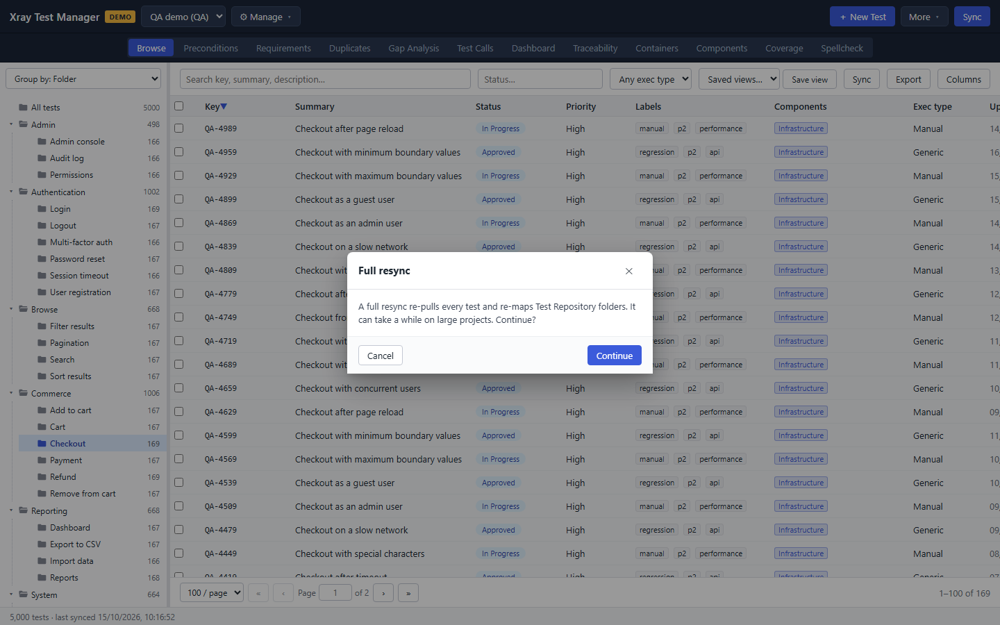

## Move between views

Use the tabs below the top bar or the **View** menu to move between Browse,
Preconditions, Requirements, Duplicates, Gap Analysis, Test Calls, Dashboard,
Traceability, Containers, Datasets, Components, Coverage and Spellcheck. A
view appears only when the selected profile's backend supports it. Coverage
also needs to be enabled from the **More** menu.

Datasets has its own **Scan datasets** action. The normal **Sync** command does
not build the dataset catalog, because a full scan makes extra Jira requests
for every Test and container relationship. See [Datasets](13-datasets.md) for
how the catalog and overrides work.

## Review and commit your changes

When you have pending changes, a yellow **N pending** button appears in the top bar, with a dot in front of the count.

1. Click **N pending** to open **Pending changes (N)**. Each row shows the test, the field, the old value (struck through) and the new value.

   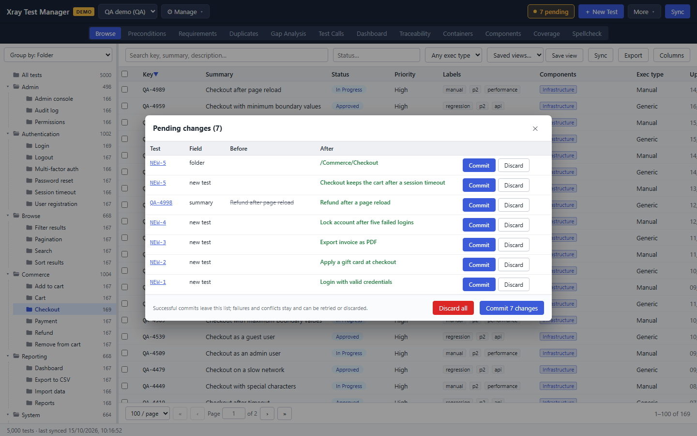

2. Choose what to send:
   - **Commit** on a row sends just that change.
   - **Discard** on a row throws that change away locally. Jira is not touched.
   - **Commit N changes** at the bottom sends everything.
   - **Discard all** reverts every pending change. XTM asks you to confirm first, because this cannot be undone.

3. Read the result at the top of the dialog. Successful commits leave the list. Failures and conflicts stay so you can retry or discard them.

   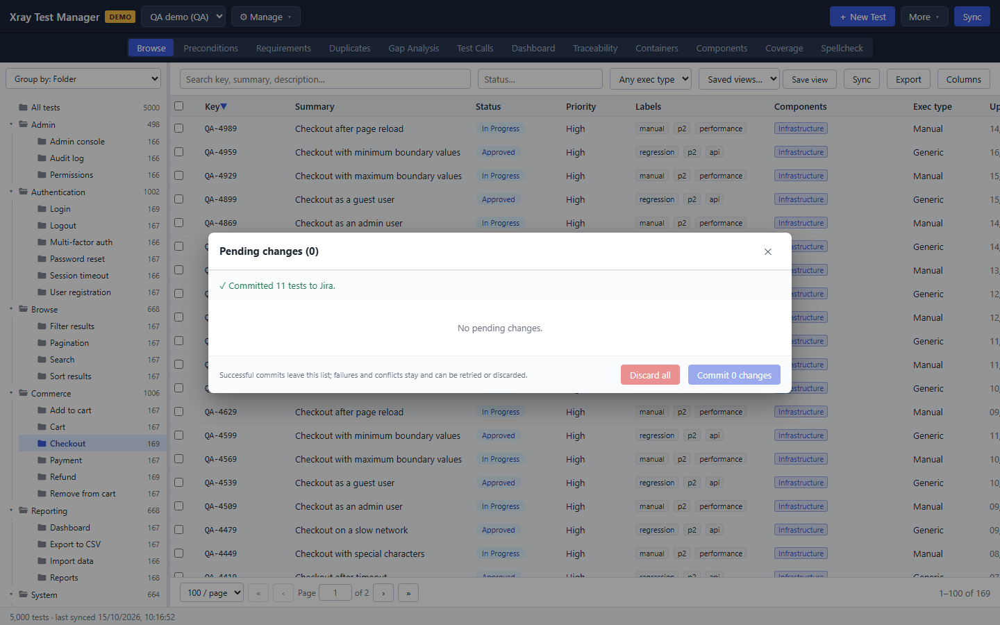

### When a commit reports a conflict

A conflict means someone changed the same test in Jira after your last sync. XTM merges the edits that do not overlap and asks you about the rest. For each conflicting field it shows **Theirs (remote)** and **Mine (local)**. Pick one per field, or use **All mine** or **All theirs**, then click **Resolve & re-commit**. **Discard mine** drops your edits for that test instead.

If the test was deleted in Jira, choose **Recreate as new** to create a new test from your edits, or **Discard my changes**.

## Manage profiles

Open **⚙ Manage → Manage Profiles…** to see every profile you have created.

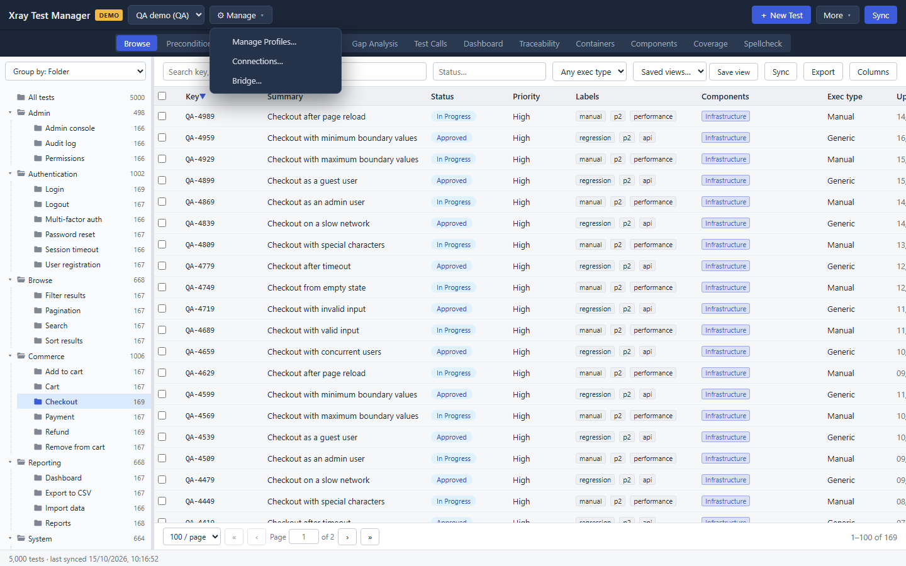

- **Create new profile** opens the same form as on first launch. When you already have profiles, **Start from** lets you copy one.
- Click a profile to edit it. **Save changes** keeps the edits, **Export** saves the profile to a file, and **Delete** removes it after you confirm.
- The star sets the profile XTM opens on launch.
- **Import from file…** loads a profile someone exported.

Changing a profile's URL or project key clears its local cache, and XTM warns you before it does. Editing a profile here does not switch your active connection. To switch, use the profile list next to the XTM name in the top bar.

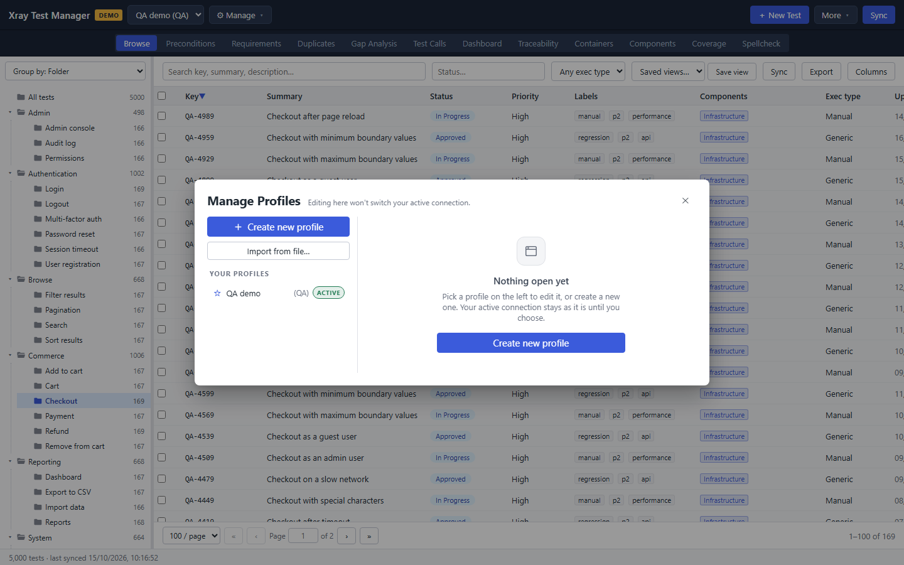

## The More menu

**More** in the top bar holds the commands you need less often.

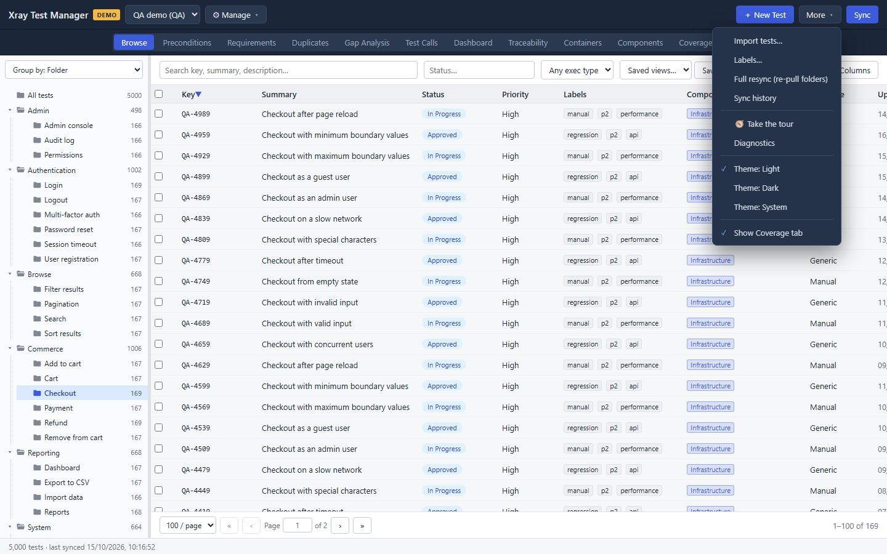

| Item | What it does |
|---|---|
| Import tests… | Imports tests from CSV or XLSX. See [Browse](01-browse.md#import-tests-from-csv-or-xlsx). |
| Labels… | Renames, merges or deletes labels across the project. |
| Full resync (re-pull folders) | Pulls every test and folder again. |
| Sync history | Lists past syncs with their duration, outcome and number of items fetched. |
| 🧭 Take the tour | Starts the window tour again. |
| Diagnostics | Shows the version, the database and log locations, and the recent log. |
| Theme: Light / Dark / System | Sets the colour theme. |
| Show Coverage tab | Shows or hides the Coverage view. |

**Sync history** helps when a sync failed or took longer than expected. Rows with details have a **▸ detail** toggle.

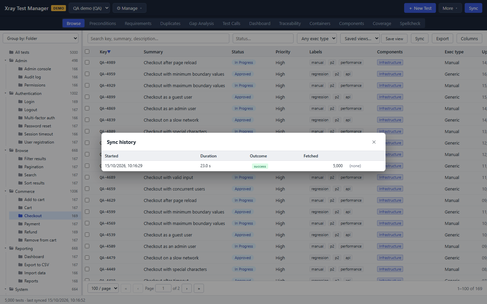

**Diagnostics** is the first place to look when something goes wrong. **Export** saves the information and the recent log to a file you can attach to a bug report.

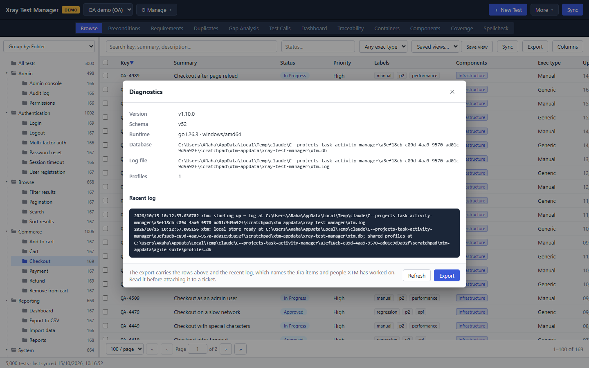

The dark theme applies to the whole window:

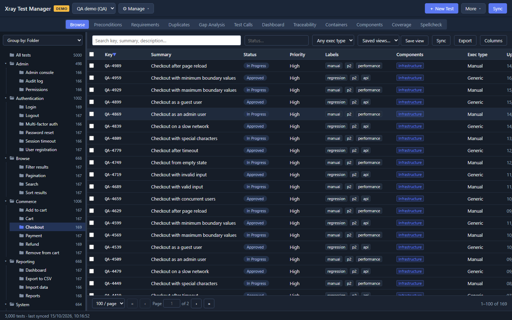

## Troubleshooting

- **Test connection fails.** Check that the URL has no trailing path and that the token has not expired. For a server with a private certificate, add the CA certificate under **Advanced: TLS / certificate settings**.
- **The grid is empty after creating a profile.** Run a sync. XTM never fetches tests on its own.
- **Sync failed.** A red ribbon across the status bar names what Jira answered
  and what to change: the token, the Jira URL and project key, or nothing at
  all when Jira itself failed. Open **More → Sync history** for the run and
  **More → Diagnostics** for the log.
- **You cannot switch profiles.** A sync is running. Wait for it to finish.
