# Browse

Browse is where you find, read and edit test cases. The left sidebar groups the tests, the grid lists them, and the detail panel on the right shows one test at a time. Open it with the **Browse** tab or Ctrl+1.

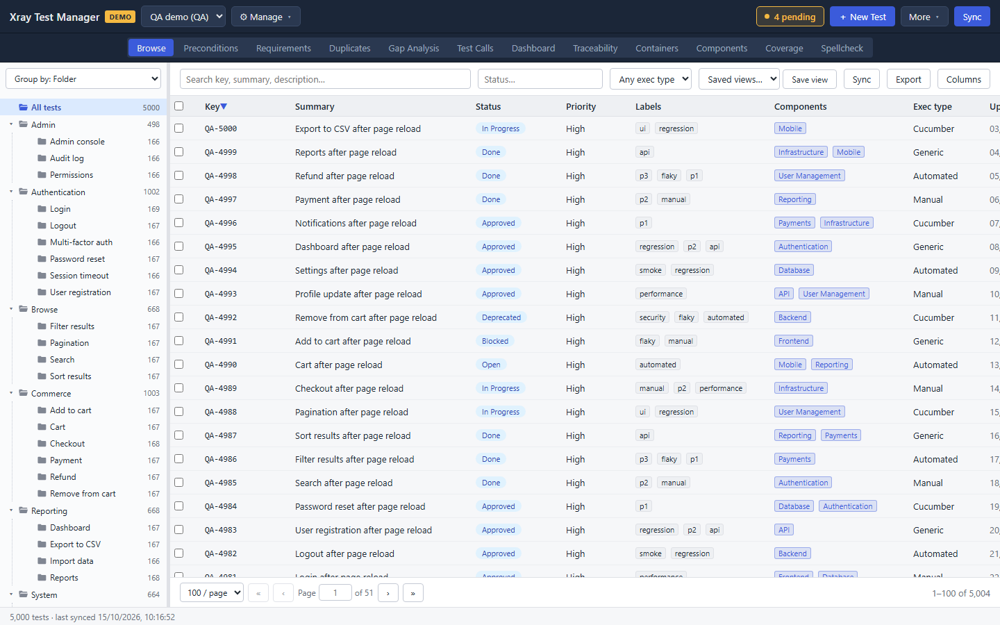

## Find tests

### Group the sidebar

The list at the top of the sidebar picks how tests are grouped:

- **Group by: Folder** shows the Xray Test Repository folders as a tree. This option appears when the backend supports folders.
- **Group by: Test Set** and **Group by: Test Plan** list containers. Click one to see its tests.
- **Group by: Component** lists the project's components.

Click a folder to show only its tests. The number next to each folder is its test count, subfolders included. **All tests** at the top clears the selection.

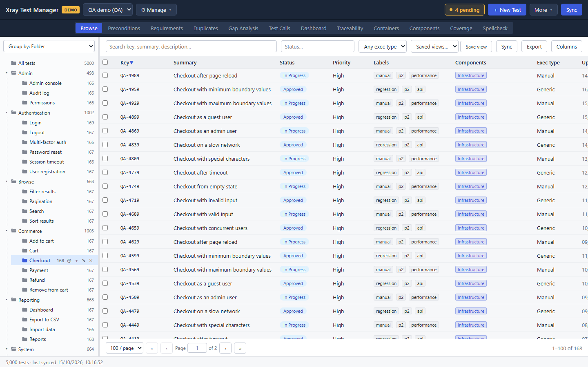

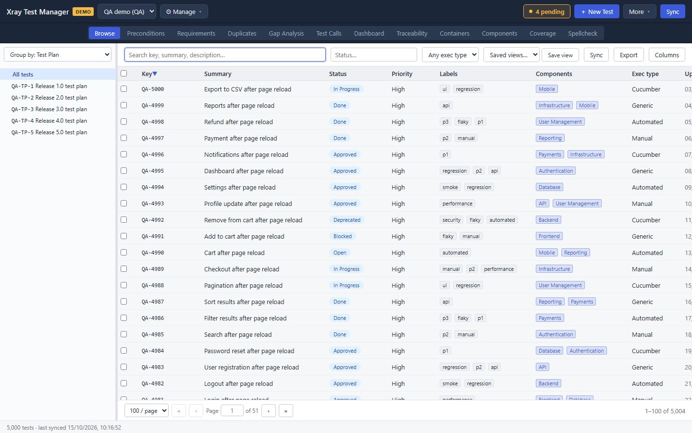

In folder mode, hover over a folder to see its buttons: new top-level folder, new test in this folder, new subfolder, rename and delete. **+ New folder** at the bottom of the sidebar creates a top-level folder. Folder changes are pending changes like any other edit.

### Search and filter the grid

The row above the grid filters what it shows:

- **Search key, summary, description…** matches as you type.
- **Status…** filters by workflow status.
- **Any exec type** limits the grid to Manual, Cucumber, Generic or Automated tests.

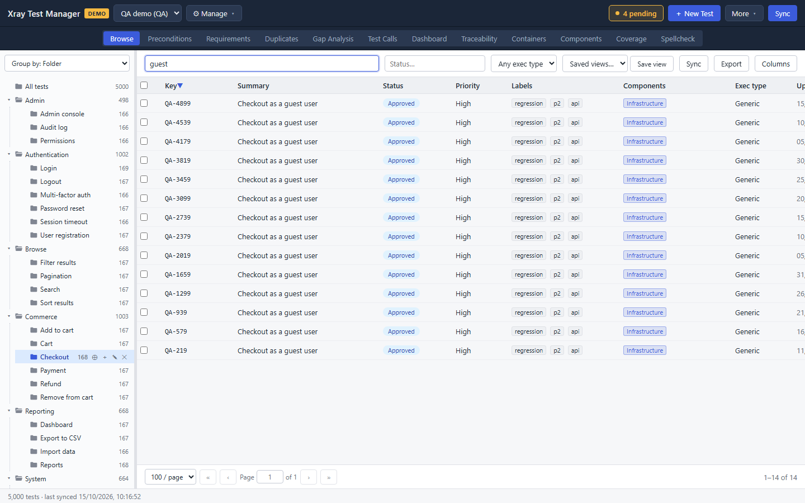

To keep a combination of filters, click **Save view** and give it a name. **Saved views…** brings it back, and **✕** next to an active view deletes it.

Click a column header (Key, Summary, Status, Updated) to sort. The pager at the bottom moves between pages and sets the number of rows per page.

### Choose the grid columns

Click **Columns** to choose which columns the grid shows and in what order. Tick a column to show it and use the ▲ and ▼ buttons to move it.

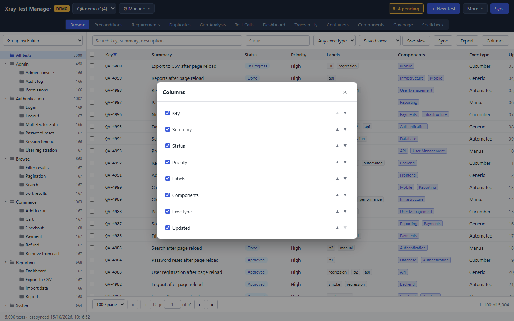

**Export** saves the tests the grid currently shows as CSV or XLSX.

## Read and edit a test

1. Click a row in the grid. The detail panel opens on the right.

   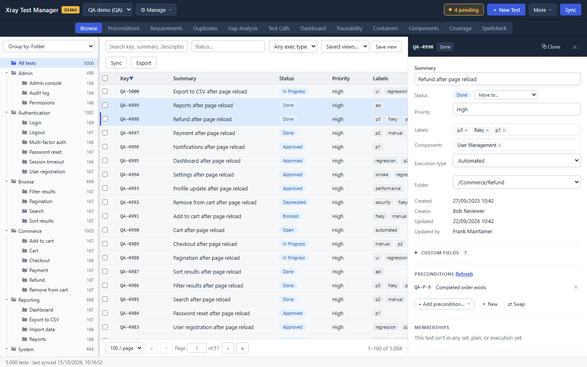

   The header shows the key, the status and two buttons: **Clone** copies the test, and **✕** closes the panel. Clicking the key opens the test in Jira in your browser.

2. Edit any field in place: Summary, Priority, Labels, Components, Execution type or Folder. To change the status, pick a transition from **Move to…**. There is no Save button. XTM saves the change locally when you leave the field.

   An edited field gets an orange dot, the row in the grid gets the same dot, and the **N pending** button in the top bar counts the change.

   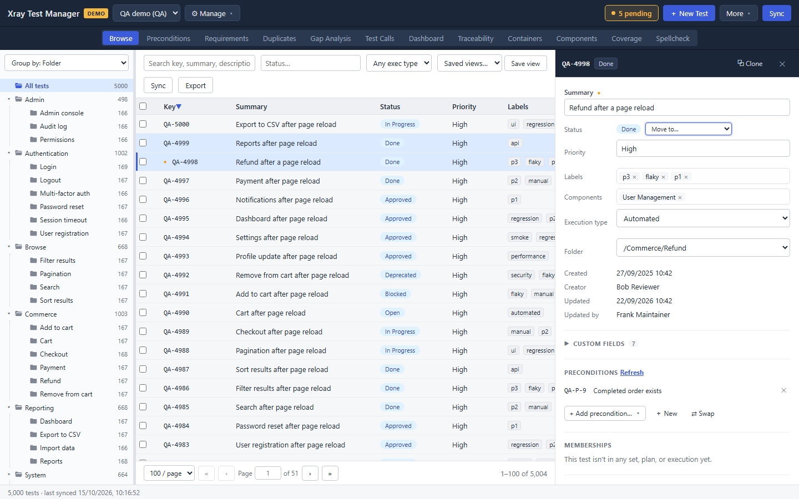

3. Scroll down for the rest of the test:
   - **Custom fields**.
   - **Preconditions**: **+ Add precondition…** links one, **+ New** creates one.
   - **Memberships**: the sets, plans and executions the test belongs to.
   - **Requirements**.
   - **Bugs**: linked defects.
   - **Run history**: results from every execution that ran the test.
   - **Description**: click to edit. Markdown is supported.
   - **Steps**.
   - **Dataset**: the parameters the test runs with, if it has any.

   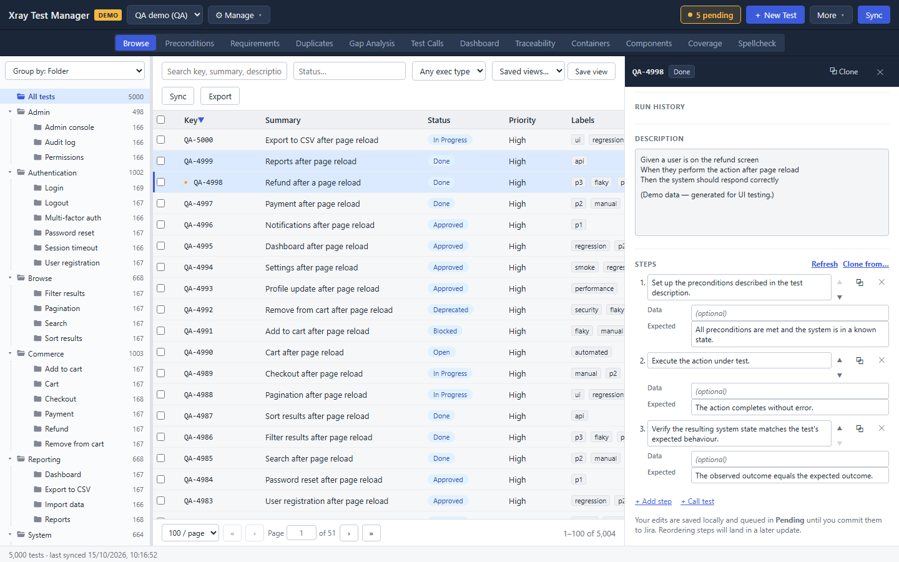

### Edit steps

Each step has an action, optional data, and an expected result. Type in a box to change it.

- **+ Add step** adds a step at the end.
- **+ Call test** adds a step that calls another test. See [Test Calls](06-test-calls.md).
- The arrows move a step up or down, the copy button duplicates it, and **✕** deletes it.
- **Clone from…** copies the steps of another test.
- **Refresh** reloads the steps from Jira.

Cucumber tests show a **Cucumber scenario** box instead of steps, and Generic tests show a **Generic definition** box.

### Give a test a dataset

A dataset is the table a test's `${placeholder}` references resolve against: one column per parameter, one row per iteration. It sits below the steps.

- **Create dataset** shows on a test that has none. **Edit** shows on a test that has one.
- A column is a parameter. Type its name in the header and tick **combinatorial** if Xray should expand it into extra iterations. **Remove** above a column deletes it with its values.
- **Add row** adds an iteration, and **Remove** at the end of a row deletes that row.
- A parameter whose values come from a list offers them as you type in its cells. XTM does not create or change lists, and editing a dataset leaves an existing one as it is.
- **Save** stores the table locally and counts it in **N pending**, like every other edit. Jira gets it on the next commit.

Xray's own limits are checked when you save: at most 20 parameters, 100 characters in a value, no two parameters with the same name, no two identical rows, and a name that starts with a letter or underscore. A table that breaks one of them is refused with the reason, and stays on screen for you to fix.

A dataset write replaces the whole table, so if someone changed it in Jira after you loaded the test, the commit stops and asks which version to keep instead of overwriting theirs.

## Create a test

1. Select the folder the test belongs in. XTM fills in the folder for you.
2. Click **＋ New Test** in the top bar. This button only shows on the Browse view.
3. Fill in **Summary** (the only required field), then any of Description, Priority, Folder, Execution type, Labels and Components. You can add steps with **＋ add step** and link preconditions.

   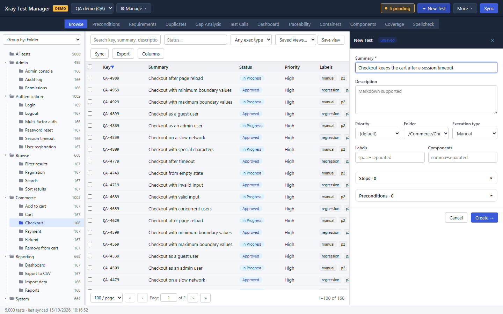

4. Click **Create →**.

The new test gets a temporary key such as `NEW-5`, and a banner says it has not been created in Jira yet. Jira creates it, with a real key, when you commit.

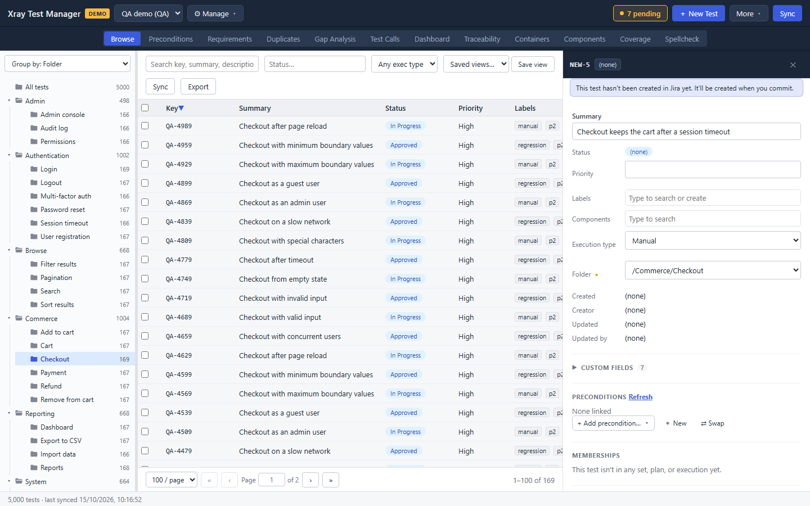

## Change many tests at once

1. Tick the checkbox of each test you want to change. The checkbox in the header selects every test on the page.
2. A yellow toolbar appears under the view tabs with the number selected and the bulk actions.

   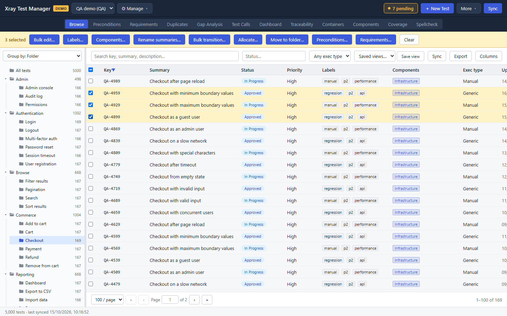

3. Pick an action:
   - **Bulk edit…** sets one field on every selected test.
   - **Labels…** and **Components…** add or remove values.
   - **Rename summaries…** finds and replaces text in the summaries.
   - **Bulk transition…** moves every selected test through a workflow transition.
   - **Allocate…** adds the tests to a Test Set, Plan or Execution.
   - **Move to folder…** moves them to another folder.
   - **Preconditions…** and **Requirements…** link or unlink in bulk.

   Some actions only appear when the backend supports them.

4. Confirm in the dialog. **Bulk edit** shows how many tests it will change before you click **Apply**.

   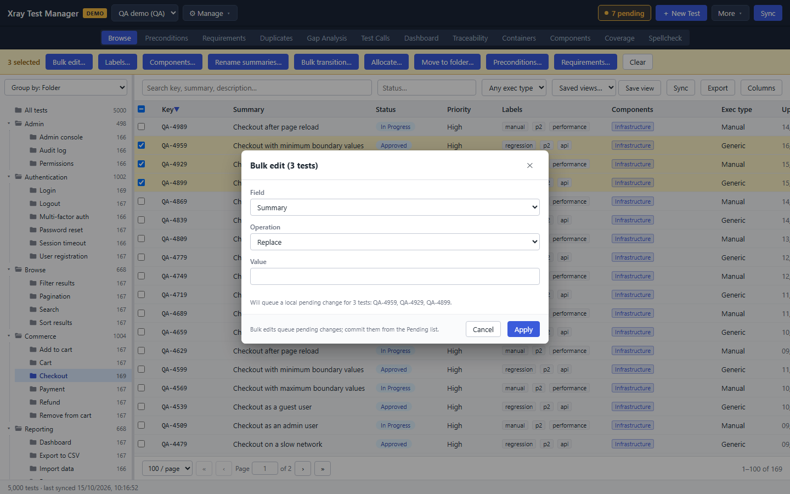

**Clear** in the toolbar deselects everything. Bulk changes are pending changes, so you review and commit them like any other edit.

## Import tests from CSV or XLSX

1. Choose **More → Import tests…** (or **File → Import Tests…**).

   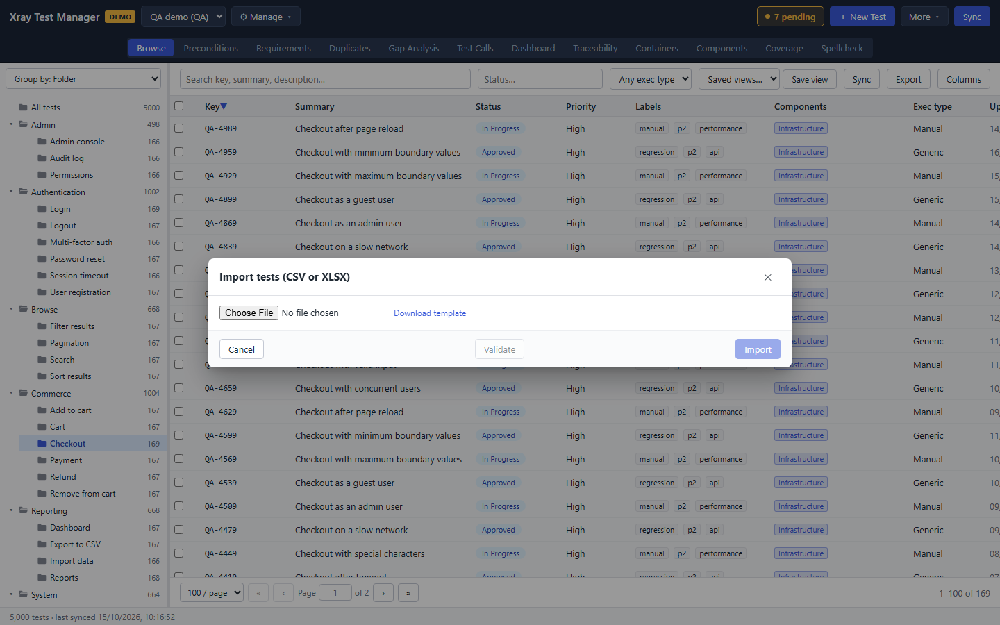

2. Click **Choose File** and pick a CSV or XLSX file. **Download template** saves a sample file with every column XTM understands.

3. Check the mapping. XTM matches columns whose header is the field name, such as `Summary`, `Priority` or `Folder`. Pick a column for any field it did not match, or leave it as **(not mapped)**. Summary is required.

   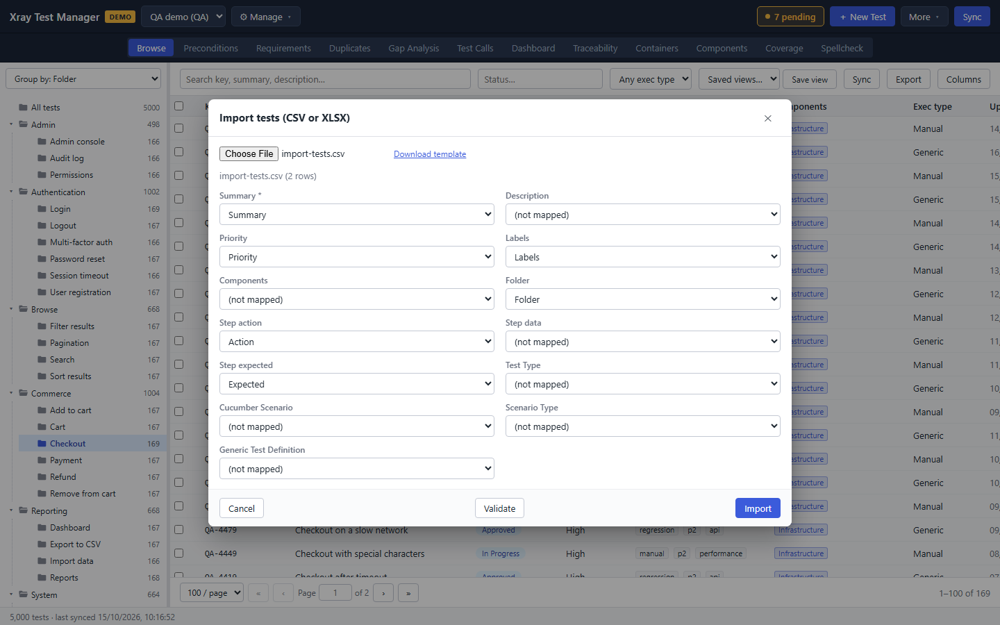

4. Click **Validate**. XTM reports how many rows are valid and lists any problems.

   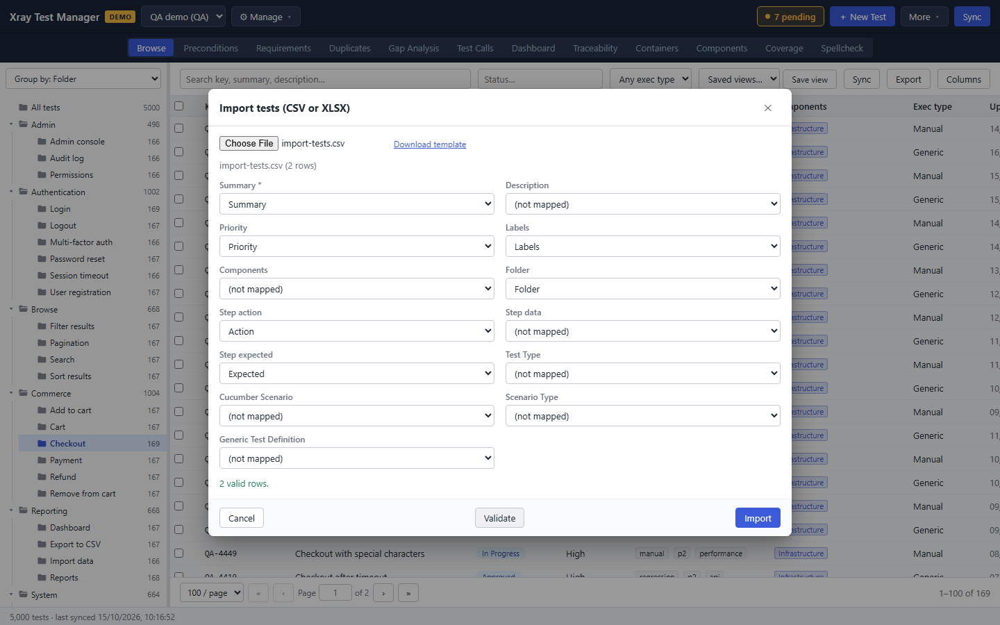

5. Click **Import**. The tests become pending creates. Commit them from the Pending list.

   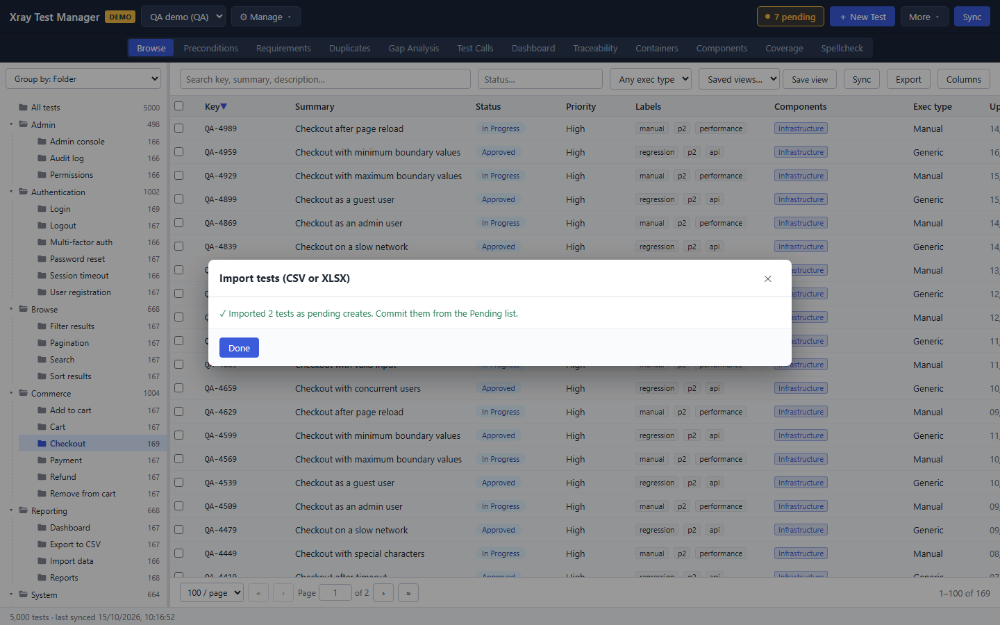

## Troubleshooting

- **A test you expect is missing.** Check the folder selection, the search box and the status and exec type filters. Then sync, because the test may be newer than your cache.
- **New Test is not in the top bar.** It only shows on the Browse view.
- **Columns is missing.** It is hidden while the detail panel is open. Close the panel.
- **Import rejects a file.** Make sure the file has a `Summary` column and that the first row is the header row.
