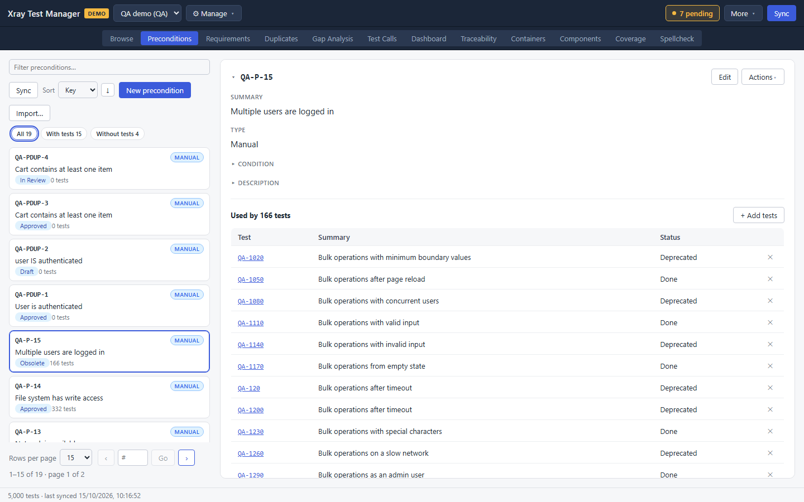
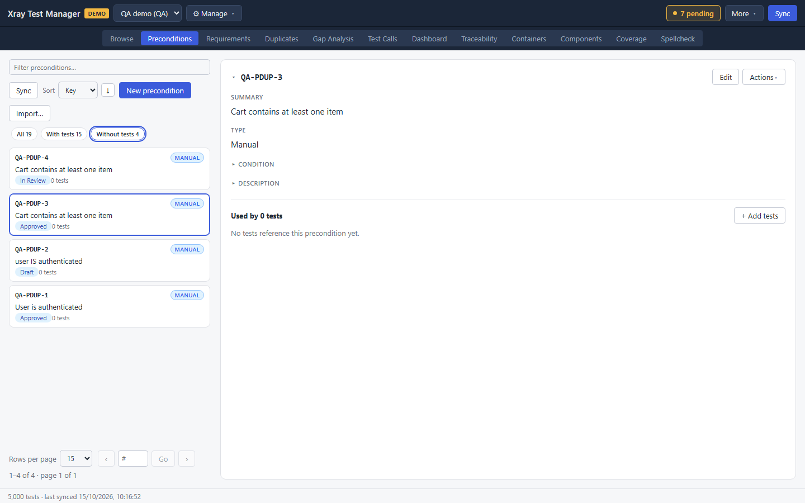
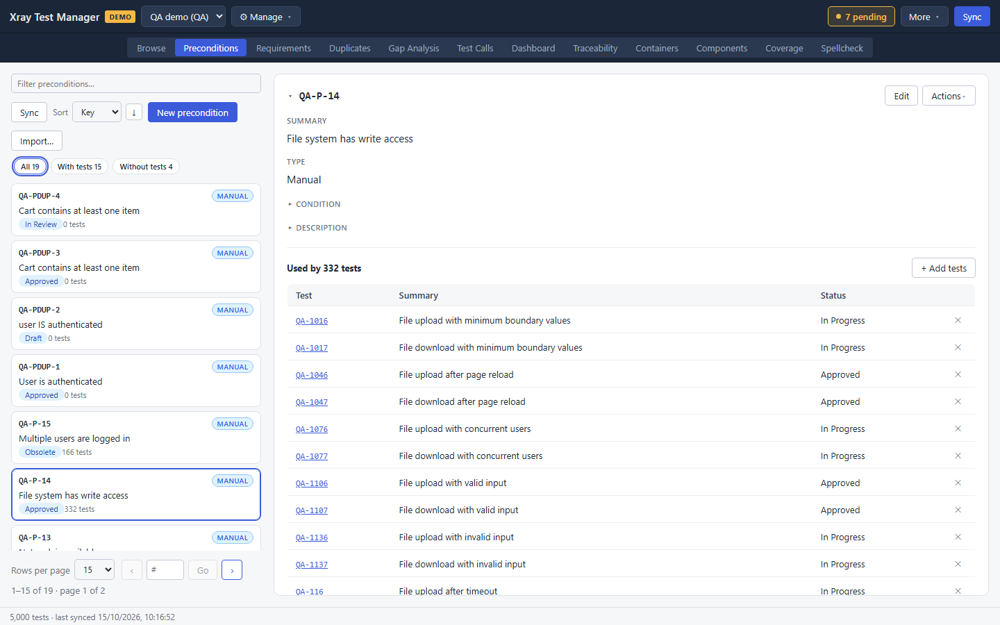
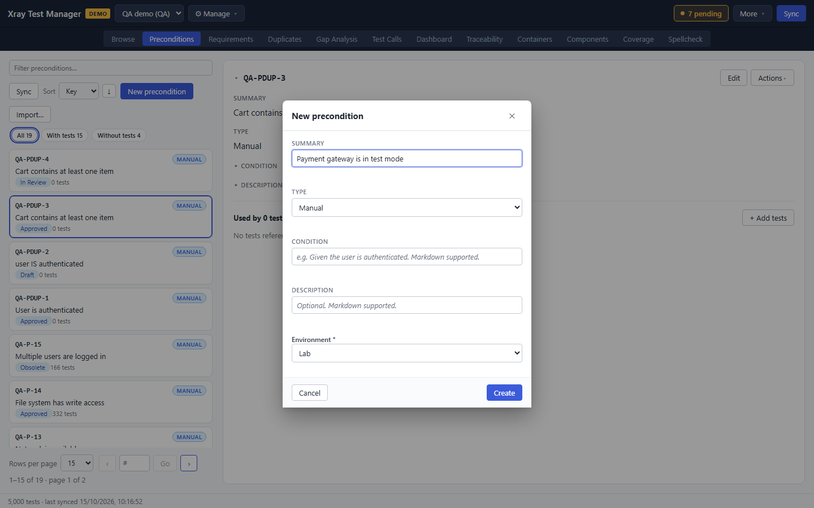
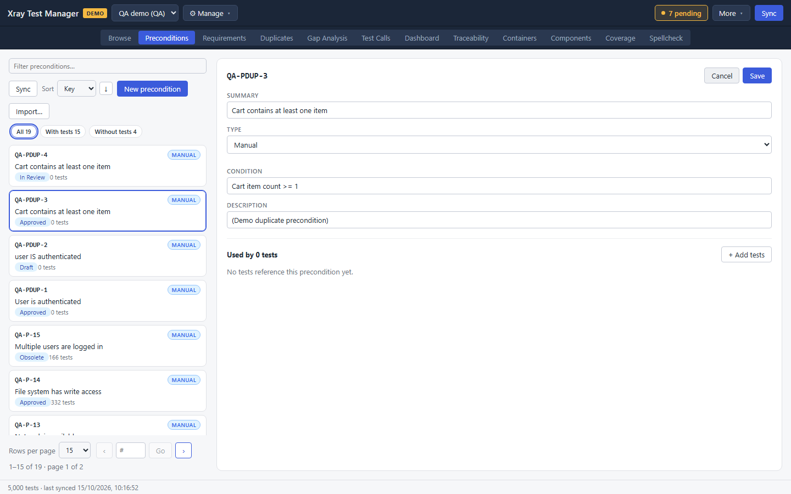
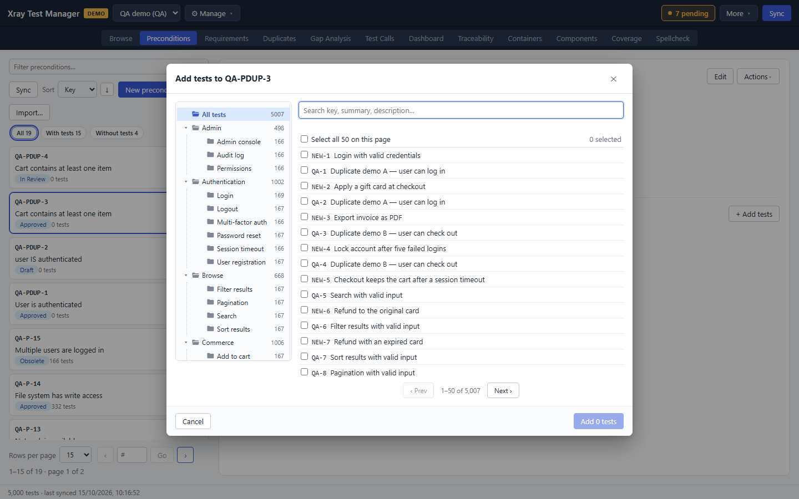

# Preconditions

A precondition is a reusable statement of the state a test needs before it starts, such as "User is authenticated". In Xray it is its own Jira issue, and many tests can link the same one. The Preconditions view lists them, shows which tests use each one, and lets you create, edit and link them. Open it with the **Preconditions** tab or Ctrl+2.

The tab only appears when the profile's backend supports precondition objects. Xray does; Kiwi TCMS does not.

## Find a precondition

- Type in **Filter preconditions…** to search by key or summary.
- **Sort** orders the list by Key, Type, Status or Usage. The arrow next to it flips the order.
- The pills under the toolbar filter by use: **All**, **With tests** and **Without tests**. Preconditions without tests are often left over and safe to retire.
- **Sync** refreshes only the preconditions from Jira.

Each card shows the key, the type, the summary, the status and how many tests use it. Click a card to open it on the right.

The detail shows the summary and the type. **Condition** and **Description** expand when you click them. **Used by N tests** lists every test that links the precondition. Click **✕** on a row to unlink that test.

## Create a precondition

1. Click **New precondition**.
2. Fill in **Summary**, then pick the **Type**. **Condition** holds the state itself, for example "Given the user is authenticated". Markdown is supported.
3. Click **Create**.

The precondition is created in Jira when you commit.

## Edit or delete a precondition

1. Open the precondition and click **Edit**.
2. Change the summary, type, condition or description.
3. Click **Save**, or **Cancel** to leave it unchanged.

To delete it, open **Actions** and choose **Delete precondition…**, then confirm.

## Link tests to a precondition

1. Open the precondition.
2. Click **+ Add tests** next to **Used by N tests**.
3. Find tests in the picker by folder or by searching, and tick them. Tests that already use the precondition are marked.
4. Click the add button at the bottom of the picker.

You can also link a precondition from a test: open the test in [Browse](01-browse.md#read-and-edit-a-test) and use **+ Add precondition…** in its Preconditions section.

## Import preconditions

**Import…** opens **Import preconditions (CSV or XLSX)**. It works like the test import: choose a file, check the column mapping, validate, then import. The imported preconditions become pending creates.

## Troubleshooting

- **The tab is missing.** The backend does not support precondition objects, or the profile is a Kiwi TCMS profile.
- **Usage counts look wrong.** Run **Sync** in the list header, then a full sync if the counts still disagree with Jira.
- **Duplicate preconditions.** The [Duplicates](04-duplicates.md) view has a Preconditions mode that finds them.
