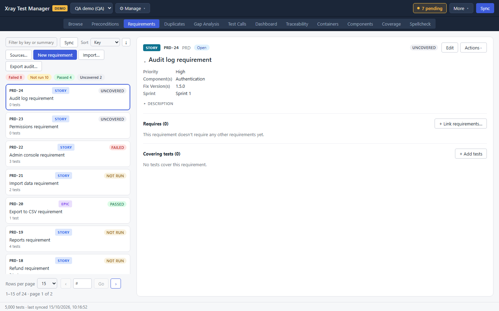
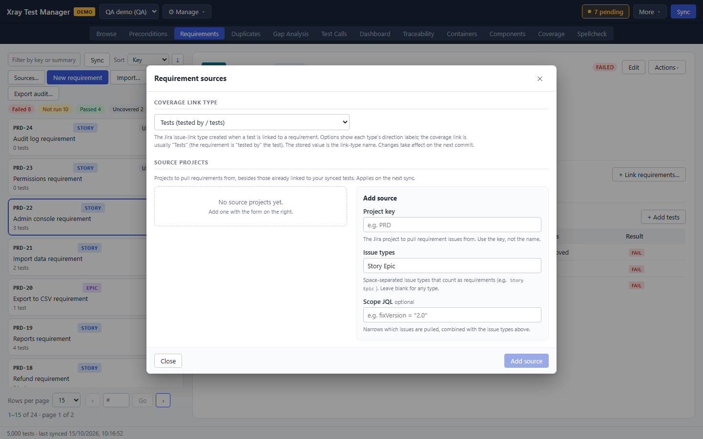
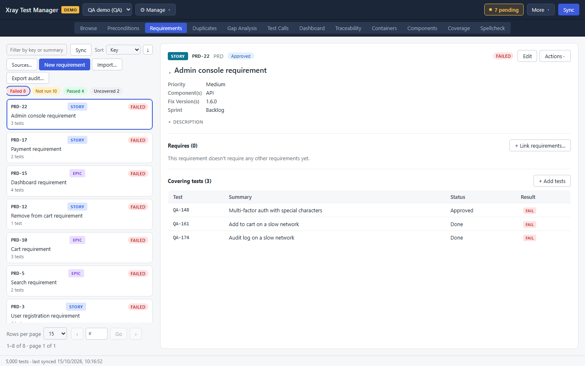
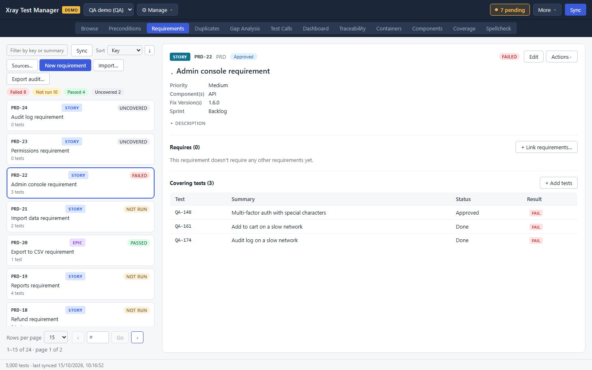
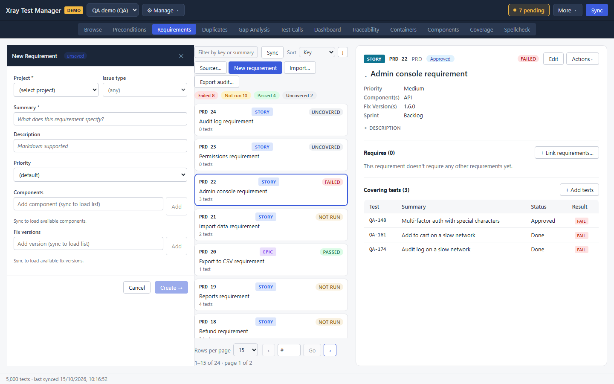

# Requirements

The Requirements view answers one question for each requirement: is it covered by tests, and did those tests pass? It lists the requirements pulled from your requirement sources with a coverage badge on each, and shows the covering tests and their latest results. Open it with the **Requirements** tab or Ctrl+3.

The tab only appears when the profile's backend supports requirement objects.

## Tell XTM where your requirements are

Requirements usually live in a different project from your tests, as Stories or Epics. XTM needs to know which projects and issue types to pull.

1. Click **⋯** beside **New requirement**, then **Sources…**.
2. Under **Coverage link type**, choose the Jira link type that connects a test to the requirement it covers.
3. Under **Add source**, enter the **Project key** and the **Issue types** that count as requirements, separated by spaces (for example `Story Epic`). Add a **Scope JQL** to narrow the source further.
4. Click **Add source**. Repeat for each project.
5. Click **Close**, then **Sync** in the list header to pull the requirements.

## Check coverage

Each requirement card carries a badge:

| Badge | Meaning |
|---|---|
| PASSED | Every covering test passed its latest run |
| FAILED | At least one covering test failed its latest run |
| NOT RUN | It has covering tests, but they have not run |
| UNCOVERED | No test covers it |

The pills above the list count each state. Click a pill to show only those requirements, and click it again to clear the filter.

Type in **Filter by key or summary** to search, and use **Sort** to order by Key, Coverage, Tests or Status. The list also responds to the arrow keys.

## Inspect a requirement

Click a requirement to open it.

- The header shows the issue type, key, status and coverage badge. **Show details** expands Priority, Components, Fix Version(s) and Sprint.
- **Requires (N)** lists the requirements this one depends on. **+ Link requirements…** adds one.
- **Covering tests (N)** lists every test that covers it, with the test's status and latest result. Click a test to open its detail.
- **+ Add tests** links more covering tests.

## Create a requirement

1. Click **New requirement**.
2. Choose the **Project** and the **Issue type**.
3. Fill in **Summary**, and optionally Description, Priority, Components and Fix versions.
4. Click **Create →**.

The requirement is created in Jira when you commit.

## Edit, import and export

- **Edit** on an open requirement changes its fields. **Save** keeps the change.
- **Actions → Delete requirement…** deletes it after you confirm.
- **⋯** beside **New requirement** holds **Sources…**, **Import…** and **Export audit…**.
- **Import…** creates requirements from a CSV or XLSX file, with the same steps as the test import.
- **Export audit…** saves a coverage report for every requirement in the list. It is greyed out while the list is empty.

## Troubleshooting

- **The list is empty.** Add a source with **⋯ → Sources…**, then click **Sync**.
- **A requirement shows UNCOVERED but a test covers it.** Check that the test uses the coverage link type you chose in **⋯ → Sources…**.
- **Results look old.** Run results come from executions. Sync the executions from [Containers](09-containers.md).
