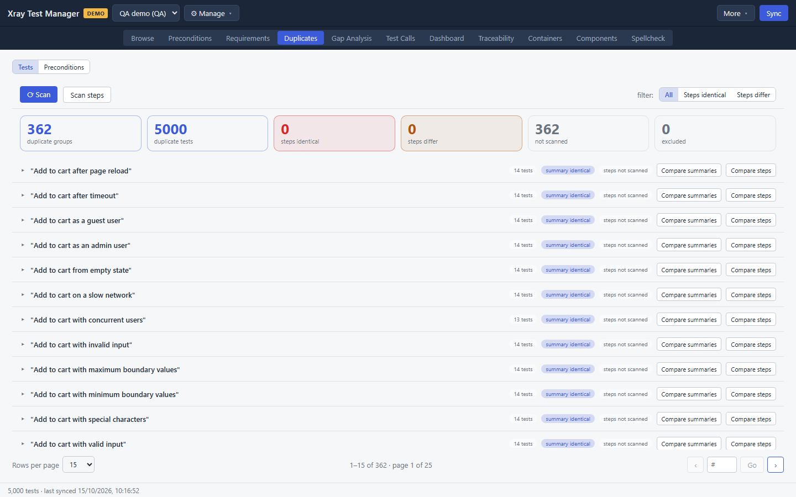
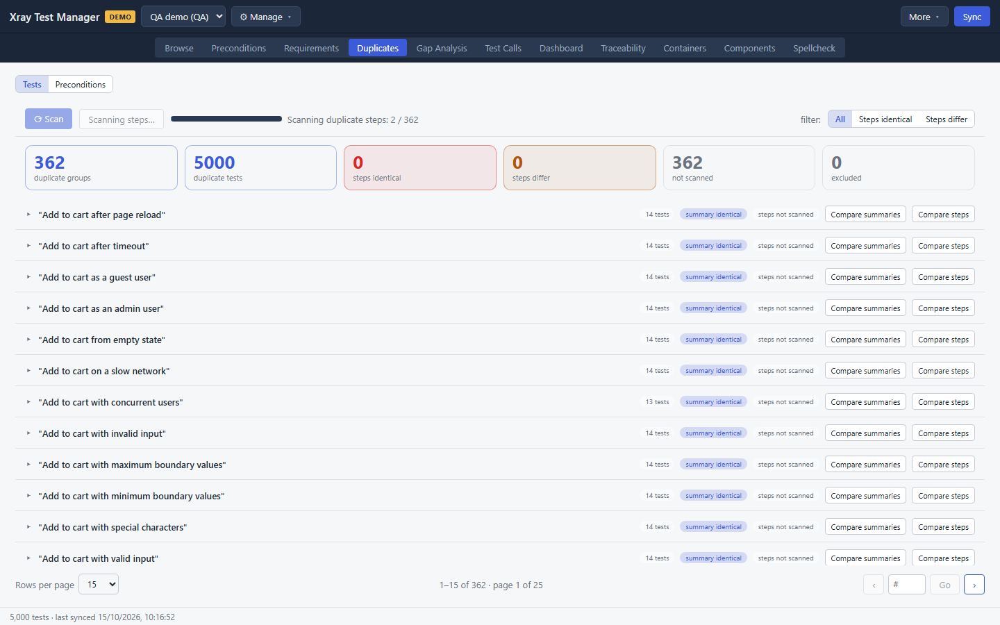
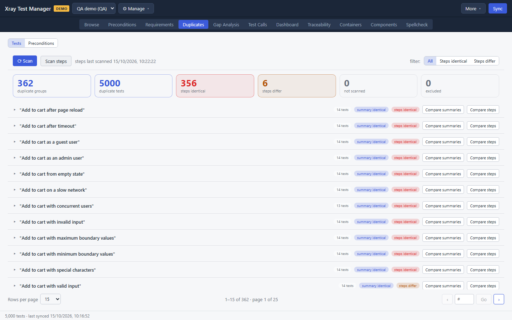
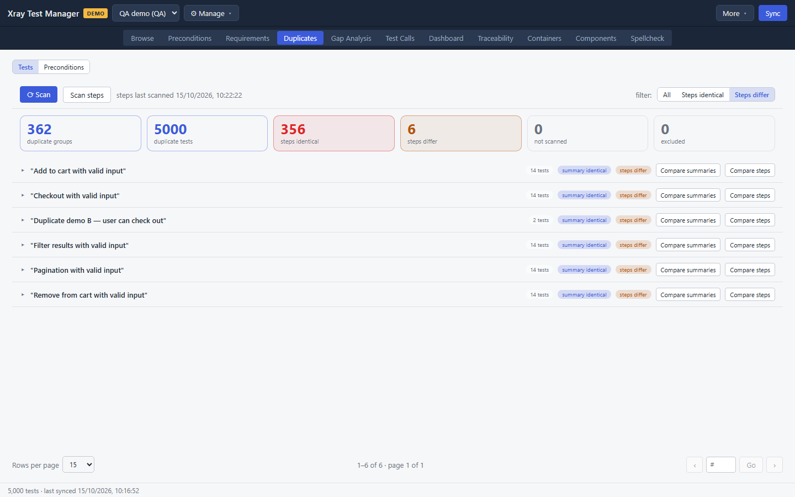
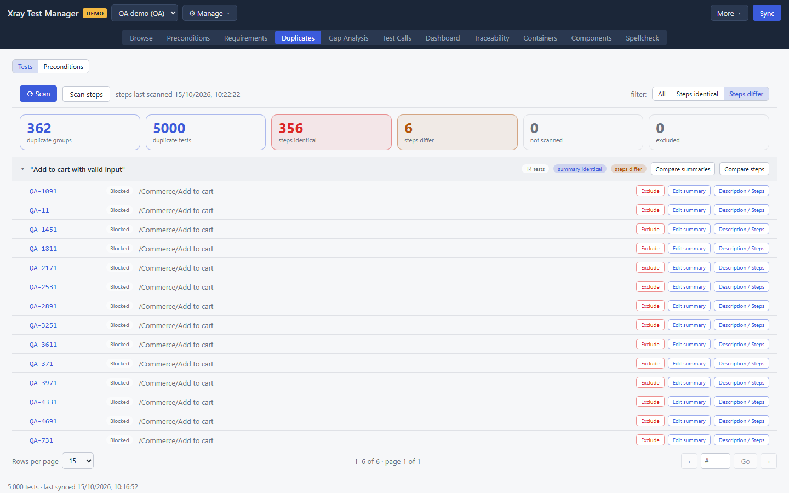
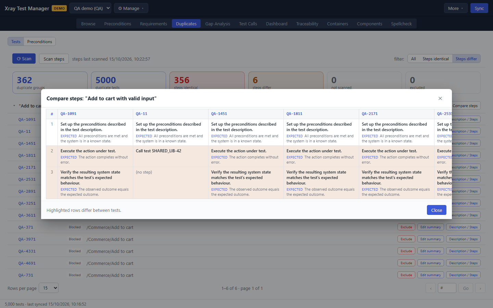
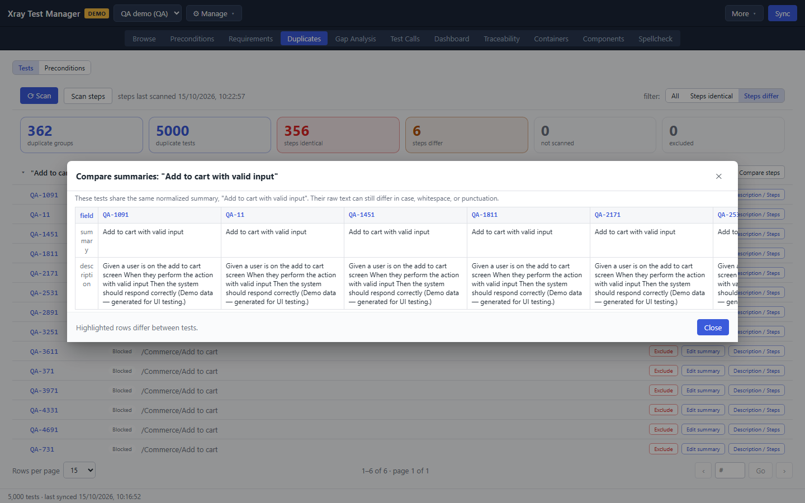
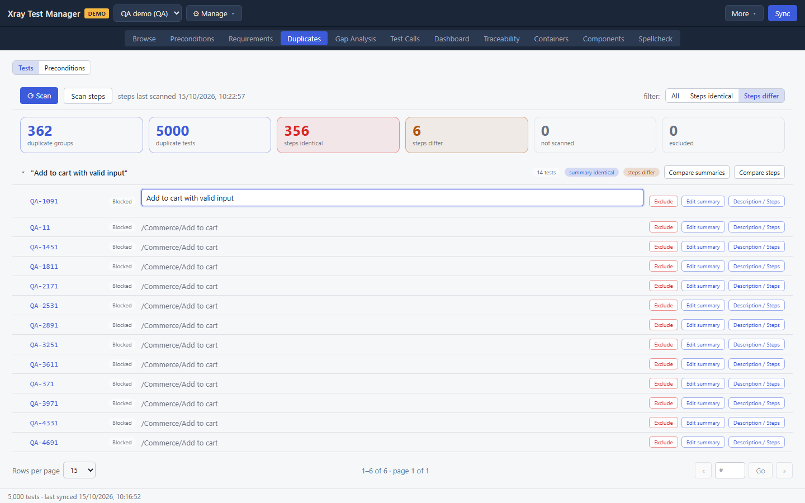
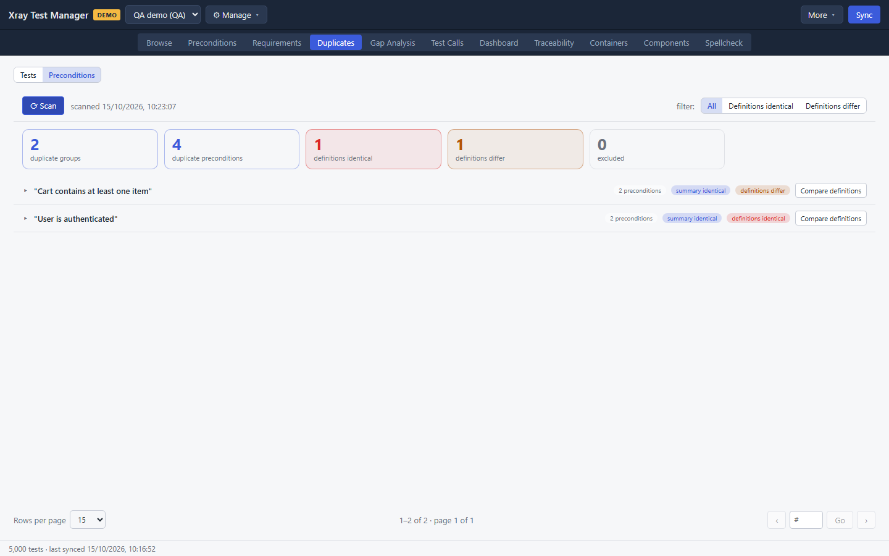

# Duplicates

Duplicates finds tests that share the same summary once case, spacing and punctuation are ignored. It then compares their steps so you can tell real duplicates from tests that only share a name. It does the same for preconditions. Open it with the **Duplicates** tab or Ctrl+4.

## Scan for duplicate tests

1. Make sure **Tests** is selected in the toggle at the top left.
2. Click **⟳ Scan**. XTM groups the tests in your local cache by summary. It reads only the cache and does not contact Jira.
3. Read the tiles:

   | Tile | Meaning |
   |---|---|
   | duplicate groups | Summaries shared by more than one test |
   | duplicate tests | Tests in those groups |
   | steps identical | Groups whose tests have the same steps |
   | steps differ | Groups whose tests share a summary but not their steps |
   | not scanned | Groups whose steps have not been compared yet |
   | excluded | Groups you marked as not duplicates |

4. Click **Scan steps** to fetch and compare the steps of every group not scanned yet. A progress bar shows how far it has got.

   

   When it finishes, the line next to the button shows when the steps were last scanned, and every group says whether its steps are identical or differ.

   

## Review a group

1. Use the **filter** at the top right to narrow the list: **All**, **Steps identical** or **Steps differ**. Groups whose steps differ need the most care.

   

2. Click a group's title to expand it. Each member shows its key, status and folder.

   

3. Compare the members:
   - **Compare steps** shows every test's steps side by side. Highlighted rows differ between tests.

     

   - **Compare summaries** shows the summary and description of every test side by side.

     

## Resolve duplicates

Each member row has three buttons:

- **Exclude** marks the test as not a duplicate. Excluded groups are counted in the tiles but no longer listed.
- **Edit summary** turns the summary into a text box so you can rename the test. Press Enter or click away to save, or Escape to cancel. The rename is a pending change.

  

- **Description / Steps** opens the test's detail panel, where you can edit anything else.

A dot next to a key means that test has uncommitted edits.

XTM does not delete duplicates for you. Once you have decided which test to keep, rename or edit the others here and commit, or retire them in Jira.

## Find duplicate preconditions

1. Click **Preconditions** in the toggle at the top left.
2. Click **⟳ Scan**.
3. Filter with **All**, **Definitions identical** or **Definitions differ**.
4. Expand a group and click **Compare definitions** to see the members side by side.

Each precondition row shows how many tests use it, which helps you pick the one to keep. **Exclude** works as it does for tests.

## Troubleshooting

- **No tiles appear.** Click **⟳ Scan**. The tiles only appear once a scan has run.
- **"No duplicate groups for this filter."** Nothing matches the current filter. Choose **All**.
- **Step results look old.** Click **Scan steps** again after a sync.
