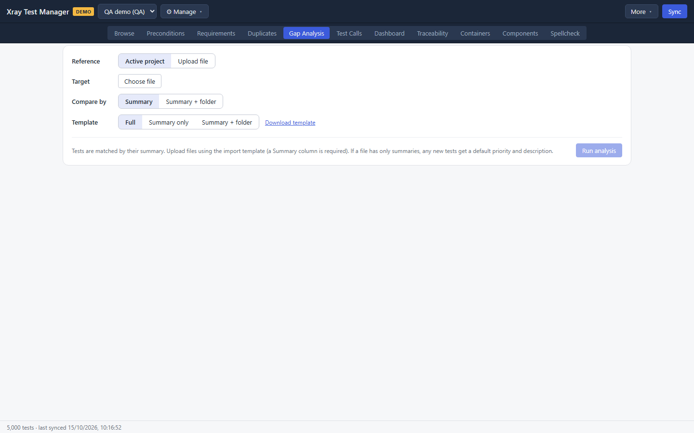
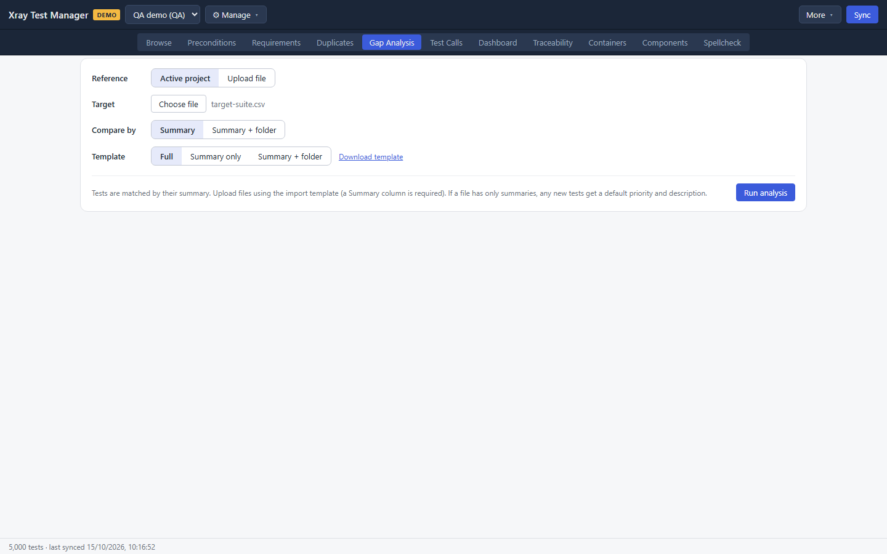
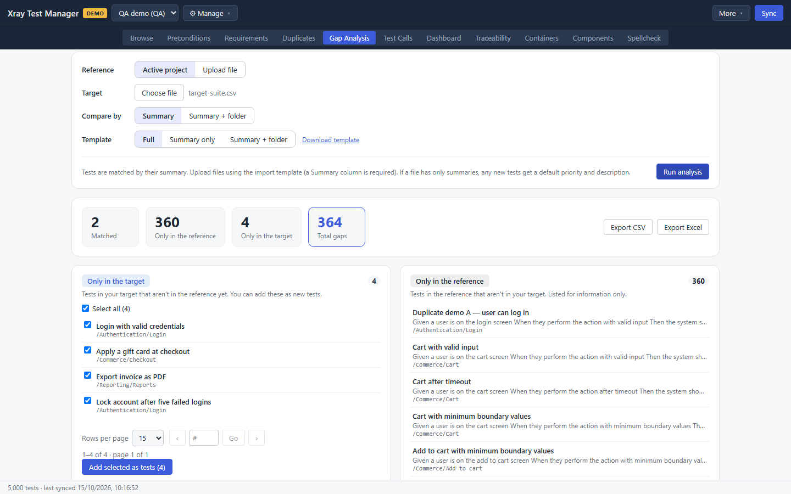
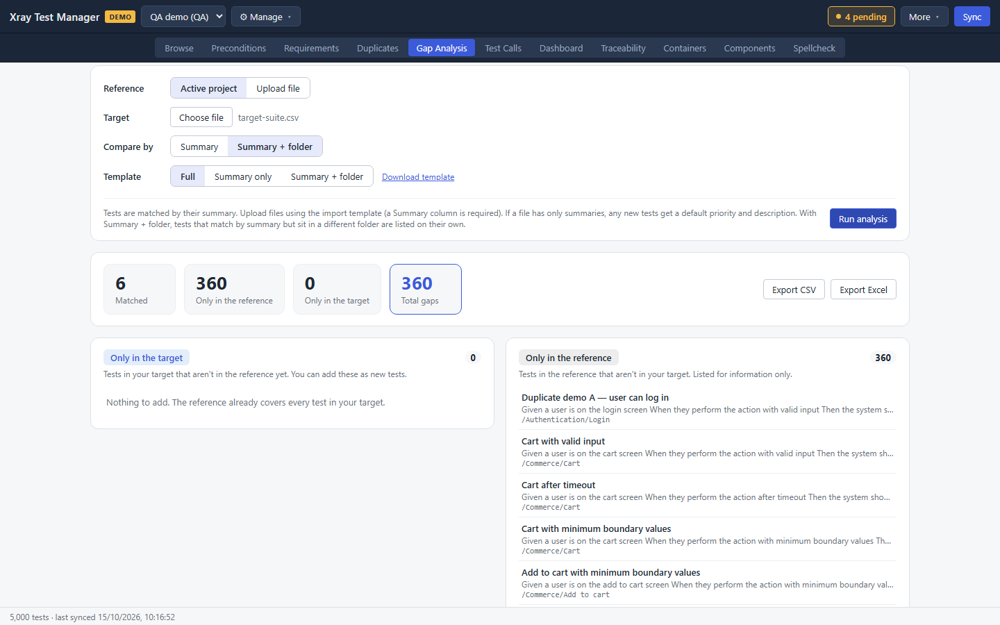
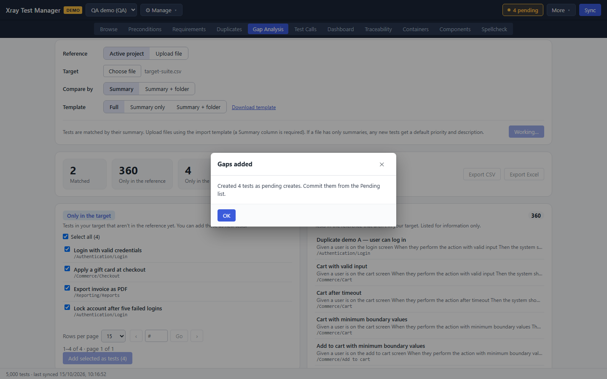

# Gap Analysis

Gap Analysis compares two test lists by summary and shows what each has that the other lacks. A typical use is checking a customer's or another team's test list (the target) against your project (the reference), then adding the missing tests to your project in one step. Open it with the **Gap Analysis** tab or Ctrl+5.



## Prepare the files

Both lists use XTM's import template, and only the `Summary` column is required. To get a template:

1. In the **Template** row, choose **Full**, **Summary only** or **Summary + folder**.
2. Click **Download template** and choose where to save it.

A target file can be as small as this:

```csv
Summary,Folder
Add to cart with valid input,/Commerce/Add to cart
Apply a gift card at checkout,/Commerce/Checkout
```

If a file only has summaries, any test you add from it gets a default priority and description.

## Run an analysis

1. In the **Reference** row, choose **Active project** to compare against your synced tests, or **Upload file** to compare two files. **Upload file** shows a **Choose file** button for the reference file.
2. In the **Target** row, click **Choose file** and pick the CSV or XLSX file to compare. Its name appears next to the button.
3. In the **Compare by** row, choose:
   - **Summary** to match tests by summary alone.
   - **Summary + folder** to also require the same folder.

   With an uploaded reference, you can also tick **Three-way: also fill gaps in the active project**.

   

4. Click **Run analysis**. The button is disabled until every file it needs is chosen.

Changing any option clears the results, so run the analysis again after a change.

## Read the results



| Tile | Meaning |
|---|---|
| Matched | Tests found in both lists |
| Only in the reference | Tests your project has that the target does not |
| Only in the target | Tests the target has that your project does not |
| Total gaps | The two previous tiles added together |
| Missing from project | With three-way only: tests from the files that the active project does not have yet. The **Missing from the project** list under the tiles adds them with **Add selected to project (N)** |

Below the tiles:

- **Only in the target** lists the tests you could add, each with a checkbox. All of them start selected.
- **Only in the reference** lists your tests the target lacks. It is for information only.
- **Folder mismatches** appears with **Summary + folder** when a summary matches but the folder does not. It lists the summary and both folders.

**Export CSV** and **Export Excel** save the full report.



## Add the missing tests

1. In **Only in the target**, untick any test you do not want. **Select all (N)** ticks or clears them all.
2. Click **Add selected as tests (N)**.
3. XTM confirms how many tests it created as pending creates. Click **OK**.



Review and commit them from the **N pending** button. See [Getting started](00-getting-started.md#review-and-commit-your-changes).

## Troubleshooting

- **Run analysis stays disabled.** Choose a target file. With **Upload file** as the reference, choose a reference file too.
- **Everything shows as a gap.** Check that the file's first row is a header row with a `Summary` column.
- **Folder mismatches never appear.** They only appear with **Summary + folder**.
