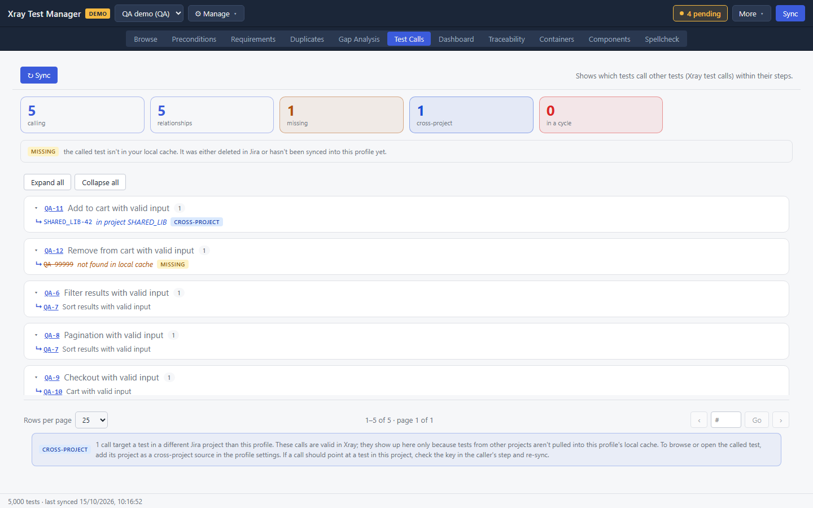
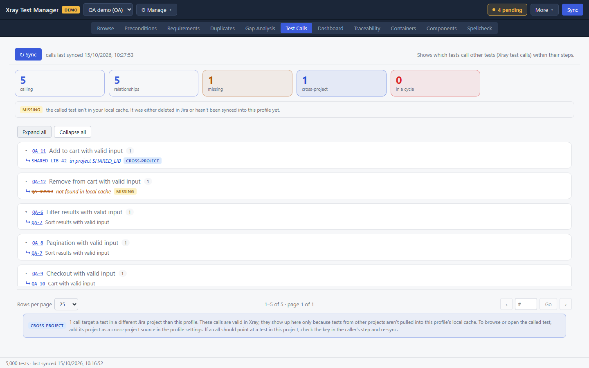
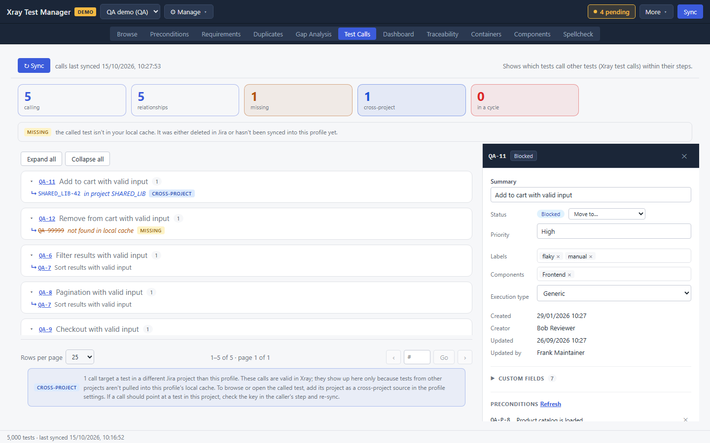

# Test Calls

In Xray, a test step can call another test instead of repeating its steps. Test Calls shows every test that calls another, and flags calls that point at a missing test, at another project, or round in a cycle. Open it with the **Test Calls** tab or Ctrl+6.

## Refresh the call graph

Click **↻ Sync** at the top left. XTM reads the call steps of your tests and rebuilds the list. The text next to the button shows when the calls were last synced.

## Read the summary

| Tile | Meaning |
|---|---|
| calling | Tests that call at least one other test |
| relationships | Calls in total |
| missing | Calls to a test that is not in your local cache |
| cross-project | Calls to a test in another Jira project |
| in a cycle | Tests that end up calling themselves through a chain of calls |

When there are missing calls or cycles, a legend under the tiles explains the badges.

## Browse the callers

Each card is one calling test, with its key, summary and number of calls. Click the ▸ arrow to expand a card, or use **Expand all** and **Collapse all**.

Under each caller, ⮡ marks a called test. A badge describes any problem:

- **MISSING**: the called test is not in your local cache. It was deleted in Jira, or it has not been synced into this profile. The key is struck through.
- **CROSS-PROJECT**: the called test is in another project. The call is valid in Xray. It only shows here because tests from other projects are not in this profile's cache.
- **CYCLE**: the test is part of a loop of calls. A card with a cycle is shown in red.

## Open a test

Click a key to open that test's detail panel. From there, fix a broken call in its Steps section.

## Fix the problems

- **Missing call.** Open the caller, find the call step, and point it at the right test, or delete the step. Sync first in case the called test is newer than your cache.
- **Cross-project call.** To browse the called test, add its project under **Cross-project source projects** in the profile settings (**⚙ Manage → Manage Profiles…**). The note at the bottom of the view says the same.
- **Cycle.** Remove one of the calls in the loop.

To add a call, open a test in [Browse](01-browse.md#edit-steps) and click **+ Call test** in its Steps section.

## Troubleshooting

- **"No call-test relationships yet."** No test in the cache calls another. Add a **+ Call test** step to a test, commit it, then click **↻ Sync**.
