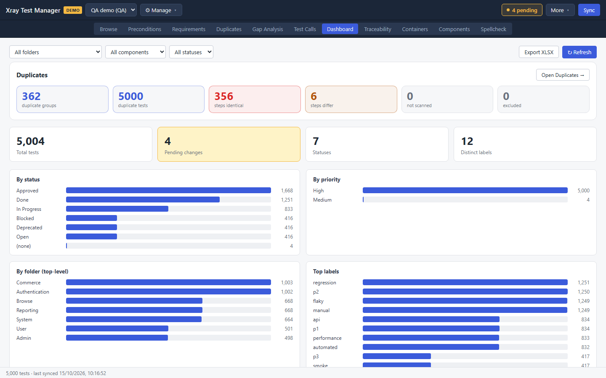
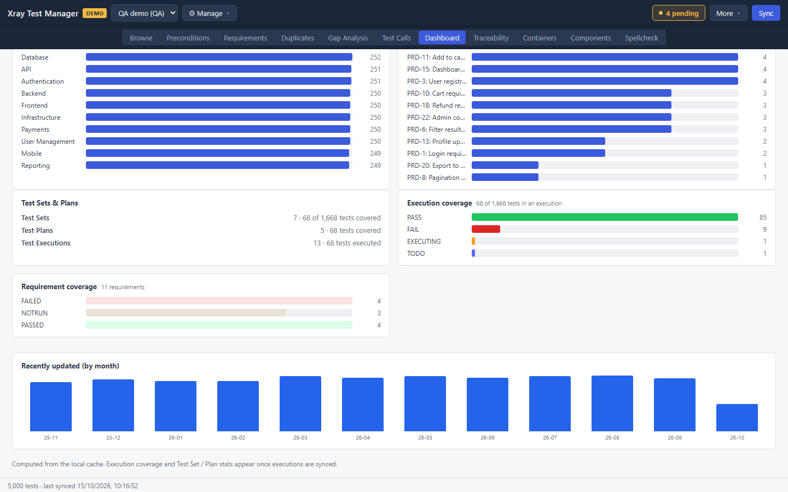
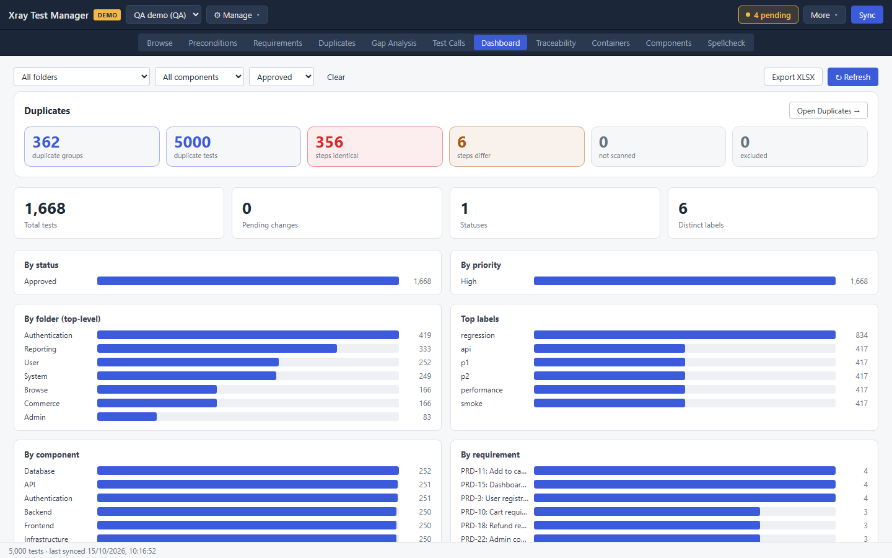

# Dashboard

The Dashboard summarises the project from your local cache: how many tests you have, their statuses and priorities, where they live, how much is covered by executions and requirements, and how recently tests changed. Open it with the **Dashboard** tab or Ctrl+7.

## Read the dashboard

The top row repeats the [Duplicates](04-duplicates.md) tiles. **Open Duplicates →** switches to that view.

The next row has four tiles:

| Tile | Meaning |
|---|---|
| Total tests | Tests in the cache, or the tests matching the filters |
| Pending changes | Edits not committed yet. The tile is highlighted when there are any |
| Statuses | Distinct workflow statuses in use |
| Distinct labels | Distinct labels in use |

Below them, bar charts break the tests down **By status**, **By priority**, **By folder (top-level)**, **Top labels**, **By component** and **By requirement**.

Further down:

- **Test Sets & Plans** counts the containers and how many tests they cover.
- **Execution coverage** shows the latest result of every test that has run.
- **Requirement coverage** shows how many requirements passed, failed or have not run.
- **Recently updated (by month)** shows how many tests changed each month.

The execution and container panels only appear once executions are synced.

## Filter the dashboard

The three lists at the top left limit every chart to part of the project:

- **All folders** picks a top-level folder.
- **All components** picks a component.
- **All statuses** picks a status.

**Clear** appears once a filter is set and resets all three.

## Export and refresh

- **Export XLSX** saves the statistics to a workbook. It uses the current filters. When it finishes, a message shows where the file was saved.
- **↻ Refresh** recalculates the charts from the cache. The dashboard does not contact Jira, so sync first if you need current data.

## Troubleshooting

- **"No tests cached yet."** Run a sync.
- **"No tests match these filters."** Clear one or more filters.
- **No execution panels.** Sync the executions from [Containers](09-containers.md).
