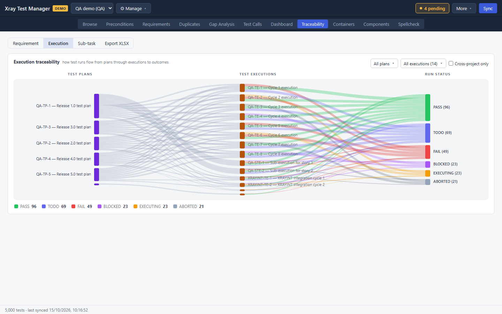
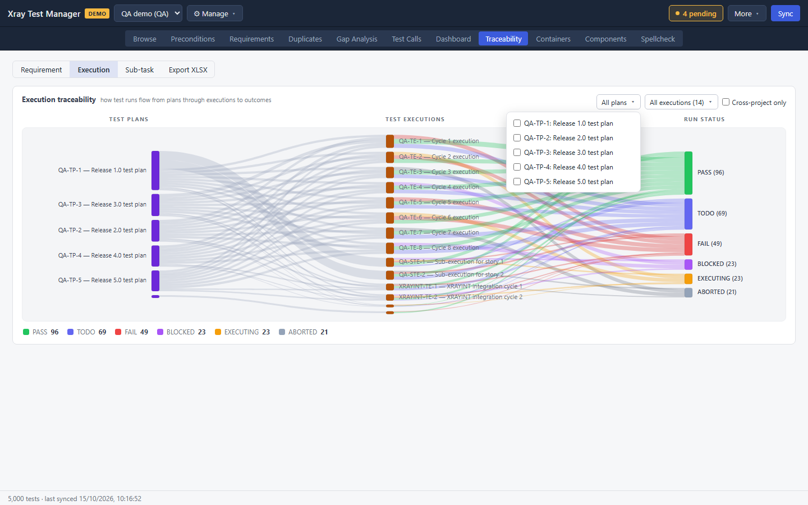
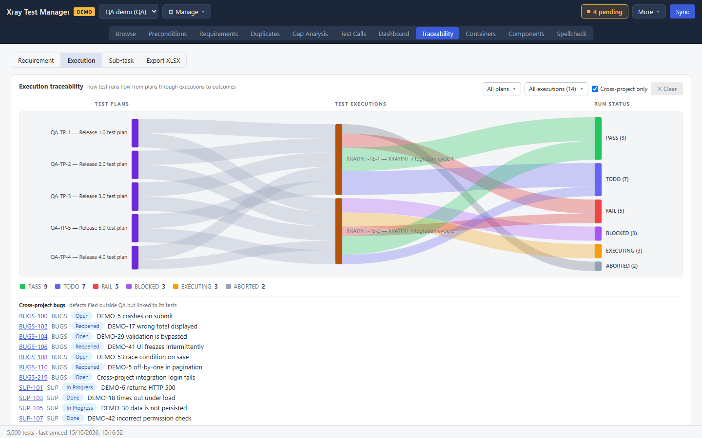
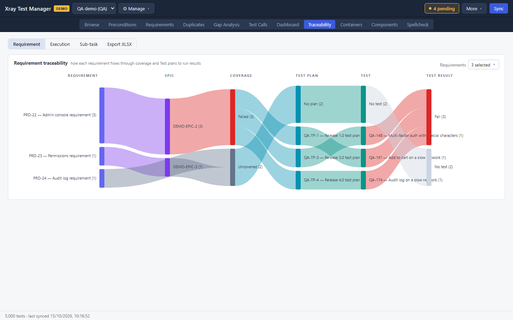
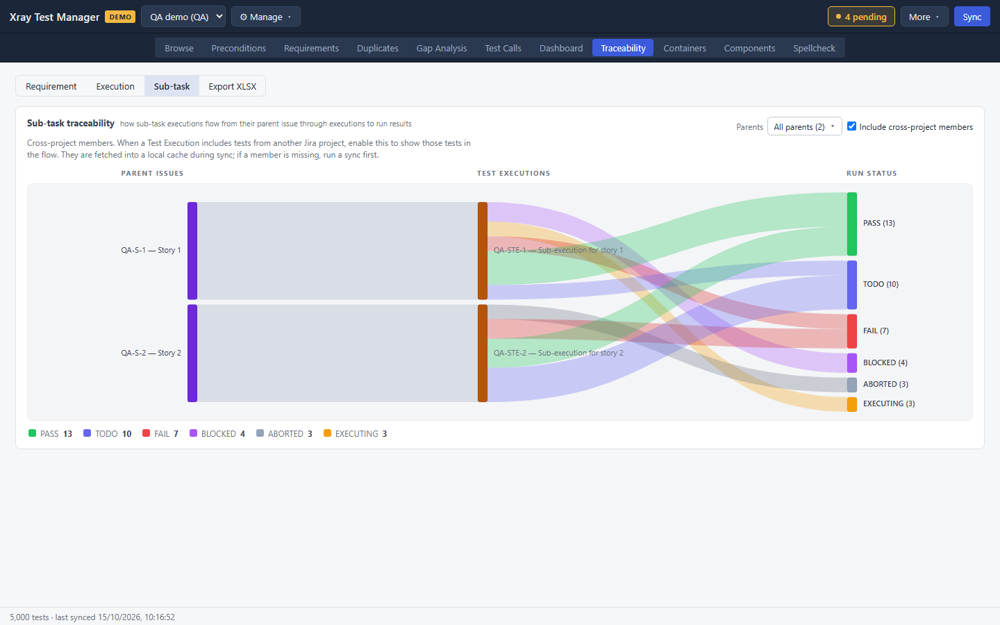

# Traceability

Traceability draws flow charts (Sankey diagrams) that follow work from one stage to the next. The width of each band is the number of items that take that path. Three charts are available:

| Tab | What flows |
|---|---|
| Requirement | Requirement → epic → coverage → test plan → test → result |
| Execution | Test plan → test execution → run status |
| Sub-task | Parent issue → test execution → run status |

Open it with the **Traceability** tab or Ctrl+8. **Execution** is the tab it opens on.

## Pick a chart

Click **Requirement**, **Execution** or **Sub-task** in the bar at the top left. Each node is labelled with its count, and the legend under the chart totals each result.

## Follow test executions

1. Open the **Execution** tab.
2. Narrow the chart with the lists at the top right:
   - **All plans** picks one or more test plans.
   - **All executions (N)** picks executions. It only lists executions in the plans you picked.

   Each list opens with a search box and a checkbox per item.

   

3. Tick **Cross-project only** to show only runs of tests from other projects. A **Cross-project bugs** list appears under the chart. Click a bug key to open it in Jira.

   

**✕ Clear** resets the filters.

## Follow requirements

1. Open the **Requirement** tab.
2. With many requirements the chart is hard to read. Use **Requirements** at the top right to pick a few.

Read it left to right: each requirement, its epic, its coverage state, the plans that hold its tests, the tests, and their latest results. **Uncovered** bands lead to **No plan** and **No test**, which shows you what to cover next.

## Follow sub-task executions

1. Open the **Sub-task** tab. It traces executions created as sub-tasks of an issue back to their parent issues.
2. Use **Parents** to pick parent issues.
3. **Include cross-project members** is on by default. Untick it to keep only tests from this project.

## Export a chart

**Export XLSX** at the right end of the tab bar saves the active chart's flows and table to a workbook. It uses the current filters. A message shows where the file was saved.

## Troubleshooting

- **"No tests cached yet."** Run a sync.
- **The Requirement tab is empty.** Add requirement sources in [Requirements](03-requirements.md#tell-xtm-where-your-requirements-are) and sync.
- **The Execution tab is empty.** Sync the executions from [Containers](09-containers.md).
- **A cross-project bug key does nothing when clicked.** That happens on demo profiles and for bugs not yet created in Jira.
