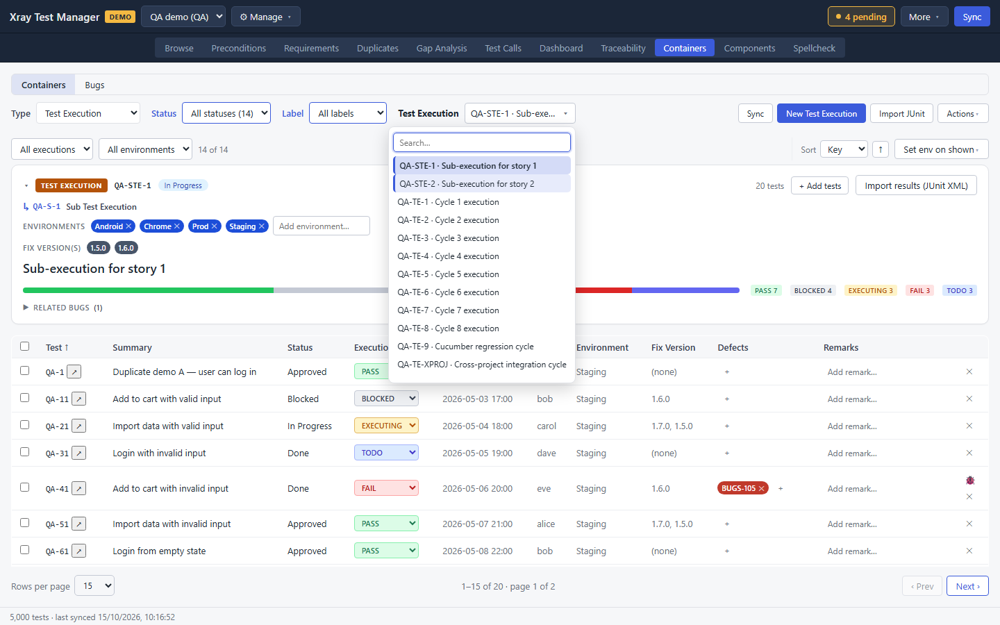
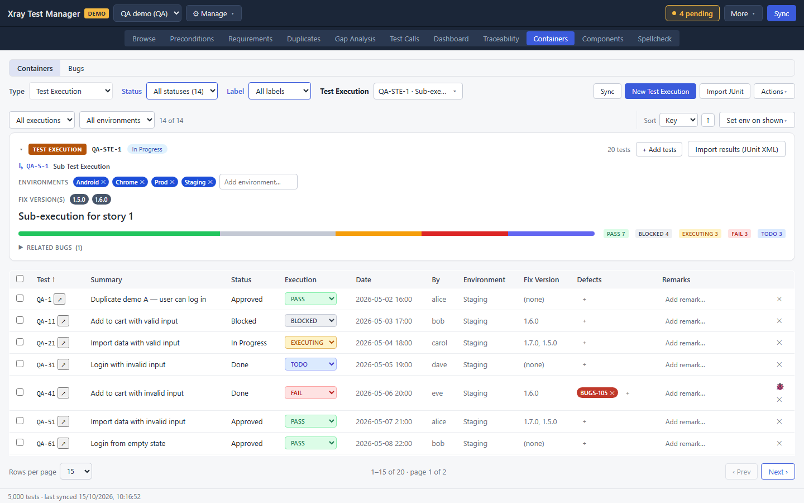
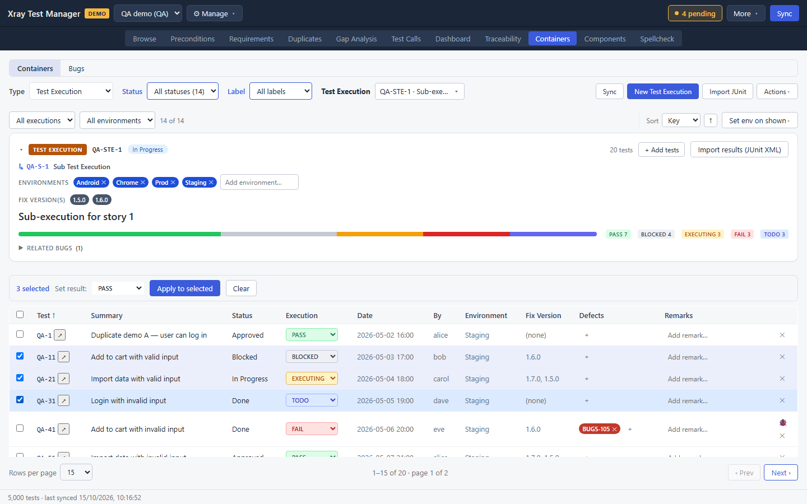
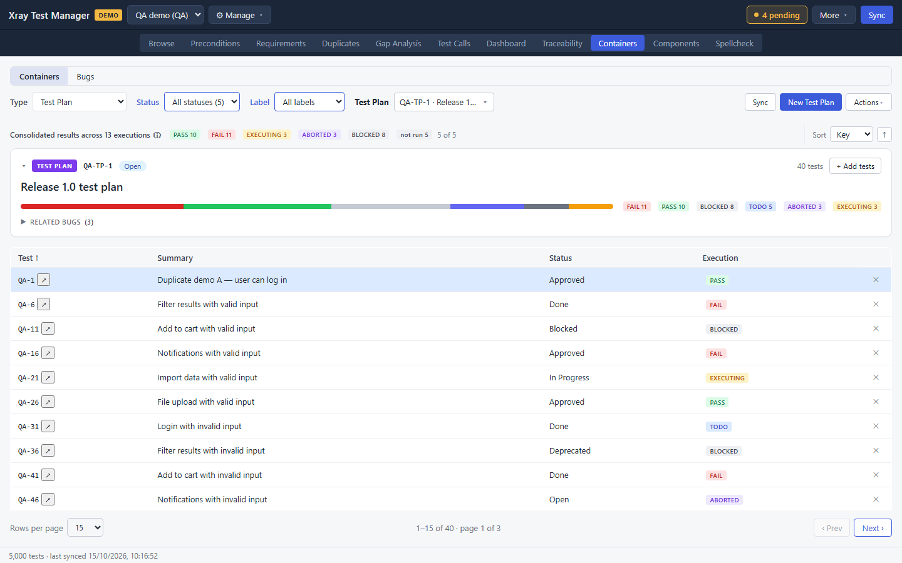
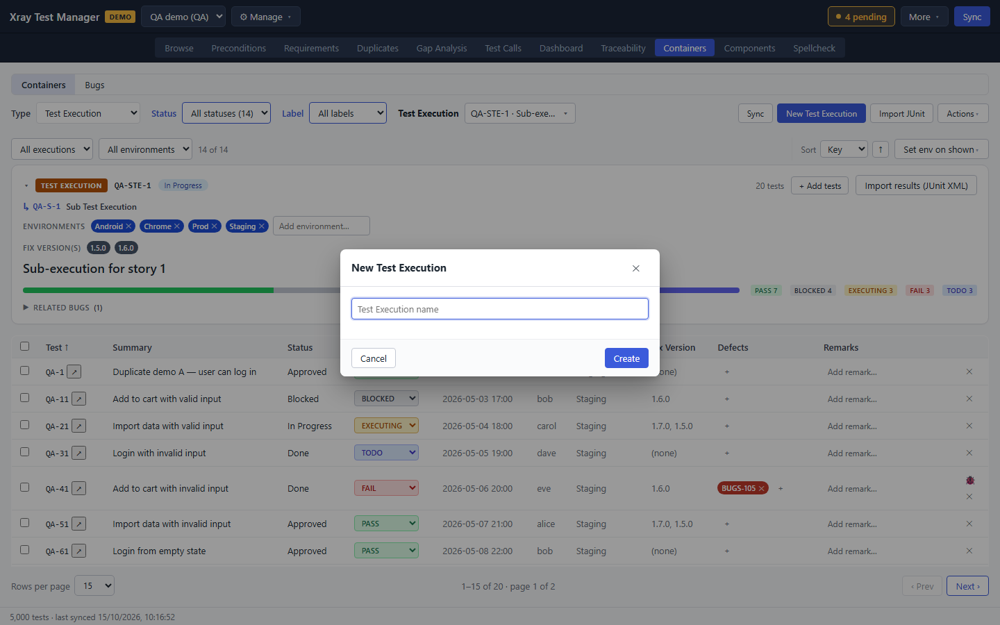
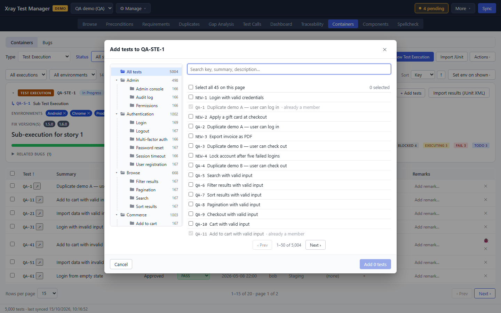
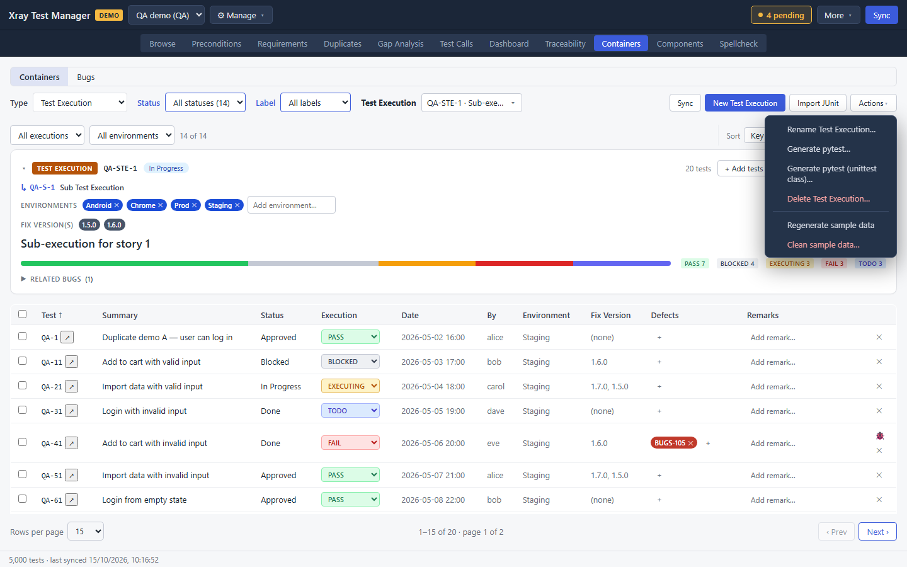
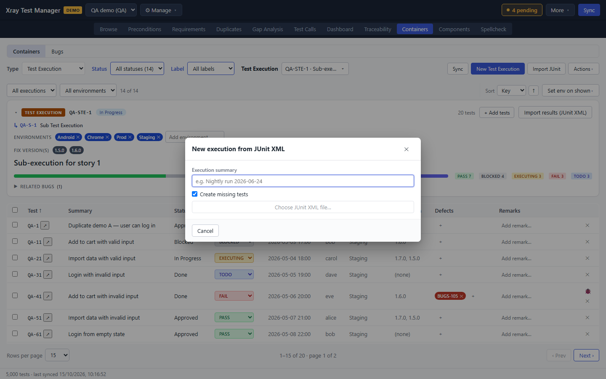
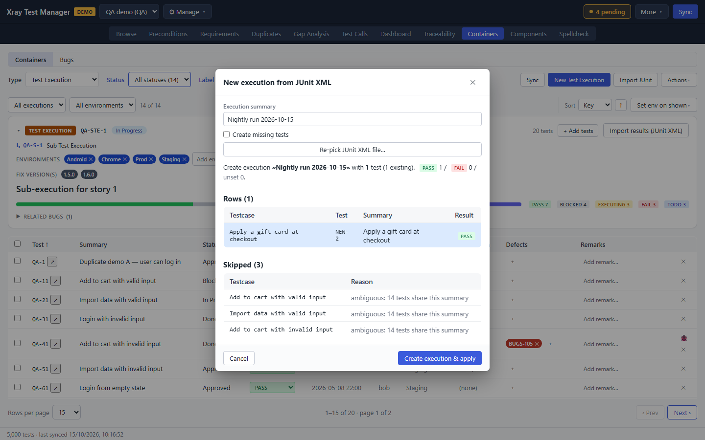
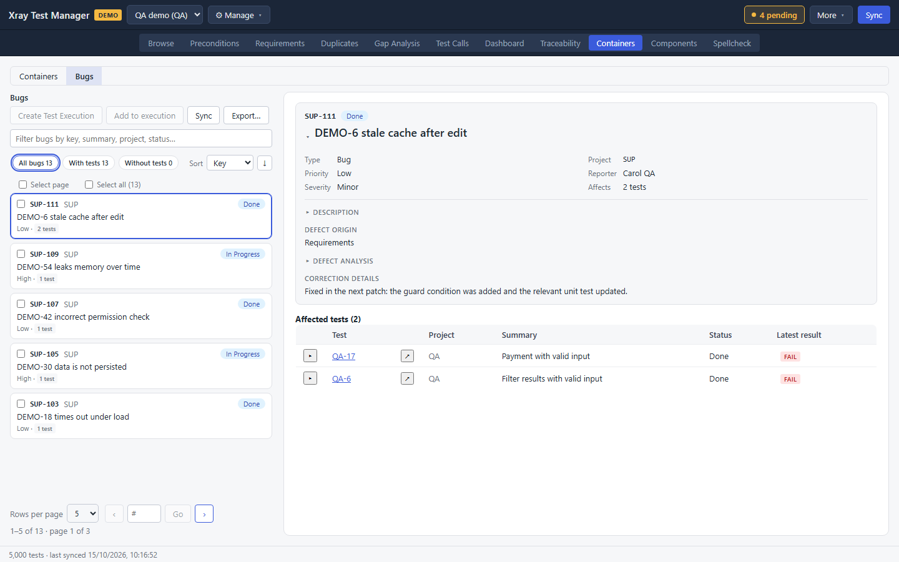

# Containers

Containers are the Xray issues that group tests: Test Sets, Test Plans and Test Executions. This view lets you pick one, see its tests and their results, create and rename containers, record run results, import JUnit reports, and work with the bugs found during testing. Open it with the **Containers** tab or Ctrl+9.

The toggle at the top left switches between **Containers** and [Bugs](#work-with-bugs).

## Pick a container

1. Set **Type** to Test Set, Test Plan or Test Execution.
2. Optionally narrow the list with **Status**, and with **Label** when containers have labels.
3. Open the picker next to the filters (it is named after the type, for example **Test Execution**) and choose a container. Type to filter the list. Each entry reads `KEY · summary`.

The card under the filters shows the container's key, status and test count. For an execution it also shows the parent issue, the **Environments** and **Fix version(s)**, and a bar with the result counts. **Related bugs** expands to list the defects linked to its runs.

The table lists the member tests. For a Test Execution it adds the run columns: Execution, Date, By, Environment, Fix Version, Defects and Remarks.

**Sync** at the right of the filters refreshes only the containers from Jira.

## Record run results

These steps apply to Test Executions.

### One test at a time

Pick a result in the test's **Execution** column: TODO, EXECUTING, PASS, FAIL, ABORTED or BLOCKED. The change is a pending change.

In the same row you can:

- Type in **Add remark…** to record a note on the run.
- Click **+** under **Defects** to link an existing bug to the run.
- On a FAIL row, click the bug button to create a bug for the failed test.
- Click **✕** to remove the test from the execution.

### A test with a dataset

When a test uses a dataset, expand its row to see one result for each parameter
combination. This reads from a live Xray profile as well as from a demo one.
The header says how many iterations are finished and which dataset the run took
its rows from. Steps arrive one call per iteration, so a long dataset takes a
moment to fill in.

Each iteration row carries the values it ran with and its result, and expanding
one shows its steps with those values already substituted. Pick a result in an
iteration's **Result** column to record it.

- On a live Xray profile the result reaches Xray as you pick it, rather than
  waiting for a commit. A refused write is reported above the table and leaves
  the result as it was.
- The change is also listed under Pending changes. Committing it finds Xray
  already holding that result and clears the row without writing again. If
  somebody moved that iteration to a third result in between, your change is
  held as a conflict labelled **Dataset iteration result** rather than
  overwriting theirs.
- Xray decides the test's own run result from its iterations. XTM re-reads the
  run after each write instead of working that out for itself, so the
  **Execution** column shows what Xray settled on.
- A step's result is a demo-only control. Xray gives a step inside an iteration
  no id of its own, so there is nothing for a step write to address, and
  picking a step result on a live profile reports that it is unsupported.
- A dataset of one row produces no iterations. Xray keeps that run's parameters
  on the run itself, so record the result in the test's own **Execution**
  column.

A backend that reports no write support at all marks the panel **Read-only
results** and shows each result as a badge instead of a dropdown, keeping any
local pending data.

### Many tests at once

1. Tick the tests to update.
2. A bar appears above the table with the number selected.
3. Pick a result under **Set result:** and click **Apply to selected**.

**Clear** deselects the tests.

### Set environments

Type in **Add environment…** on the card to add an environment to the execution, and click **✕** on an environment to remove it. To change many executions at once, filter them with **All executions** and **All environments**, then use **Set env on shown**.

## See results across a Test Plan or Set

Pick a Test Plan or Test Set. A line above the card shows **Consolidated results across N executions**, with a badge per result. Click a badge to see which tests and executions it counts. The table shows each test's latest result.

## Create, rename and delete containers

1. Click **New Test Set**, **New Test Plan** or **New Test Execution** (the button follows the type).
2. Enter a name and click **Create**.

To add tests to the selected container, click **+ Add tests** on its card. Find tests by folder or search, tick them, and click **Add tests**.

The **Actions** menu holds the rest:

- **Rename Test Execution…** (or Set or Plan). Clicking the container's title on the card renames it too.
- **Generate pytest…** and **Generate pytest (unittest class)…** save a pytest skeleton with one test per member. XTM asks where to save the file, then shows its path.
- **Delete Test Execution…** deletes the container after you confirm.

On a demo profile, **Regenerate sample data** and **Clean sample data…** reset the generated containers.

## Import JUnit results

### Into an existing execution

1. Pick the Test Execution.
2. Click **Import results (JUnit XML)** on its card and choose the report.
3. Check the preview. It lists the results it will apply and the testcases it skipped, with the reason.
4. Click **Apply N results**.

### Into a new execution

1. Set **Type** to Test Execution and click **Import JUnit**.
2. Enter the **Execution summary**, for example `Nightly run 2026-10-15`.
3. Tick **Create missing tests** if testcases with no matching test should become new tests.
4. Click **Choose JUnit XML file…** and pick the report.

   

5. Check the preview. New tests are marked NEW. An existing parameterized test
   shows the dataset iteration its JUnit properties point to, such as
   `USER=bob`. If the properties do not match exactly one iteration, choose
   the right iteration or exclude the testcase. New tests get one overall
   run result, because they have no dataset yet. **Skipped testcases**
   lists names XTM could not match to one test.

   

6. Click **Create execution and apply N results**.

XTM matches each testcase to a test by its summary. For an existing
parameterized test, add one JUnit `<property>` for every dataset parameter.
The property names and values must match the full parameter combination.
The new execution has no server run IDs until it exists, so XTM stores the
parameter values (the signature) as a pending result. On commit, XTM creates
the execution, adds the tests, looks up the server's stable iteration ID for
the signature, and then writes the result. If the dataset changed or the
signature matches more than one iteration, XTM keeps the result as a conflict
so it never writes to the wrong iteration. Both import flows end as pending changes, so commit them from the
Pending list.

## Work with bugs

Click **Bugs** in the toggle at the top left to list the defects linked to your tests.

- Filter with **Filter bugs by key, summary, project, status…** and the pills **All bugs**, **With tests** and **Without tests**.
- Click a bug to see its details and the **Affected tests** with their latest results. The arrow on a test opens its detail.
- Tick bugs and click **Create Test Execution** to build an execution from the tests they affect, or **Add to execution** to add those tests to an existing one.
- **Export…** saves the list.

## Troubleshooting

- **"You don't have any Test Sets yet."** Create one, or sync, or generate sample data on a demo profile.
- **The run columns are missing.** They only show for Test Executions.
- **A JUnit testcase is skipped as ambiguous.** Several tests share that summary. Rename the duplicates (see [Duplicates](04-duplicates.md)) and import again.
- **An iteration result is refused with 403, "Current user does not have permissions to execute the Test Run".** Check whether the Test Execution is closed. The same account writes to an open execution without trouble, so the message names a permission when the cause is usually the execution's state.
- **A step result will not save on a live profile.** Only a demo profile can set one. Xray exposes no id for a step result, so XTM has nothing to address the write to.
- **A row reads "iterations unavailable".** The run was found but could not be read or kept. Hover the marker for the reason, and look in `xtm.log` for the line naming the test and the execution. A test with no dataset shows nothing at all instead, which is not a fault.
