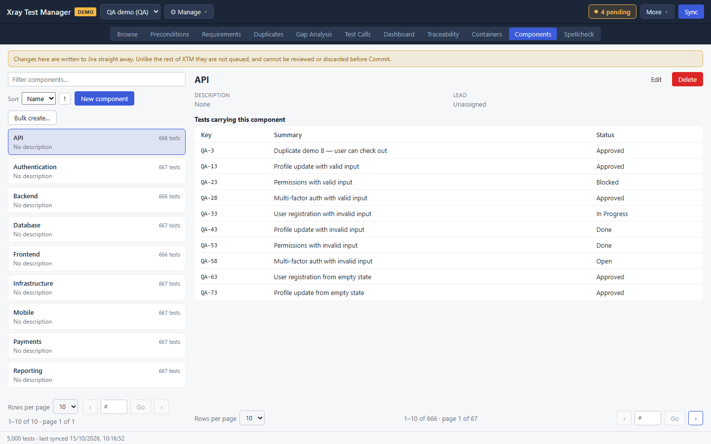
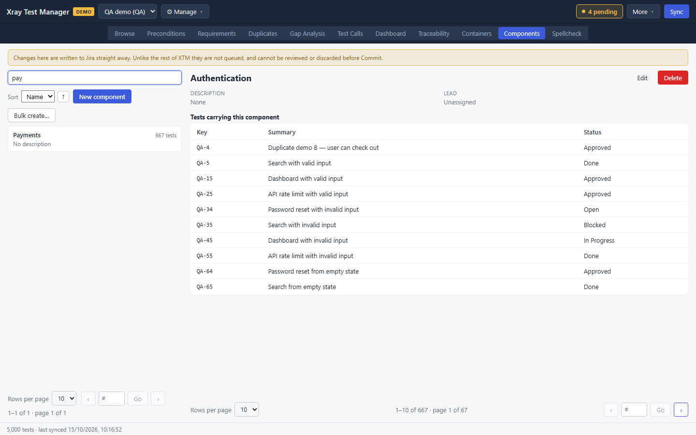
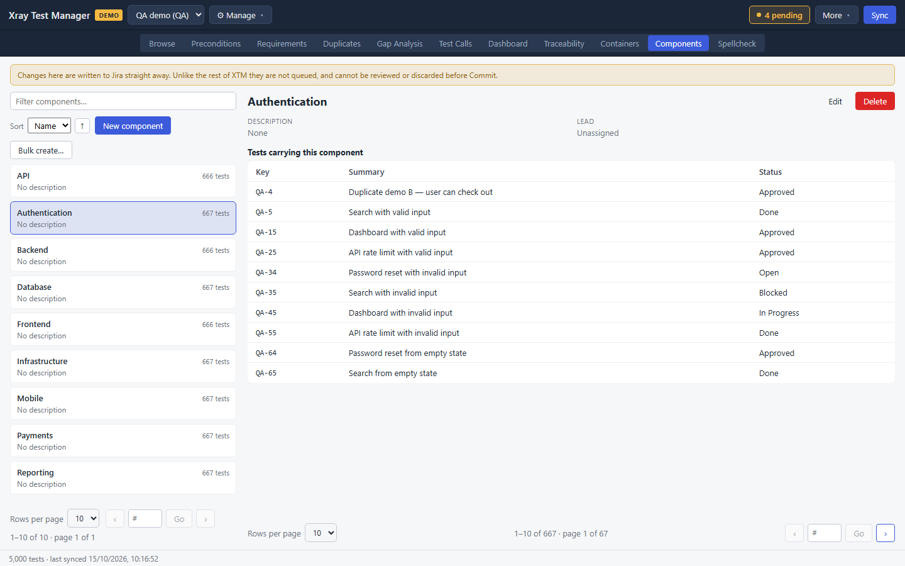
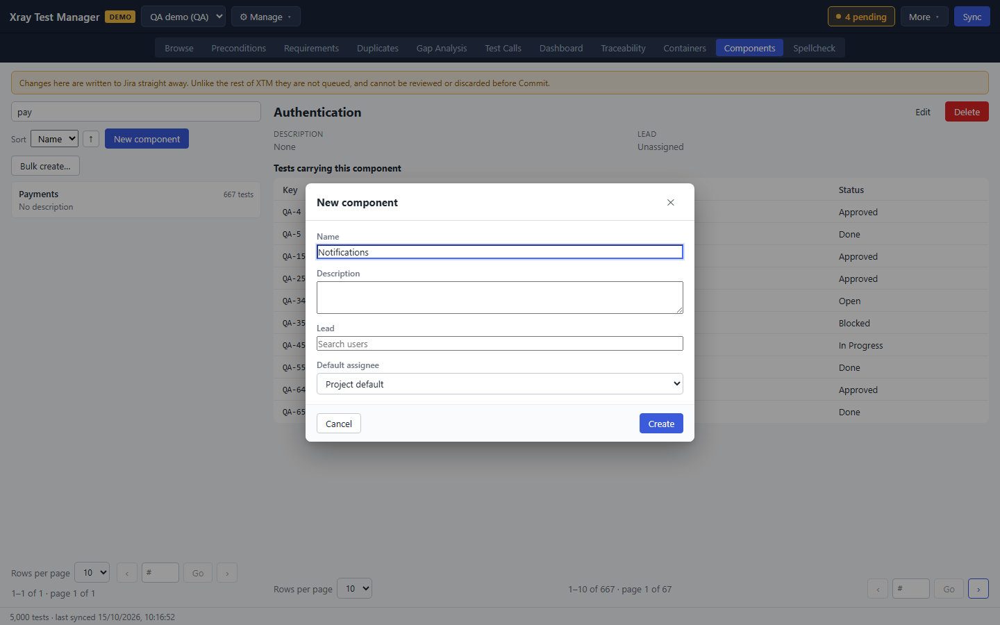
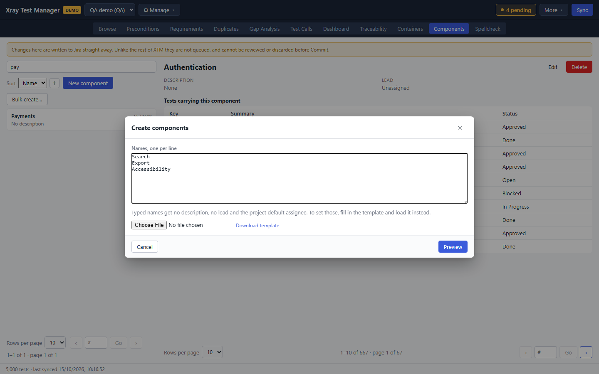
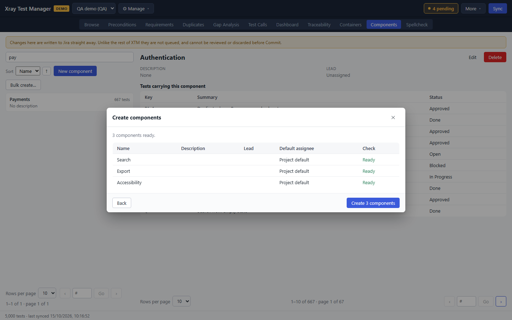
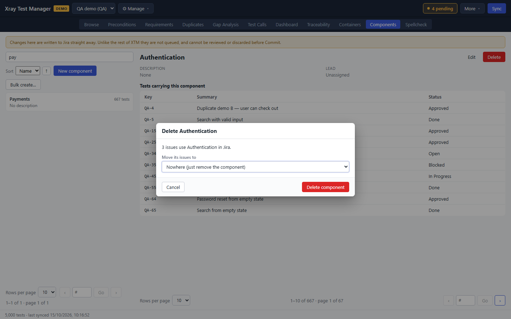

# Components

Components are the Jira project's own components, such as "Payments" or "API". This view lists them with the number of synced tests that carry each one, and lets you create, edit and delete them. Open it from the **Components** tab or the **View** menu.

The tab only appears when the backend supports managing components.

> **Changes here go to Jira immediately.** Unlike everywhere else in XTM, component changes are not queued as pending changes. You cannot review or discard them before Commit. The banner at the top of the view says so.

## Find a component

- Type in **Filter components…** to search by name.
- **Sort** orders the list by Name, Tests or Lead.

Click a component to see its **Description**, its **Lead**, and **Tests carrying this component**.

## Create a component

1. Click **New component**.
2. Enter a **Name**, and optionally a **Description**.
3. Search for a **Lead** if the component has one.
4. Choose a **Default assignee**: Project default, Component lead, Project lead or Unassigned.
5. Click **Create**.

## Create many components at once

1. Click **Bulk create…**.
2. Type one name per line under **Names, one per line**, or click **Choose File** to load an XLSX workbook. **Download template** saves a workbook with the columns XTM reads.

   

3. Click **Preview**. Each row shows the name, description, lead and default assignee, and a **Check** column that reads **Ready** for rows that can be created.

   

4. Click **Create N components**, then **Done**. **Back** returns to the names.

## Edit or delete a component

- Click **Edit** in the component's header, change its fields, and click **Save**.
- Click **Delete**. The dialog says how many issues use the component. Under **Move its issues to**, choose another component to move them to, or keep **Nowhere (just remove the component)**. Click **Delete component** to confirm.

## Troubleshooting

- **The tab is missing.** The backend does not support component management.
- **Test counts look old.** The counts come from the local cache. Sync to update them.
- **A deleted component still shows on tests.** Sync. The tests in your cache still carry it until then.
