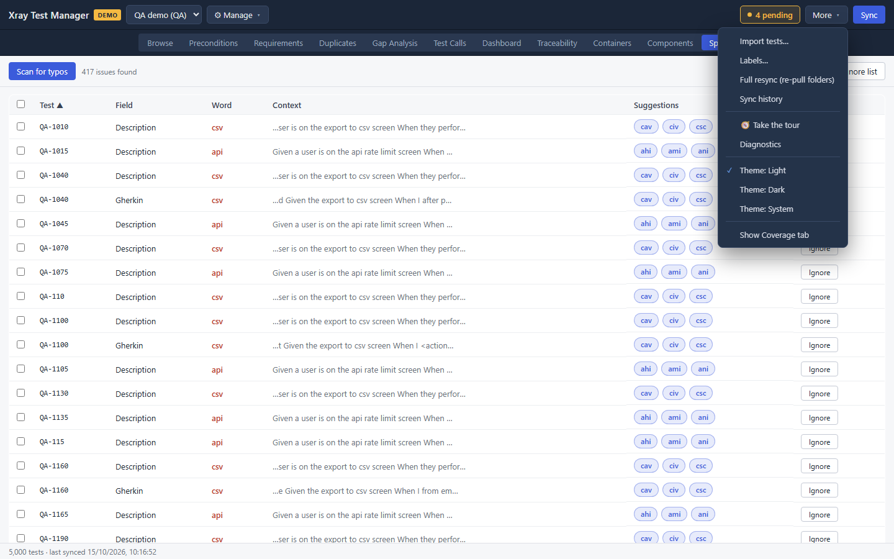
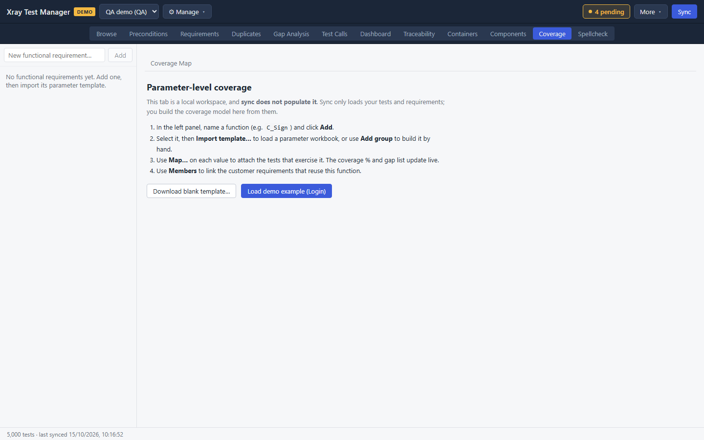
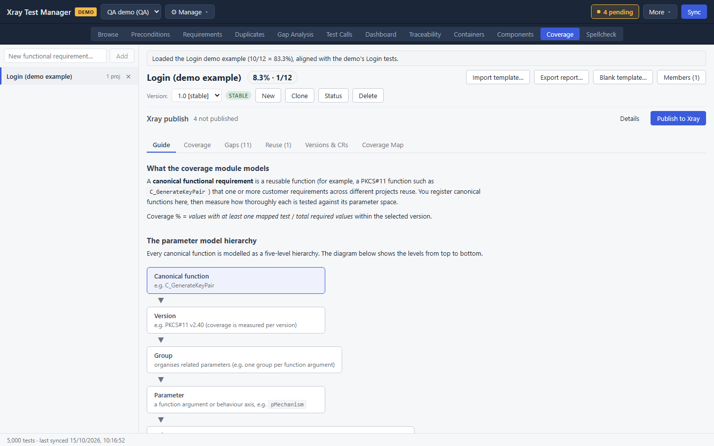
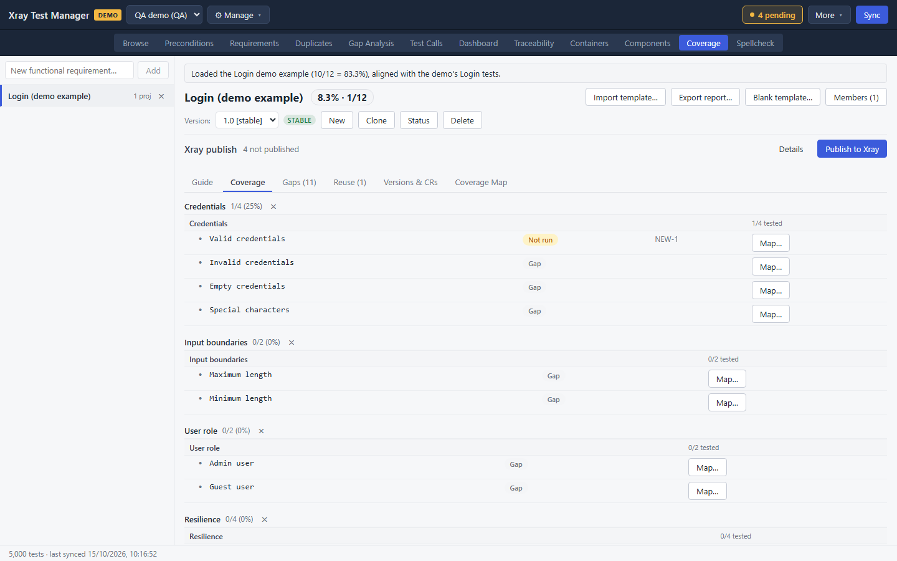
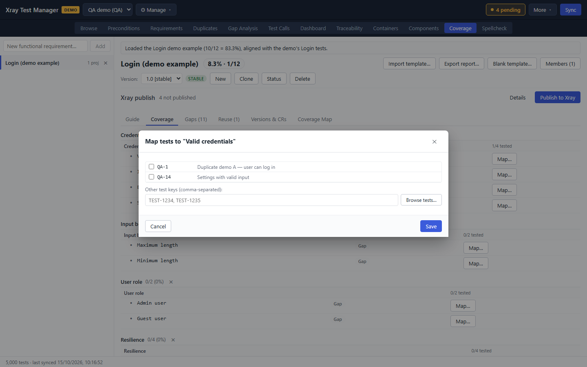
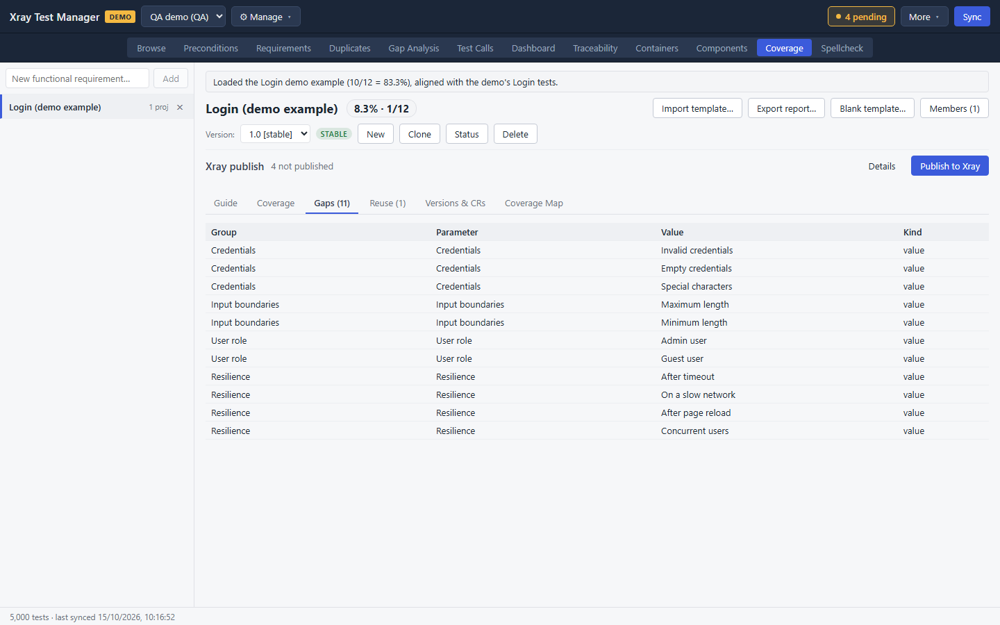
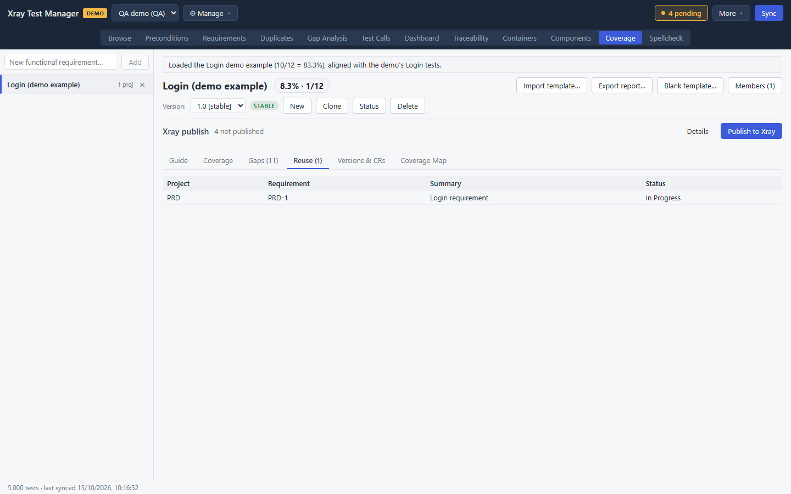
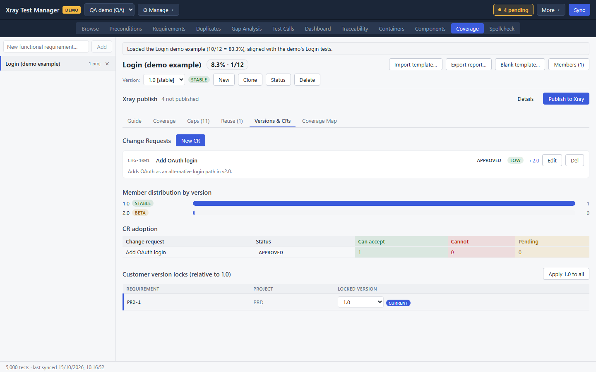
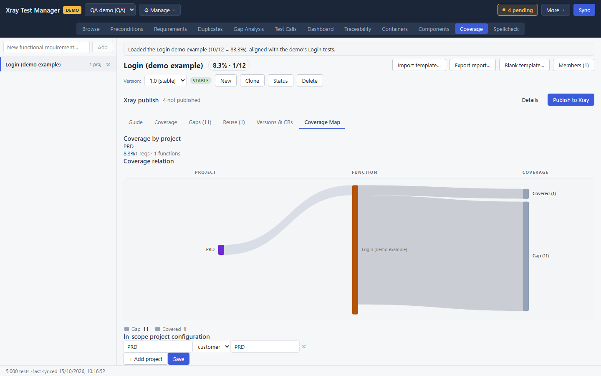

# Coverage

Coverage measures how thoroughly a function is tested against its parameters, not just whether it has tests. You describe a functional requirement as groups of parameters and their values, map tests to each value, and XTM works out the share of required values that have a test. It also tracks versions, change requests, and which customer requirements reuse the function.

Coverage is a local workspace. Sync does not fill it, and it does not need Jira until you publish.

## Turn on the Coverage view

The view is hidden by default.

1. Open **More** in the top bar.
2. Tick **Show Coverage tab**.

The **Coverage** tab appears between Components and Spellcheck. XTM remembers the setting.

## Start a model

With nothing selected, the view explains the four steps and offers **Download blank template…**.

To add a functional requirement, type its name in **New functional requirement…** at the top left and click **Add**, for example `C_GenerateKeyPair` or `Login`.

On a demo profile, **Load demo example (Login)** creates a complete example to explore.

The header shows the requirement's name and its coverage as a percentage and a count, for example `8.3% · 1/12`. The buttons next to it are:

- **Import template…** loads a filled-in template into the model.
- **Export report…** saves a coverage report.
- **Blank template…** saves an empty template.
- **Members (N)** lists the customer requirements that reuse this function.

The **Guide** tab explains the model in detail.

## Work with versions

Coverage is measured per version. The **Version** row picks the version you are looking at.

- **New** creates a version and **Clone** copies the selected one.
- **Status** sets it to Planning, Beta, Stable or Deprecated.
- **Delete** removes it.

With no versions yet, the matrix asks you to create one first.

## Map tests to values

1. Open the **Coverage** tab. Each group of parameters is a block, and each value is a row with its status: a result such as **Not run** when a test is mapped, or **Gap** when none is.

   

2. To add a group, type its name in **Add group…** and click **Add group**.
3. To map tests to a value, click **Map…** on its row.
4. In the dialog, tick suggested tests, type keys (for example `TEST-1234, TEST-1235`), or click **Browse tests…** to search.
5. Click **Save**.

The headline percentage updates as values gain tests.

## Find the gaps

The **Gaps (N)** tab lists every required value with no mapped test, by group, parameter, value and kind. When everything is covered it reads "No gaps. Every required value has a test."

## Track reuse

A functional requirement is often reused by requirements in several customer projects.

1. Click **Members (N)** in the header.
2. Pick the member requirements, or type a key manually, and click **Save**.

The **Reuse (N)** tab lists the members with their project, summary and status.

## Manage change requests

The **Versions & CRs** tab tracks changes to the function and who can take them.

1. Click **New CR**.
2. Enter an ID (for example `CR-001`), a title, a status (Open, Accepted, Rejected or Withdrawn), a priority and a description.
3. Click **Create**. **Edit** and **Del** change or remove it later.

Below the change requests:

- **Member distribution by version** shows how many members are on each version.
- **CR adoption** records, per member, whether it can accept each change.
- **Customer version locks** shows the version each member is locked to. **Apply 1.0 to all** locks every member to the selected version.

## See the Coverage Map

The **Coverage Map** tab shows coverage by project, a chart of how projects relate to functions and coverage, and the **In-scope project configuration**. Use **+ Add project** to add a project as a source or a customer, give it a label, and click **Save**.

## Publish to Xray

The **Xray publish** line under the header counts what has not been published yet. **Publish to Xray** writes the model to Xray, and **Details** lists what it will send.

## Troubleshooting

- **The tab is missing.** Tick **More → Show Coverage tab**.
- **The matrix asks for a version.** Create one with **New** in the Version row.
- **The percentage does not change after mapping.** Only values marked as required count, and only in the selected version.
