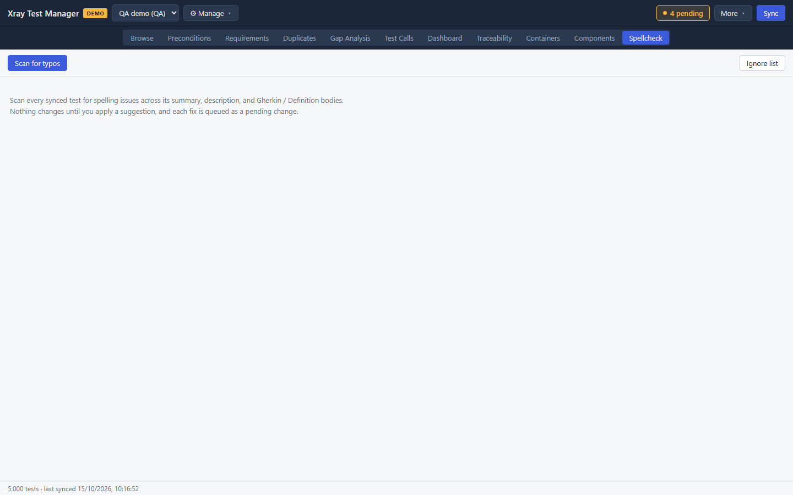
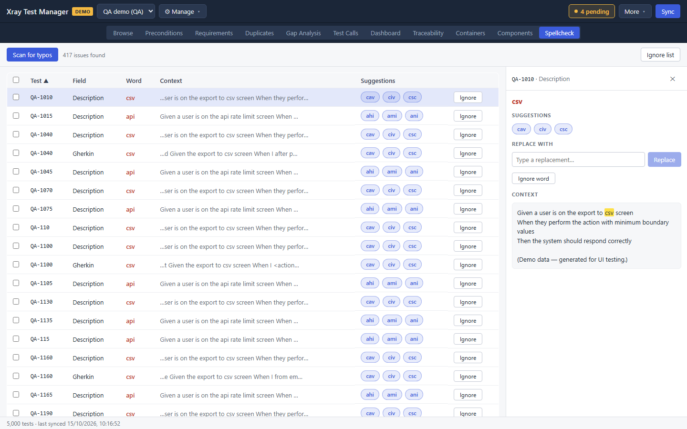

# Spellcheck

Spellcheck scans your synced tests for typos in the summary, the description and the Gherkin or Generic definition text. You fix them one at a time or in bulk, and each fix becomes a pending change. Open it from the **Spellcheck** tab or the **View** menu.

## Scan for typos

1. Click **Scan for typos**. While it runs the button reads **Scanning…**.
2. When it finishes, the count of issues appears next to the button and the table fills in.

Each row is one finding: the test, the field, the word, a snippet of the context, and suggested replacements.

Technical terms such as `csv` or `api` show up as findings too. Ignore them once and they stop appearing (see [Ignore words](#ignore-words)).

## Fix one finding

The quickest fix is to click a suggestion in the **Suggestions** column. The word is replaced and the change is queued.

To see more first, click the row. A panel opens on the right with the suggestions, a **Replace with** box, the full context, and **Ignore word**.

Type a replacement and the panel shows the text before and after. Click **Replace** to queue it.

## Fix or ignore many findings

1. Tick a finding. XTM selects every finding of the same word, so one tick can select hundreds of rows.
2. The bar above the table shows how many findings and words are selected.
3. With one word selected, pick a suggestion next to **Replace all:**, or type into **Replace all with…** and click **Replace all**.
4. **Ignore selected** ignores the selected words instead. **Clear** deselects everything.

## Ignore words

**Ignore** on a row, **Ignore word** in the panel and **Ignore selected** in the bar all add words to the ignore list. Ignored words are skipped in every later scan.

To manage the list, click **Ignore list**:

- Type a word in **Add a word to ignore…** and click **Add**.
- Use **Filter…** to find a word, and its remove button to take it off the list.
- Click **Done** to close.

The ignore list is shared by all your profiles.

## Troubleshooting

- **No findings after a fix.** Scan again. The table is a snapshot of the last scan.
- **A fixed word still appears in Jira.** Fixes are pending changes. Commit them.
